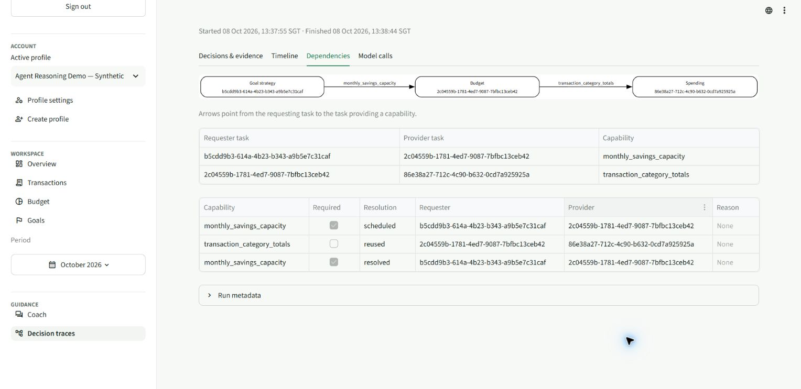

# Live agent reasoning retest after 0287740 — 8 October 2026

**Completed all 34 original turns: 29 clean passes, 5 failures. Three responses were withheld (17, 19, 25); case 20 answered with an unwanted dependency; case 5 answered with contradictory budget-limit statements. Additional case 35 also failed and is reported separately.**

Ran through the signed-in **Edge browser plugin** from **13:17–14:26 SGT**, including a browser-runtime interruption, using **Agent Reasoning Demo — Synthetic** with October 2026 selected. The UI and exported traces report **v9 / openai / gpt-6-luna**. Source context is `02877400aeca9df3936b44089f5f5aee37c767cf`; the deployed Git SHA was not independently verified.

All **25 transactions, 3 budgets and 4 goals are exactly unchanged**, comparing all exported fields before and after. Only test conversations and trace records were added. No financial CRUD prompts ran.

## Acceptance and evidence

The original approved prompts were preserved. Each received one submitted turn, with no reruns to obtain a pass. Case 26b continues 26a; every other case uses a fresh conversation. Case 19 was recovered from its existing conversation after the plugin interruption, without resubmission.

Acceptance uses the documented `orchestration_live_regression_v2.json` conditional expectations, plus inspection of the delivered answer. Case 7 requires G → B; B → S is optional for that original wording. Its trace has G → B and passes this current expectation. The frozen v1 full-chain criterion would also fail case 7, giving 28/34; the historical v1 result is unchanged. Case 5 fails response consistency despite passing the automated review and graph checks. Expected missing-data qualifications and clarification in cases 24 and 27 count as passes.

The official profile export supplies **35 complete, unique traces**, matched using each exact prompt and capture window. Every reference also matches the UI evidence. This resolves the earlier DOM bookkeeping problem for cases 2 and 3 and the two-reference display during follow-up 26b. There are no incomplete traces for the run.

There are **56 passing numeric fact checks, 0 mismatches and 10 unavailable checks** in sanitized blocked-response exports. Unavailable facts are not counted as verified. Saved goal projections are matched by name because fixture and live export order differ. Workflow durations range from **8.85 to 63.77 seconds**. No application HTTP timeout was observed; the interruption affected the test browser runtime. This is one live sample per prompt, without fault injection or repeated reliability measurement.

S = Spending; B = Budget; G = Goal; I = Investment education. **Arrows point from requester to capability provider**, so G → B → S means Goal consumes Budget capacity and Budget consumes Spending totals.

## Original suite results

| Case | Scenario | Effective initial → final specialists | Dependencies | Outcome | Reference ID |
|---|---|---|---|---|---|
| 1 | Spending: single specialist | S → S | None | Pass | `1c437fdb-6209-4b7a-8344-fd1befda282f` |
| 2 | Budget: single specialist | B → B | None | Pass | `0dea5048-e64c-4dea-954c-7cdce44b4a06` |
| 3 | Goal: single specialist | G → G | None | Pass | `bc0db570-cf71-44ba-bd5e-cdcc385675b0` |
| 4 | Investment: single specialist | I → I | None | Pass | `7e557246-433d-4a15-810e-17db51be0a88` |
| 5 | Budget + Spending: dependency | B + S → B + S | B → S | Fail: contradiction | `02d834b5-c1c8-4b23-a68a-aaeed1276d0f` |
| 6 | Budget + Goal: dependency | G → G + B | G → B | Pass | `2a09fc13-3254-4c41-8f83-bf5ce7e88d1c` |
| 7 | Budget + Spending + Goal: dependency | S + G → S + G + B | G → B | Pass | `b86813c8-12a2-408f-97e6-a1c96d75065c` |
| 8 | Spending + Goal: dependency requested, exact pair unsupported | S + G → S + G + B | G → B; B → S | Pass | `575a360e-a7cd-4f86-abd0-20f4fd726581` |
| 9 | Budget + Spending: independent parallel candidates | S + B → S + B | None | Pass | `153b1261-8318-49df-9e65-f7ef2c704bcf` |
| 10 | Budget + Goal: independent parallel candidates | B + G → B + G | None | Pass | `68bc44b0-a6b7-4e3b-81e0-6388f36790e4` |
| 11 | Budget + Spending + Goal: independent parallel candidates | S + B + G → S + B + G | None | Pass | `0aa26176-d453-4f22-9a8b-f90815fcd3d0` |
| 12 | Spending + Goal: independent parallel candidates | S + G → S + G | None | Pass | `34aa92f8-363b-482a-aec2-1cfc1eae893c` |
| 13 | Spending + Investment | S + I → S + I | None | Pass | `e142cfe3-268c-4e8a-a7f5-0af6c4590416` |
| 14 | Budget + Investment | B + I → B + I | None | Pass | `203ff5d7-bdc9-4597-b343-081a52601740` |
| 15 | Goal + Investment | G + I → G + I | None | Pass | `1eb95600-e71b-456b-b4dd-93b3978e29a7` |
| 16 | Budget + Spending + Investment | S + B + I → S + B + I | B → S | Pass | `86a190c5-b8e4-4ac0-8b6d-4059de517a5b` |
| 16P | Independent Investment combination | S + B + I → S + B + I | None | Pass | `1ea581d7-4af1-4c63-b099-6519705b45f6` |
| 17 | Spending + Goal + Investment | S + G + I → S + G + I | None | Fail: withheld | `789d6b4f-a548-489c-9b65-7bb41a724cfa` |
| 18 | Budget + Goal + Investment | G + I → G + I + B | G → B | Pass | `4e758b22-1a12-42bf-a9b6-8bbe8dc213c4` |
| 18P | Independent Investment combination | B + G + I → B + G + I | None | Pass | `e3b333e6-d9a0-4660-82c2-215afdd42cc1` |
| 19 | All four specialists | G + S + I → G + S + I + B | G → B; B → S | Fail: withheld | `3b9dc8aa-2ee2-41a3-a42c-f6cdfa7c161d` |
| 19P | Independent Investment combination | S + B + G + I → S + B + G + I | None | Pass | `dc81cc28-e813-4ffc-9eab-9126cfd42f0a` |
| 20 | Goal dynamically adds Budget | B + G → B + G + S | G → B; B → S | Fail: extra dependency | `a2e9602f-2434-4e58-b335-4f215926bbe5` |
| 21 | Recurrence reasoning: projected versus recorded expenses | S → S | None | Pass | `1ce286d3-3767-41a1-ba11-7476468954da` |
| 22 | Saved plan with no observed expenses | S → S | None | Pass | `93910297-ef4a-499a-bd8d-a94d63ceff0c` |
| 23 | Calendar scope and competing goals | G → G + B | G → B | Pass | `5905d238-c8f5-4dcc-8a95-89dfe45248a9` |
| 24 | Missing requested budget | G → G + B | G → B | Pass | `1878a618-fafd-461f-9b5d-6af1cf1d5a73` |
| 25 | Emergency-fund special path | G → G | G → Education tool | Fail: withheld | `9ac5735f-20fe-47af-88a4-7ba2fac4a73b` |
| 26a | Follow-up subject resolution | I → I | None | Pass | `35c6bd1d-ce42-478a-8588-22f96c3b4db1` |
| 26b | Follow-up subject resolution | I → I | None | Pass | `23d053d1-979a-4aa8-9c0e-d1cbde556a11` |
| 27 | Ambiguous follow-up in a fresh conversation | I → I | None | Pass | `0e4af4a6-aeec-4165-bd5e-b1c00e62f9f5` |
| 28 | Response preferences without changing reasoning | G → G + B | G → B | Pass | `b4c9c28b-2ca4-440a-9212-ea49e2763446` |
| 29 | Partial education answerability | I → I | None | Pass | `4bfaa82b-c8e0-4ee5-bee8-b889cdd38774` |
| 30 | Conditional Education grounding versus a separately routed Investment answer | B + I → B + I | None | Pass | `2b0229fe-6403-4dd9-bb13-73c6129a4f83` |

## Failure evidence

**Case 5 — contradictory composed response.** Budget correctly compares recorded totals with saved limits and reports Food SGD 10, Entertainment SGD 25 and Shopping SGD 20 over their limits. The final Spending paragraph then says “there are no budget limits here to determine whether they exceed your plan.” Compliance permits the answer. A cross-section consistency gap is a plausible explanation; the trace does not prove the internal cause of that wording.

**Cases 17 and 19 — eligible-looking factual qualifications cannot enter repair within the workflow token budget.** Both have `answer_complete=true`, `repairable=true` and `factual_qualification` issues. Case 17 has Spending `qualify` and Investment `qualify` issues; case 19 has a Goal `ground_claim` issue referencing projections and feasibility. Both receive `REPAIR_TOKEN_BUDGET_EXCEEDED`. The Education-only fallback receives `REPAIR_SECTION_NOT_OWNED`, because the unresolved set contains a financial specialist issue.

| Case | Used tokens | Estimated repair tokens | Remaining tokens | Limit |
|---|---:|---:|---:|---:|
| 17 | 53,119 | 58,708 | 26,881 | 80,000 |
| 19 | 45,691 | 39,042 | 34,309 | 80,000 |

These are recorded admission estimates, not measured token consumption from a repair that ran. Case 19 demonstrates the complete dependency graph even though its final answer is withheld. Sanitized blocked exports do not establish that the reviewer findings were false positives.

**Case 20 — incorrect conditional requirement adds Spending.** The semantic router selects Budget and Goal. Its effective task assignment sets Budget `requires_spending=true`, `requires_income=true` and `requires_capacity=true`. Budget then schedules Spending and creates B → S for `transaction_category_totals`, alongside G → B for `monthly_savings_capacity`. The confirmed saved allocation is already available and this prompt does not request a Spending analysis. The final numeric answer is useful, but the extra specialist and edge violate the expected graph.

**Case 25 — repair runs but does not produce an acceptable final draft.** Goal remains the only domain specialist and requests `education_context`; no Budget or Spending specialist is added. Round 1 has a Goal `qualify` issue, and repair is allowed (`REPAIR_ELIGIBLE`: 25,305 used, 29,384 estimated, 54,695 remaining). Round 2 still blocks with Goal `qualify` on `goal_strategy.emergency_fund` and composition `remove_claim` on `goal_strategy.contexts`. The single repair round is exhausted. This is a post-repair review failure; it is not repair admission failure. The exported blocked draft does not show enough to judge whether the review is too strict.

## Additional full-chain prompt: case 35

This extra demonstration is outside the original 34-turn score:

> First analyze my recorded October 2026 spending by category. Have Budget reconcile those category totals against my saved October limits and explain expense pressures alongside the confirmed savings allocation. Then use that Budget assessment to evaluate all my saved goals together, including required monthly contributions and the shared-pool shortfall. Keep recorded totals distinct from complete household expenses.

Expected S + B + G with B → S and G → B. `routing.proposed` correctly selects all three and October scope. A subsequent deterministic `FOLLOW_UP_READ_ONLY` override reports `MISSING_SUBJECT`, changes the effective route to I, and marks follow-up ambiguous even though this is a fresh conversation with an explicit subject. The completed route still retains S/B/G task assignments, which disagree with its effective selected agent. There are no dependency edges. Review then blocks with `review_contract_unverified` / `unverifiable_claim`. This is evidence of a false follow-up override after successful semantic routing; the precise textual trigger needs implementation diagnosis.

Reference: `f215c4a8-4750-4555-9167-0834e3c5c6c7`. Additional outcome: **Fail**.

## Dependency and parallel execution verification

Goal adds Budget dynamically in cases **6, 7, 8, 18, 23, 24 and 28**. Saved-goal arithmetic in cases **3, 10, 11, 12, 15, 17, 18P and 19P** adds no Budget. Case 2 remains Budget-only. The explicit full G → B → S chain is observed in cases **8 and 19**, with Investment independently selected in case 19.

All eleven independent multi-specialist combinations have **no specialist edges and positive overlap in their first executions**. Repair executions are excluded from the initial-overlap calculation. Case 17 passes the parallel-graph criterion even though its answer is withheld.

| Case | Specialists | Common first-execution overlap (seconds) |
|---|---|---:|
| 9 | S + B | 4.418 |
| 10 | B + G | 3.369 |
| 11 | S + B + G | 3.388 |
| 12 | S + G | 3.575 |
| 13 | S + I | 5.632 |
| 14 | B + I | 4.117 |
| 15 | G + I | 3.853 |
| 16P | S + B + I | 4.768 |
| 17 | S + G + I | 4.231 |
| 18P | B + G + I | 3.723 |
| 19P | S + B + G + I | 3.988 |

## Other reasoning checks

- Successful repairs: case 2 Budget qualification, case 3 Goal qualification, and case 16P Spending completeness. Case 16P preserves the independent Budget and Investment branches.
- Recurrence: case 21 forecasts only explicit rent of SGD 1,800 on 1 November. Case 22 distinguishes no recorded November transactions from no household expenses.
- Calendar grounding: case 23 uses September/October/November capacities separately, giving monthly shortfalls of SGD 1,200/1,000/1,600. Case 24 preserves the missing December capacity.
- Follow-up: 26b resolves the displayed second option to ETFs in the same chat. Case 27 asks for clarification in a fresh chat. The additional case 35 exposes a separate false-positive override.
- Preferences: case 28 uses a compact table while preserving requirement SGD 2,600, shared allocation SGD 1,600 and shortfall SGD 1,000.
- Partial answerability: case 29 answers supported general diversification education and limits current tax/personal eligibility claims.
- Conditional Education grounding: case 25 records Goal → Education tool context. Case 30 selects B + I with no edge and 7.501 seconds of first-execution overlap, and gives Investment ownership of the concept. It does not prove the controlled Budget-only `education_context` edge; that path has not been run in this suite.
- The deferred direct Spending–Goal capability edge remains outside this test. Case 8 uses Budget as the intermediate provider.

## Decision trace viewer

All four tabs—**Decisions & evidence, Timeline, Dependencies and Model calls**—rendered without `ModuleNotFoundError: pydantic`. The screenshot below shows case 19’s requester-to-provider graph and capability resolution records. It proves graph visibility, not successful delivery of case 19’s answer.

## Saved evidence

The [selected JSON evidence](evaluation-evidence/agent-reasoning-live-v9-2026-10-08-post0287740.json) includes all prompts, answers, acceptance assessments, unique references, initial/final routes, edges, first execution intervals, selected review/repair events and numeric checks. Raw profile exports and account-bearing DOM captures remain under ignored artifacts. The [earlier partial report](agent-reasoning-live-test-results-2026-10-08-post0287740-partial.md) is retained as a superseded snapshot. No application source change or deployment was made during this retest.
