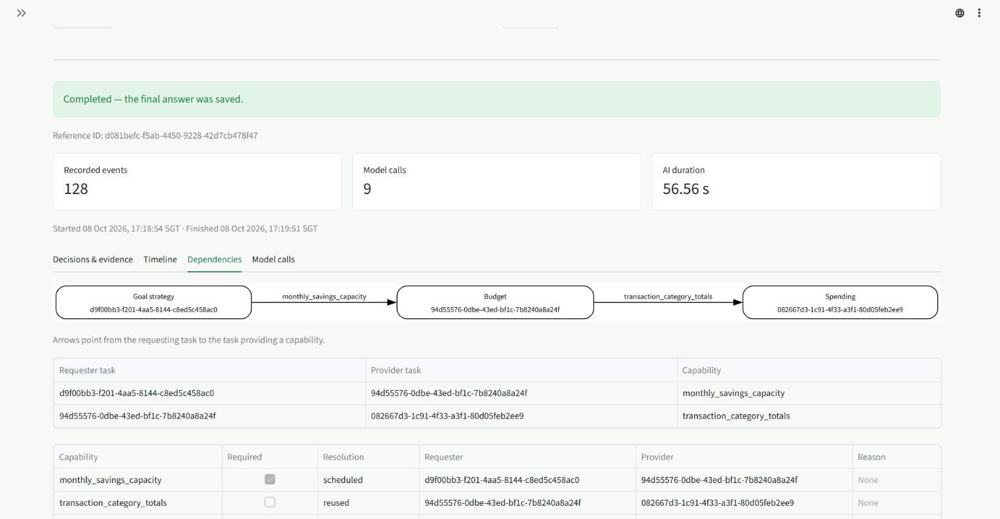

# Live reasoning retest after dae539d — 8 October 2026

**Completed all 34 original turns: 27 passes, 7 failures. Additional case 35: fail.**

Ran in the signed-in Edge application from 16:45–17:42 SGT using **Agent Reasoning Demo — Synthetic**, with October 2026 selected. Source context is `dae539d22250b33a4f93cf611e2bf5be8cf7e981`; the deployed Git SHA was not independently verified.

The 25 transactions, 3 budgets and 4 goals are exactly unchanged across all exported fields. Only test conversations and traces were added.

One first attempt per original prompt and the additional full-chain demonstration. Case 26b continues 26a; all others use fresh conversations. Acceptance uses the documented conditional v2 dataset and inspection of the delivered answer. Case 7 permits a conditional Budget–Spending edge; case 35 requires the explicit full chain. Previous reports and verdicts are unchanged.

S = Spending; B = Budget; G = Goal; I = Investment. Arrows point from requester to capability provider. Parallel execution is checked from first execution intervals, excluding repairs.

| Case | Scenario | Initial → final specialists | Dependencies | Outcome | Reference ID |
| --- | --- | --- | --- | --- | --- |
| 1 | Spending: single specialist | S → S | None | Pass | `9085ed32-e827-49d5-a2e7-c27a80ddf1d5` |
| 2 | Budget: single specialist | B → B | None | Pass | `9d79cc69-7a2a-4c41-a34f-a8161f0d1cde` |
| 3 | Goal: single specialist | G → G | None | Pass | `a72e27fe-8814-4ec1-b365-0ba3d644a174` |
| 4 | Investment: single specialist | I → I | None | Pass | `569d85cf-1dea-4b01-b3b8-631fc071d931` |
| 5 | Budget + Spending: dependency | B + S → B + S | B → S (transaction_category_totals) | Pass | `2c90fcbd-636a-4394-857a-38a98883924c` |
| 6 | Budget + Goal: dependency | G → G + B | G → B (monthly_savings_capacity) | Pass | `df3d350f-83c1-4ef9-90dc-c2ddb62e0718` |
| 7 | Budget + Spending + Goal: dependency | S + G → S + G + B | G → B (monthly_savings_capacity) | Pass | `469dc374-03f0-4733-97f6-d7463985c7ad` |
| 8 | Spending + Goal: dependency requested, exact pair unsupported | S + G → S + G + B | G → B (monthly_savings_capacity); B → S (transaction_category_totals) | Pass | `e80cd35f-061e-4f80-8dc1-cc801c0a5b23` |
| 9 | Budget + Spending: independent parallel candidates | S + B → S + B | None | Pass | `62e381c8-ba71-46bb-a496-149ee7b5d1f2` |
| 10 | Budget + Goal: independent parallel candidates | B + G → B + G | None | Pass | `1cde8aac-96c6-46b3-b033-24d96350e591` |
| 11 | Budget + Spending + Goal: independent parallel candidates | S + B + G → S + B + G | None | Pass | `7b2f8977-81a2-4cb9-b238-c8ba1ce7138b` |
| 12 | Spending + Goal: independent parallel candidates | S + G → S + G | None | Pass | `70c674fe-dd4d-4c77-bb09-287db8d2f102` |
| 13 | Spending + Investment | S + I → S + I | None | Fail: withheld | `398a3f6f-cff6-4f97-a24c-1df9f0ca1d52` |
| 14 | Budget + Investment | B + I → B + I | None | Pass | `f6b03e40-5594-4fcf-9f5f-b645471a12a0` |
| 15 | Goal + Investment | G + I → G + I | None | Pass | `c83f217b-3b06-4588-97e4-2a88c1341f49` |
| 16 | Budget + Spending + Investment | S + B + I → S + B + I | B → S (transaction_category_totals) | Pass | `b45876e9-38e0-4151-b11a-da2ceba52b0b` |
| 16P | Independent Investment combination | S + B + I → S + B + I | None | Pass | `4885caf5-34ec-46b5-b800-87a303ef85e3` |
| 17 | Spending + Goal + Investment | S + G + I → S + G + I | None | Pass | `2deac6d5-bfb4-4dfb-878b-cd19f11f02cb` |
| 18 | Budget + Goal + Investment | G + I → G + I + B | G → B (monthly_savings_capacity) | Pass | `c8a5be8c-987b-45b7-a855-23a6ae33a01c` |
| 18P | Independent Investment combination | B + G + I → B + G + I | None | Pass | `f0d90610-5340-4f55-8ec7-3f624eb74d64` |
| 19 | All four specialists | S + G + I → S + G + I + B | G → B (monthly_savings_capacity); B → S (transaction_category_totals) | Pass | `d081befc-f5ab-4450-9228-42d7cb478f47` |
| 19P | Independent Investment combination | S + B + G + I → S + B + G + I | None | Fail: withheld | `abfe1d7c-149d-45e0-8679-b2feb32cc181` |
| 20 | Goal dynamically adds Budget | G → G + B | G → B (monthly_savings_capacity) | Pass | `a10ca1a9-1d8f-484c-b520-8339882011dc` |
| 21 | Recurrence reasoning: projected versus recorded expenses | S → S | None | Fail: withheld | `3371c927-a3d7-44ee-909a-829d424fc12c` |
| 22 | Saved plan with no observed expenses | S → S | None | Fail: withheld | `ea8475ca-efb5-474a-b296-983d9e1e2e92` |
| 23 | Calendar scope and competing goals | G → G + B | G → B (monthly_savings_capacity) | Pass | `1ef4f1d0-7210-495c-8c81-db1776fb8b18` |
| 24 | Missing requested budget | G + B → G + B | G → B (monthly_savings_capacity) | Pass | `5001fc6a-3a47-45bc-8571-b308d0db4348` |
| 25 | Emergency-fund special path | G → G | None | Fail | `8dabee5d-c176-4948-b262-84ae2afc2198` |
| 26a | Follow-up subject resolution | I → I | None | Pass | `f209f752-5ade-4aae-be87-3e325578bf7b` |
| 26b | Follow-up subject resolution | I → I | None | Fail: withheld | `d1374edb-fd9a-4d69-886c-0959179cd089` |
| 27 | Ambiguous follow-up in a fresh conversation | I → I | None | Pass | `0b6a8a8e-d65e-4b81-a407-a85be07943e7` |
| 28 | Response preferences without changing reasoning | G → G + B | G → B (monthly_savings_capacity) | Pass | `b6f469be-661e-4607-b7a4-f27b63c65c2f` |
| 29 | Partial education answerability | I → I | None | Fail: withheld | `da3e2e0e-5b9b-4db1-b767-a719cfb141f9` |
| 30 | Conditional Education grounding versus a separately routed Investment answer | B + I → B + I | None | Pass | `f9e0361a-d8b0-4f66-966d-54c569276891` |
| 35 | Explicit full dependency chain (additional) | S + B + G → S + B + G | G → B (monthly_savings_capacity) | Fail: withheld | `08d3adb9-20b0-43f5-895e-cc14b7bf7916` |

## Comparison with the previous run

The previous run had 29/34 original passes. Previously failing cases now passing: 5, 17, 19, 20. New failures: 13, 19P, 21, 22, 26b, 29. Remaining original failure: 25. Additional case 35 remains a failure.

Case 17 exercised an allowed financial repair and passed its second review. Cases 3 and 14 also recovered through one financial repair. Case 19 demonstrated the full dependency chain and passed; case 20 dynamically added Budget without adding Spending. This is one live sample per prompt, so these improvements do not establish repeated reliability.

## Failures and review evidence

### Case 13

Spending and Investment ran independently with the expected graph. Review requested a qualification in Investment section education_3, but marked the answer complete and not repairable. Education completeness recovery was denied because the verdict was not repairable and no missing points were present. The answer was withheld despite sufficient remaining token budget; rejected prose is unavailable in the safe export.

Reference: `398a3f6f-cff6-4f97-a24c-1df9f0ca1d52`. Graph issues: none. Answer status: `refused`.

- Review round 1: blocked `True`, complete `True`, repairable `False`. Issues: investment_education/education_3: qualify. Categories: factual_qualification.
- `education.completeness.repair_decision`: allowed `False`; reason `REPAIR_VERDICT_NOT_REPAIRABLE`; blockers `REPAIR_VERDICT_NOT_REPAIRABLE, REPAIR_ANSWER_ALREADY_COMPLETE, REPAIR_NO_MISSING_POINTS`. Estimated repair tokens 18921; remaining tokens 31815.

### Case 19P

All four specialists ran independently with the expected graph and overlapping initial executions. Review requested a Spending coverage qualification but marked the answer complete and not repairable. Financial repair was denied by REPAIR_VERDICT_NOT_REPAIRABLE; education repair also rejected the financial section ownership. The combined answer was withheld.

Reference: `abfe1d7c-149d-45e0-8679-b2feb32cc181`. Graph issues: none. Answer status: `refused`.

- Review round 1: blocked `True`, complete `True`, repairable `False`. Issues: spending/spending: qualify. Categories: factual_qualification.
- `financial.review.repair_decision`: allowed `False`; reason `REPAIR_VERDICT_NOT_REPAIRABLE`; blockers `REPAIR_VERDICT_NOT_REPAIRABLE`. Estimated repair tokens 19050; remaining tokens 34216.
- `education.completeness.repair_decision`: allowed `False`; reason `REPAIR_SECTION_NOT_OWNED`; blockers `REPAIR_SECTION_NOT_OWNED, REPAIR_VERDICT_NOT_REPAIRABLE, REPAIR_ANSWER_ALREADY_COMPLETE, REPAIR_NO_MISSING_POINTS`. Estimated repair tokens 17569; remaining tokens 34216.

### Case 21

Withheld the recurring-expense forecast. Spending and November scope were selected, but the semantic route also set spending_capture=true for this read-only forecast prompt. Review recorded factual_qualification without structured review issues or explicit answer_complete/repairable fields. No financial repair decision was emitted; education recovery was ineligible. The safe export cannot establish the specific rejected claim or whether the forecast was correctly computed.

Reference: `3371c927-a3d7-44ee-909a-829d424fc12c`. Graph issues: none. Answer status: `refused`.

- Review round 1: blocked `True`, complete `not recorded`, repairable `not recorded`. Issues: none recorded. Categories: factual_qualification.
- `education.completeness.repair_decision`: allowed `False`; reason `REPAIR_VERDICT_NOT_REPAIRABLE`; blockers `REPAIR_VERDICT_NOT_REPAIRABLE, REPAIR_ANSWER_ALREADY_COMPLETE, REPAIR_SPECIALIST_NOT_ELIGIBLE, REPAIR_NO_MISSING_POINTS, REPAIR_GROUNDING_UNAVAILABLE, REPAIR_USAGE_UNAVAILABLE`. Estimated repair tokens 4754; remaining tokens 65423.

### Case 22

Correct Spending routing and October/November scopes, followed by withholding. Review requested qualification of the Spending period/coverage explanation while marking it complete and not repairable. Financial repair was denied by REPAIR_VERDICT_NOT_REPAIRABLE despite ample remaining budget. The safe export does not reveal the rejected wording.

Reference: `ea8475ca-efb5-474a-b296-983d9e1e2e92`. Graph issues: none. Answer status: `refused`.

- Review round 1: blocked `True`, complete `True`, repairable `False`. Issues: spending/spending: qualify. Categories: factual_qualification.
- `financial.review.repair_decision`: allowed `False`; reason `REPAIR_VERDICT_NOT_REPAIRABLE`; blockers `REPAIR_VERDICT_NOT_REPAIRABLE`. Estimated repair tokens 14058; remaining tokens 64784.
- `education.completeness.repair_decision`: allowed `False`; reason `REPAIR_SECTION_NOT_OWNED`; blockers `REPAIR_SECTION_NOT_OWNED, REPAIR_VERDICT_NOT_REPAIRABLE, REPAIR_ANSWER_ALREADY_COMPLETE, REPAIR_SPECIALIST_NOT_ELIGIBLE, REPAIR_NO_MISSING_POINTS, REPAIR_GROUNDING_UNAVAILABLE, REPAIR_USAGE_UNAVAILABLE`. Estimated repair tokens 7663; remaining tokens 64784.

### Case 25

Goal was correctly selected, but its exported calculation_scope was saved_goal_arithmetic, with saved-goal projections and no Education capability request. This is evidence that the emergency-reserve context path was not used. One financial repair was allowed; the second review still marked the answer incomplete. The delivered answer omitted recorded-expense summaries and said no recorded monthly-expense amount was included.

Reference: `8dabee5d-c176-4948-b262-84ae2afc2198`. Graph issues: none. Answer status: `incomplete`.

- Review round 1: blocked `False`, complete `False`, repairable `True`. Issues: goal_strategy/goal_strategy: complete. Categories: none.
- `financial.review.repair_decision`: allowed `True`; reason `REPAIR_ELIGIBLE`; blockers `none`. Estimated repair tokens 13513; remaining tokens 65214.
- Review round 2: blocked `False`, complete `False`, repairable `True`. Issues: goal_strategy/goal_strategy: complete. Categories: none.

### Case 26b

Follow-up resolution succeeded: ATTRIBUTED_ORDERED_OPTION selected Investment with exchange-traded_funds as the topic. Review then requested a qualification in education_2 but marked the answer complete and not repairable. Completeness recovery was denied, and the ETF analogy was withheld. This failure concerns final answer review/recovery, rather than referent resolution.

Reference: `d1374edb-fd9a-4d69-886c-0959179cd089`. Graph issues: none. Answer status: `refused`.

- Review round 1: blocked `True`, complete `True`, repairable `False`. Issues: investment_education/education_2: qualify. Categories: factual_qualification.
- `education.completeness.repair_decision`: allowed `False`; reason `REPAIR_VERDICT_NOT_REPAIRABLE`; blockers `REPAIR_VERDICT_NOT_REPAIRABLE, REPAIR_ANSWER_ALREADY_COMPLETE, REPAIR_NO_MISSING_POINTS`. Estimated repair tokens 14187; remaining tokens 42501.

### Case 29

Investment routing was correct. Review identified a composition-owned factual issue requiring remove_claim and marked the answer complete but not repairable. Financial recovery was denied by REPAIR_VERDICT_NOT_REPAIRABLE and REPAIR_USAGE_UNAVAILABLE; education completeness recovery also rejected the complete/not-repairable verdict. The supported diversification portion was withheld together with the rest; the safe export cannot prove the rejected tax-related wording.

Reference: `da3e2e0e-5b9b-4db1-b767-a719cfb141f9`. Graph issues: none. Answer status: `refused`.

- Review round 1: blocked `True`, complete `True`, repairable `False`. Issues: composition/draft: remove_claim. Categories: factual_qualification.
- `financial.review.repair_decision`: allowed `False`; reason `REPAIR_VERDICT_NOT_REPAIRABLE`; blockers `REPAIR_VERDICT_NOT_REPAIRABLE, REPAIR_USAGE_UNAVAILABLE`. Estimated repair tokens 10751; remaining tokens 47757.
- `education.completeness.repair_decision`: allowed `False`; reason `REPAIR_VERDICT_NOT_REPAIRABLE`; blockers `REPAIR_VERDICT_NOT_REPAIRABLE, REPAIR_ANSWER_ALREADY_COMPLETE, REPAIR_NO_MISSING_POINTS`. Estimated repair tokens 14991; remaining tokens 47757.

### Case 35

The explicit chain failed twice: Budget did not request transaction_category_totals from Spending, and the final answer was withheld. Initial task assignments set Budget requires_spending=true, but the semantic route also set budget_capture=true and budget_planning=true for a reasoning-only prompt. Only Goal-to-Budget capacity reuse occurred. Review found composition-owned removal/completion issues and marked the answer incomplete and not repairable. Financial recovery was denied for verdict, capture-workflow and grounding blockers. No financial records changed.

Reference: `08d3adb9-20b0-43f5-895e-cc14b7bf7916`. Graph issues: ['Missing required edge: budget / spending / transaction_category_totals']. Answer status: `refused`.

- Review round 1: blocked `True`, complete `False`, repairable `False`. Issues: composition/draft: remove_claim; composition/draft: complete. Categories: factual_qualification.
- `financial.review.repair_decision`: allowed `False`; reason `REPAIR_VERDICT_NOT_REPAIRABLE`; blockers `REPAIR_VERDICT_NOT_REPAIRABLE, REPAIR_CAPTURE_WORKFLOW, REPAIR_GROUNDING_UNAVAILABLE`. Estimated repair tokens 21242; remaining tokens 43572.
- `education.completeness.repair_decision`: allowed `False`; reason `REPAIR_SECTION_NOT_OWNED`; blockers `REPAIR_SECTION_NOT_OWNED, REPAIR_VERDICT_NOT_REPAIRABLE, REPAIR_SPECIALIST_NOT_ELIGIBLE, REPAIR_GROUNDING_UNAVAILABLE, REPAIR_USAGE_UNAVAILABLE`. Estimated repair tokens 11097; remaining tokens 43572.

## Independent execution overlap

| Case | Specialists | Common first-execution overlap (seconds) |
| --- | --- | --- |
| 9 | S + B | 5.481 |
| 10 | B + G | 4.241 |
| 11 | S + B + G | 4.669 |
| 12 | S + G | 4.849 |
| 13 | S + I | 5.755 |
| 14 | B + I | 5.932 |
| 15 | G + I | 3.534 |
| 16P | S + B + I | 4.977 |
| 17 | S + G + I | 4.095 |
| 18P | B + G + I | 4.177 |
| 19P | S + B + G + I | 4.773 |

## Verification and limits

The official export contains 35 unique complete traces, all matched to exact prompts, capture windows and UI references. Numeric checks: {'pass': 56, 'unavailable_blocked_export': 10}. Unavailable blocked-export facts are not counted as verified.

Every original case matches the expected specialist set and capability graph; all eleven independent combinations have a positive common overlap in first executions, including cases whose final answers were withheld. Passing the graph check does not imply that every routing intent flag or the final answer was correct.

Saved traces show routing, capability dependencies, execution timing and bounded review outcomes. Safe exports do not reveal withheld prose, and cannot by themselves establish that a semantic reviewer was wrong. This run does not measure repeated reliability or injected transient failures.

Viewer verification: `{"tabs": ["Decisions & evidence", "Timeline", "Dependencies", "Model calls"], "all_rendered": true, "pydantic_import_error_observed": false, "reference_id": "d081befc-f5ab-4450-9228-42d7cb478f47", "case": "19", "verified_at": "2026-10-08T10:32:27.322Z", "screenshot": "agent-reasoning-live-v9-trace-viewer-2026-10-08-postdae539d.png"}`.

[Selected JSON evidence](evaluation-evidence/agent-reasoning-live-v9-2026-10-08-postdae539d.json) contains all prompts, answers, checks, dependency graphs, execution intervals and selected review events. Raw exports and captures remain under ignored artifacts. No implementation or deployment changes were made during testing.

