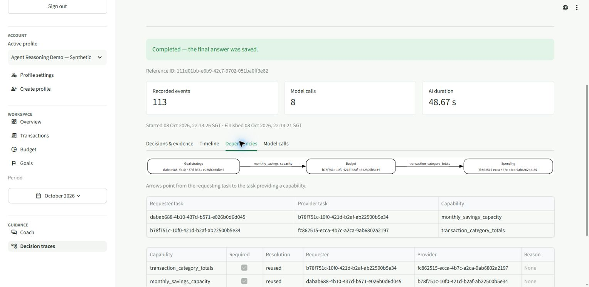

# Live reasoning retest after e99409d — 8 October 2026

**All 34 original prompt turns attempted: 27 passes, 7 failures. Additional full-chain case 35: pass.**

Ran through the signed-in Edge plugin from 21:01–22:15 SGT with **Agent Reasoning Demo — Synthetic** and October 2026 selected. Thirty-four saved-turn traces report build `e99409d143444a28fe42b1a1431a90a607be4244` and prompt set v9 hash `1f27335bac2e7d171a5a0cfc022c55b5b55edd09065da9f863a1cfeac0b15fac` with OpenAI / gpt-6-luna. Case 13 has a retained timeout trace rather than a saved answer, and does not expose these identity fields. AWS deployment state was not independently queried.

The **25 expenses, 3 budgets and 4 goals are exactly unchanged across every exported field**. Baseline financial records also match the previous live run. Only test chats and traces were added.

One model execution per approved prompt; no reruns to obtain passes. Case 26b continues 26a; all others use fresh chats. Authentication expired before case 23 was saved: the official export confirmed no message or trace, and it was submitted after sign-in. That interruption is recorded separately from model outcomes.

Acceptance uses the conditional v2 dataset plus inspection of the delivered answer. Correct numbers or specialist names alone do not pass a dependency or reasoning test. S = Spending, B = Budget, G = Goal, I = Investment. Arrows point from requester to capability provider.

| Case | Scenario | Initial → final specialists | Dependencies | Outcome | Reference ID |
| --- | --- | --- | --- | --- | --- |
| 1 | Spending: single specialist | S → S | None | Pass | `1de7a9e0-2420-4eec-ab95-cb2e23eb322a` |
| 2 | Budget: single specialist | B → B | None | Pass | `20aa49a3-07d7-4ae2-9fc6-1a09dcec89cc` |
| 3 | Goal: single specialist | G → G | None | Pass | `75e1794e-cead-4bcf-85d9-b0a5952e1707` |
| 4 | Investment: single specialist | I → I | None | Pass | `d10fccc8-dd0f-48ba-8516-e94535312afd` |
| 5 | Budget + Spending: dependency | B + S → B + S | None | Fail | `6b2a32a0-f839-458f-a938-e8b94a1f2f40` |
| 6 | Budget + Goal: dependency | G → G + B | G → B (monthly_savings_capacity) | Pass | `0cd38156-73b0-43f7-9e50-5cf4d7768ff3` |
| 7 | Budget + Spending + Goal: dependency | S + G → S + G + B | G → B (monthly_savings_capacity); B → S (transaction_category_totals) | Pass | `acb0685e-6648-49cf-bf71-26f0e3d1c7ca` |
| 8 | Spending + Goal: dependency requested, exact pair unsupported | S + G → S + G + B | G → B (monthly_savings_capacity); B → S (transaction_category_totals) | Pass | `f2e4d875-3260-41c3-9242-f030e41e78c7` |
| 9 | Budget + Spending: independent parallel candidates | S + B → S + B | None | Fail | `785ce979-491b-4db1-a389-ad82b03e3aac` |
| 10 | Budget + Goal: independent parallel candidates | B + G → B + G | None | Pass | `0cbc506f-e1d1-4bc6-be72-1804389daa5a` |
| 11 | Budget + Spending + Goal: independent parallel candidates | S + B + G → S + B + G | None | Pass | `599a09fb-60da-4f0e-9dc4-f5cdc78283d8` |
| 12 | Spending + Goal: independent parallel candidates | S + G → S + G | None | Pass | `3b7eb1e1-67f8-4e02-85db-e8b64ec6dc3f` |
| 13 | Spending + Investment | S + I → S + I | None | Fail: timeout | `d15fc79a-dea9-4753-8358-42a15520f4e8` |
| 14 | Budget + Investment | B + I → B + I | None | Pass | `3a654892-5614-4f3c-b516-ceddad292b1d` |
| 15 | Goal + Investment | G + I → G + I | None | Pass | `a25d93e8-4662-409f-b875-f97952b6aba5` |
| 16 | Budget + Spending + Investment | S + B + I → S + B + I | B → S (transaction_category_totals) | Pass | `adf3aa70-65ca-4838-8e61-00765f428b4a` |
| 16P | Independent Investment combination | S + B + I → S + B + I | None | Pass | `44944ce9-2d6d-4b15-a719-918427dad54f` |
| 17 | Spending + Goal + Investment | S + G + I → S + G + I | None | Pass | `580ed94e-8a30-4bbf-bea8-7de5f31c9da0` |
| 18 | Budget + Goal + Investment | G + I → G + I + B | G → B (monthly_savings_capacity) | Pass | `0bf85536-e37c-49ce-a12b-10b05d4ee284` |
| 18P | Independent Investment combination | B + G + I → B + G + I | None | Pass | `b6a95a43-a7fc-444d-a2d4-1a3fca81b8da` |
| 19 | All four specialists | S + G + I → S + G + I + B | G → B (monthly_savings_capacity); B → S (transaction_category_totals) | Pass | `8fe943bf-3ffb-48d3-a7ee-832e2d55d946` |
| 19P | Independent Investment combination | S + B + G + I → S + B + G + I | None | Pass | `2e9a9bba-068f-448b-bb07-b17684517e45` |
| 20 | Goal dynamically adds Budget | G → G + B | G → B (monthly_savings_capacity) | Pass | `3a78b489-81cc-47bd-b02a-920e0b178af3` |
| 21 | Recurrence reasoning: projected versus recorded expenses | S → S | None | Fail | `9f1c9c29-ade6-454f-a092-86193fc0f212` |
| 22 | Saved plan with no observed expenses | S → S | None | Pass | `ce32aeb0-102a-4af3-99c9-fa88d642b1ba` |
| 23 | Calendar scope and competing goals | G → G + B | G → B (monthly_savings_capacity) | Pass | `13a5af91-34c6-4a40-8da4-332b47ea85cc` |
| 24 | Missing requested budget | G → G + B | G → B (monthly_savings_capacity) | Pass | `0fc2a79c-fbef-414d-9bb7-6c1a66ae2738` |
| 25 | Emergency-fund special path | G → G | G → tool:education_retriever:1b6a1a6c1a0f5e3c (education_context) | Fail: withheld | `1bf35b40-6d8a-4096-a178-a1d4db5541de` |
| 26a | Follow-up subject resolution | I → I | None | Pass | `81850a4b-d2d5-4d5d-af32-5d5946963a7b` |
| 26b | Follow-up subject resolution | I → I | None | Pass | `fc6b07ee-a315-4917-8876-0270a163eb5c` |
| 27 | Ambiguous follow-up in a fresh conversation | I → I | None | Pass | `28c1e756-6d40-4a9b-a8e0-864d1828261d` |
| 28 | Response preferences without changing reasoning | G → G + B | G → B (monthly_savings_capacity) | Pass | `2089f561-c0c0-496f-8c8c-a94cd56688de` |
| 29 | Partial education answerability | I → I | None | Fail: withheld | `5b0748d0-1e17-4551-8964-245145ac0d8b` |
| 30 | Conditional Education grounding versus a separately routed Investment answer | B → B | B → tool:education_retriever:2de7dcd8393ecbc4 (education_context) | Fail: withheld | `3f967660-3681-4a09-ba3e-08879e44b8ac` |
| 35 | Explicit full dependency chain (additional) | S + B + G → S + B + G | G → B (monthly_savings_capacity); B → S (transaction_category_totals) | Pass | `111d01bb-e6b9-42c7-9702-051ba0ff3e82` |

## Comparison with the previous run

The original pass count remains **27/34**, but the outcomes changed:

- Previously failing cases now passing: **19P, 22, 26b**.
- Newly failing cases: **5, 9, 30**.
- Still failing: **13, 21, 25, 29**, with different mechanisms in cases 13 and 21.
- Additional **case 35 now passes**, including both required edges and provider reuse.

Cases 3, 8, 14, 15, 16P and 19 each admit one owned qualification repair and pass the second review, including drafts initially marked financial_language_safe=false. Case 13 also admits education repair, but its corrective review exceeds the deadline. Case 21 now produces the correct forecast and resolves the read-only operation; its remaining gap is the delivered explanation.

This is one live sample per prompt. Changed routes, claims and review outcomes under the same fixture remain evidence of variability, rather than proof of repeated reliability. Case 30 changed from B + I in the previous run to B alone with Education grounding, which exercises a different supported ownership path.

## Failures and evidence

### Case 5

The delivered figures are correct, but the required Budget-to-Spending capability edge is missing. Router assigned Budget requires_spending=false, so Budget capacity and Spending pressure analysis ran separately. This fails the approved dependency demonstration, even though the answer combines their narratives.

Reference: `6b2a32a0-f839-458f-a938-e8b94a1f2f40`. Graph issues: ['Missing required edge: budget / spending / transaction_category_totals']. Answer status: `answered`. Trace status: `completed`.

- Review 1: blocked `False`, complete `True`, repairable `False`. Issues: none recorded. Categories: none.
- `education.completeness.repair_decision`: allowed `False`; reason `REPAIR_VERDICT_NOT_REPAIRABLE`; blockers `REPAIR_VERDICT_NOT_REPAIRABLE, REPAIR_ANSWER_ALREADY_COMPLETE, REPAIR_SPECIALIST_NOT_ELIGIBLE, REPAIR_NO_MISSING_POINTS, REPAIR_GROUNDING_UNAVAILABLE, REPAIR_USAGE_UNAVAILABLE`. Estimated repair tokens 9745; remaining 53717.

### Case 9

Correct category totals and independent graph, but the answer claims the comparison is between all of September and October 1–6. September records cover only September 1–26. The final answer therefore overstates September coverage; the review did not block it.

Reference: `785ce979-491b-4db1-a389-ad82b03e3aac`. Graph issues: none. Answer status: `answered`. Trace status: `completed`.

- Review 1: blocked `False`, complete `True`, repairable `False`. Issues: none recorded. Categories: none.
- `education.completeness.repair_decision`: allowed `False`; reason `REPAIR_VERDICT_NOT_REPAIRABLE`; blockers `REPAIR_VERDICT_NOT_REPAIRABLE, REPAIR_ANSWER_ALREADY_COMPLETE, REPAIR_SPECIALIST_NOT_ELIGIBLE, REPAIR_NO_MISSING_POINTS, REPAIR_GROUNDING_UNAVAILABLE, REPAIR_USAGE_UNAVAILABLE`. Estimated repair tokens 8522; remaining 55887.

### Case 13

UI returned 503 with no saved user/assistant turn. A unique retained trace in the submission window records AI_SERVICE_TIMEOUT after about 85 seconds. Initial specialists and overlap are correct. Education qualification repair was admitted with sufficient token budget, but its corrective ScopedEducationComplianceDecision was rejected, a second contract-correction call started, and the workflow deadline expired. This is a repair/review timeout, rather than the previous deployment's repair admission denial.

Reference: `d15fc79a-dea9-4753-8358-42a15520f4e8`. Graph issues: none. Answer status: `incomplete`. Trace status: `timed_out`.

- Review 1: blocked `True`, complete `True`, repairable `True`. Issues: investment_education/education_4: qualify. Categories: factual_qualification.
- `education.completeness.repair_decision`: allowed `True`; reason `REPAIR_ELIGIBLE`; blockers `none`. Estimated repair tokens 18008; remaining 42120.

### Case 21

The date and numeric forecast are correct: one scheduled rent occurrence on 1 November, SGD 1,800. Spending.operation.resolved corrects the router's legacy spending_capture=true flag to false, and the normal Spending writer/reviewer ran. However, transaction_staging.stage_transaction_draft replaces response.answer for draft.action=forecast with handle_recurring_forecast_query's template. Backend response composition then runs, but its grounding review rejects the proposed composition; backend.composition.completed records status=fallback and ACTION_COMPOSITION_UNGROUNDED. The delivered fallback does not explicitly explain forecast versus recorded payment as requested. Numeric forecast passes; requested reasoning coverage is incomplete.

Reference: `9f1c9c29-ade6-454f-a092-86193fc0f212`. Graph issues: none. Answer status: `answered`. Trace status: `completed`.

- Review 1: blocked `False`, complete `True`, repairable `False`. Issues: none recorded. Categories: none.
- `education.completeness.repair_decision`: allowed `False`; reason `REPAIR_VERDICT_NOT_REPAIRABLE`; blockers `REPAIR_VERDICT_NOT_REPAIRABLE, REPAIR_ANSWER_ALREADY_COMPLETE, REPAIR_SPECIALIST_NOT_ELIGIBLE, REPAIR_NO_MISSING_POINTS, REPAIR_GROUNDING_UNAVAILABLE, REPAIR_USAGE_UNAVAILABLE`. Estimated repair tokens 6256; remaining 63898.

### Case 25

The router correctly selects Goal emergency_reserve mode with no Budget capacity dependency and requests education_context. Both initial and corrective EducationQueryPlan decisions fail INVALID_EDUCATION_PROVENANCE. No agent_goal_strategy writer runs; the evidence-gap fallback is reviewed through the basic ComplianceDecision contract, rather than the scoped contract. That review blocks for factual_qualification without structured owned issues, answer_complete, repairable, or request_allowed fields. No financial repair decision is recorded, and education repair is ineligible. The safe export does not identify the precise invalid plan field or rejected prose; those should not be guessed.

Reference: `1bf35b40-6d8a-4096-a178-a1d4db5541de`. Graph issues: none. Answer status: `refused`. Trace status: `blocked`.

- Review 1: blocked `True`, complete `not recorded`, repairable `not recorded`. Issues: none recorded. Categories: factual_qualification.
- `education.completeness.repair_decision`: allowed `False`; reason `REPAIR_VERDICT_NOT_REPAIRABLE`; blockers `REPAIR_VERDICT_NOT_REPAIRABLE, REPAIR_ANSWER_ALREADY_COMPLETE, REPAIR_SPECIALIST_NOT_ELIGIBLE, REPAIR_NO_MISSING_POINTS, REPAIR_GROUNDING_UNAVAILABLE, REPAIR_USAGE_UNAVAILABLE`. Estimated repair tokens 6356; remaining 56559.

### Case 29

Expected Investment-only route, but all education is withheld rather than preserving supported diversification with a tax-scope limitation. The review ends as review_contract_unverified / unverifiable_claim with no actionable review issues. Education recovery is denied because the verdict is not repairable and supplies no missing points. Two risk review calls are recorded. The failure is review contract verification, not evidence that the user's tax request was answered incorrectly; rejected prose is unavailable.

Reference: `5b0748d0-1e17-4551-8964-245145ac0d8b`. Graph issues: none. Answer status: `refused`. Trace status: `blocked`.

- Review 1: blocked `True`, complete `not recorded`, repairable `not recorded`. Issues: none recorded. Categories: unverifiable_claim.
- `education.completeness.repair_decision`: allowed `False`; reason `REPAIR_VERDICT_NOT_REPAIRABLE`; blockers `REPAIR_VERDICT_NOT_REPAIRABLE, REPAIR_ANSWER_ALREADY_COMPLETE, REPAIR_NO_MISSING_POINTS`. Estimated repair tokens 16006; remaining 38245.

### Case 30

This run demonstrates the previously unobserved Budget-only education_context path: Budget alone is routed and requests Education grounding for liquidity. A composition qualification is admitted for financial repair with enough tokens. The second full review still blocks the revised composition for factual_qualification referencing Budget contexts and subquestion coverage. The bounded correction is exhausted and the answer is withheld. Unlike the prior passing run, a separately routed Investment specialist did not own the liquidity explanation.

Reference: `3f967660-3681-4a09-ba3e-08879e44b8ac`. Graph issues: none. Answer status: `refused`. Trace status: `blocked`.

- Review 1: blocked `True`, complete `True`, repairable `True`. Issues: composition/draft: qualify. Categories: factual_qualification.
- `financial.review.repair_decision`: allowed `True`; reason `REPAIR_ELIGIBLE`; blockers `none`. Estimated repair tokens 42167; remaining 49501.
- Review 2: blocked `True`, complete `True`, repairable `True`. Issues: composition/draft: qualify. Categories: factual_qualification.

## Independent execution overlap

All eleven independent combinations have no financial specialist dependency and positive common overlap in their first executions. Case 13 retains timing evidence despite its later timeout. This is execution evidence, not a verdict on the delivered answer.

| Case | Specialists | Common first-execution overlap (seconds) |
| --- | --- | --- |
| 9 | S + B | 4.265 |
| 10 | B + G | 5.042 |
| 11 | S + B + G | 5.287 |
| 12 | S + G | 4.969 |
| 13 | S + I | 6.543 |
| 14 | B + I | 11.432 |
| 15 | G + I | 4.279 |
| 16P | S + B + I | 4.176 |
| 17 | S + G + I | 5.525 |
| 18P | B + G + I | 4.411 |
| 19P | S + B + G + I | 3.929 |

## Why the results vary

The deployed fixes address general operation classification, grounding and bounded repair; they are present in the verified build. They do not guarantee identical task assignments, draft claims or reviewer verdicts on every model execution. Case 5 shows an incorrect requires_spending=false assignment; case 9 shows an incorrect coverage claim surviving review. Case 30 takes a different supported route from its prior B + I execution, with Budget alone owning liquidity through Education grounding. Cases 13 and 29 expose invalid review contracts after otherwise valid structured JSON. Case 25 exposes invalid Education planning provenance before narrative generation. Case 21 loses reasoning during backend staging and composition fallback.

Local contract tests and the 87-case gate did not measure repeated signed-in, end-to-end behavior through every backend output stage. A passing graph, a schema-valid response, correct arithmetic and a passed review are separate observations. This run should inform broader assertions across those stages and repeated trials, rather than literal rules keyed to the approved prompt strings.

## Risk & Compliance responsibilities

RiskComplianceAgent.validate inspects the request, draft, specialist results and rationales; applies deterministic hard boundaries; retrieves governed policy evidence; and asks the model to review permitted factual claims, citations, assumptions, qualifications and requested coverage. It validates structured review ownership and evidence references. Repairability is derived under server rules from valid owned issues, rather than trusting an unconstrained model repairable flag.

The orchestrator runs bounded correction and review when eligible. Its _finalize method reads compliance.blocked; if true after recovery, it replaces the draft with the refusal/verification message and withholds specialist narratives and citations. Thus Risk & Compliance supplies the blocking verdict and the orchestrator enforces withholding. Invalid review contracts can themselves produce a fail-closed verdict without proving the draft contained a prohibited claim.

Risk & Compliance does not schedule specialists, calculate the authoritative ledger or budget, enforce the intended demonstration graph, or guarantee backend composition will preserve every requested explanation. Cases 5, 9 and 21 pass its review yet fail test acceptance. Case 13 ends in timeout/503. Cases 25, 29 and 30 end in saved withheld responses. Backend action-grounding review is another validator: its rejection in case 21 leads to a forecast-template fallback rather than the generic Risk & Compliance refusal.

## Demonstrated behavior and limits

- Case 35 demonstrates G → B → S with both matching-provider reuse resolutions; cases 7, 8 and 19 also contain the full financial chain.
- Cases 20, 23, 24 and 28 start with Goal and add Budget. Saved-goal arithmetic cases remain independent.
- Case 30 demonstrates Budget-only education_context; case 25 requests Goal reserve Education context without Budget, but its query plan fails provenance validation. Both final answers are withheld; scheduling does not establish usable grounding or a successful end-to-end answer.
- Case 21 forecasts one rent occurrence for SGD 1,800 on 1 November; the backend template loses the requested recorded-payment explanation. Case 22 correctly distinguishes missing records from zero expenses.
- Case 26b resolves the displayed second option to ETFs; case 27 asks for context in a fresh chat. Case 28 changes presentation without changing capacity arithmetic.
- Case 4 uses disclosed model-knowledge fallback because source verification is unavailable. Cases 18 and 19 repeat Budget paragraphs; these presentation issues are retained without changing their reasoning verdicts.

The official export contains **34 saved-turn traces (31 completed, 3 blocked) and one retained timeout trace**, all 35 references verified in the UI. Numeric checks: **{'pass': 65, 'unavailable_blocked_export': 1}**, with no mismatches. The unavailable blocked-export fact is not counted as verified. The timeout trace is not counted as a completed answer.

The Decisions & evidence, Timeline, Dependencies and Model calls views render for case 35. The failed-run viewer renders case 13 with AI_SERVICE_TIMEOUT and its saved events. Case 35 records a backend response_composer failure, followed by fallback delivery that preserves the reviewed answer. Browser connection/rendering delays and the authentication interruption are recorded as tooling/session observations, not invented model failures.

Safe traces do not expose withheld prose or hidden reasoning. They cannot establish that a reviewer was wrong where owned issues or valid contracts are absent. No fault injection, repeated reliability study, direct Goal–Spending edge, implementation changes or deployment changes were performed.

[Selected JSON evidence](evaluation-evidence/agent-reasoning-live-v9-2026-10-08-poste99409d.json) includes approved prompts, delivered answers, assertions, graphs, timing and sanitized review/model events. Raw account-bearing exports stay in ignored artifacts.

