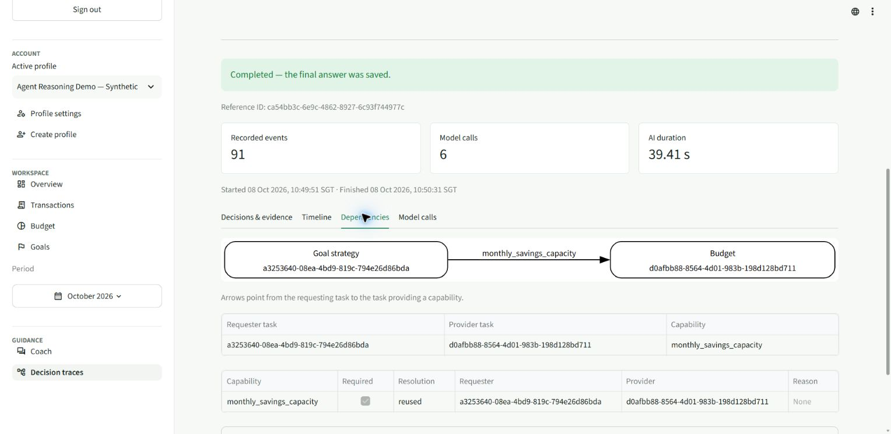

# Live agent reasoning retest — 8 October 2026

**28 of 34 approved turns met the answer and dependency expectations. Five answers were withheld, and one useful answer missed the expected full dependency chain. The application has not passed full live acceptance.** No prompt timed out, and neither of the previous unnecessary clarification failures recurred. The deployed Decision traces viewer rendered without the Pydantic import error.

The full suite ran through the **Edge browser plugin** in the user's signed-in application from approximately **10:42–11:11 SGT**. These are 34 first attempts, with no replacement retests. The earlier partial 8 October session was excluded. Only case 26b continued case 26a's conversation; all other cases used a fresh chat. Prompts were copied exactly from [the approved catalog](agent-reasoning-test-prompts-2026-10-07.md).

The active profile was **Agent Reasoning Demo — Synthetic**, `agent-reasoning-demo-20261007`, with October 2026 selected. Saved trace metadata reported **v9 / OpenAI / gpt-6-luna**. This metadata does not independently prove a deployed Git SHA. All amounts below are SGD.

Answers were captured in Coach, then correlated with the application's normal **Profile settings → Privacy & data → JSON export** by exact prompt and per-turn time window. All 34 turns have unique saved references and complete traces; there are no incomplete traces in this run. Case 5's immediate UI snapshot caught an empty render; its saved refusal was recovered from the export and retained as a failure. No budget, transaction or goal record was created, edited or deleted. The final export still contains the original 25 transactions, three budgets and four goals, with their original amounts and durations.

## Comparison with 7 October

| First attempts only | 7 October | 8 October |
|---|---:|---:|
| Substantive answer, including graph gaps and useful partial answers | 18 | 28 |
| Expected fresh-chat clarification | 1 | 1 |
| Unnecessary clarification | 2 | 0 |
| Review withheld the answer | 7 | 5 |
| HTTP timeout | 6 | 0 |
| Total approved turns | 34 | 34 |

There are **29 useful outcomes** in the new run, including the expected clarification and the useful missing-December partial answer. One substantive answer, case 7, fails the catalog graph expectation, leaving **28 passes and six failed cases** when answer delivery and the expected graph are assessed together. This is one sample per prompt, not a statistical reliability estimate. The [previous report](agent-reasoning-live-test-results-2026-10-07.md) and its two retests remain separate.

## The twelve requested scenarios

S = Spending; B = Budget; G = Goal Strategy; I = Investment Education. Arrows point from requester to capability provider. Mandatory Compliance review and Education retrieval are excluded from the four-specialist count. The initial route can differ from the final set when a dependency adds an agent.

| Case | Initial → final specialists | Saved edges | Verdict | Reference ID |
|---|---|---|---|---|
| 1 | S → S | None | Pass | `9834c497-207c-4cac-a1a8-8822bfd111ce` |
| 2 | B → B | None | Pass | `9ccbaee4-b9ea-40fb-8d3a-344056ea71bc` |
| 3 | G → G | None | Withheld | `1e7ed994-7dee-4acc-ab0b-f235569afd34` |
| 4 | I → I | None | Pass | `ba679213-3ced-431c-856a-1bfc4d56b963` |
| 5 | B + S → B + S | B → S | Withheld | `e0ae6f47-3681-46c1-bcb0-d8783d584a85` |
| 6 | G → G + B | G → B | Pass | `a9efa59d-6983-412e-91ae-8cd62731adca` |
| 7 | S + B + G → S + B + G | G → B | Answer pass; chain expectation failed | `ca54bb3c-6e9c-4862-8927-6c93f744977c` |
| 8 | S + G → S + G + B | G → B; B → S | Pass | `170605b6-731b-47bf-b1fc-a63c38d0b2eb` |
| 9 | S + B → S + B | None | Pass | `00f6a4f5-c4eb-41d4-a5c0-1be6ab71726d` |
| 10 | B + G → B + G | None | Pass | `c314f431-7ec8-4019-a2b5-58d87c5552cd` |
| 11 | S + B + G → S + B + G | None | Pass | `8d240e23-8ee5-4817-8fce-78d3d213101c` |
| 12 | S + G → S + G | None | Pass | `2a72bbd0-d488-46d3-abb9-12d63d1c5f21` |

Case 7 returned correct contributions and a 1,000 shared-pool shortfall. However, it saved only `G → B`; Budget completed its first attempt without requesting Spending. Spending ran separately and its context appeared in the final synthesis. This is a **failure of the frozen full-chain demonstration expectation**, not proof that the financial answer was wrong. Cases 8 and 19 demonstrate the full supported chain. The direct Spending–Goal edge remains deferred.

## Additional specialist combinations

| Case | Initial → final specialists | Saved edges | Verdict | Reference ID |
|---|---|---|---|---|
| 13 | S + I → S + I | None | Withheld | `0a0302f6-2683-4879-b6cb-28214275d1c3` |
| 14 | B + I → B + I | None | Pass | `d25a2cf0-b925-4db5-9c75-c3496bc65318` |
| 15 | G + I → G + I | None | Withheld | `8b57b7e7-2858-409d-85ae-503cd19fbb2e` |
| 16 | S + B + I → S + B + I | B → S | Pass | `a8d38751-706f-4b84-811b-f84f580a2446` |
| 16P | S + B + I → S + B + I | None | Pass | `6a1e8dc8-89ef-4326-9b4f-742382c54b27` |
| 17 | S + G + I → S + G + I | None | Pass | `c9e42388-8743-4342-bd6e-da17dde22a48` |
| 18 | G + B + I → G + B + I | G → B | Pass | `a0742cf3-fba6-4f69-89bb-308f7a21ed1b` |
| 18P | B + G + I → B + G + I | None | Pass | `b0f87f5c-ab17-4177-afea-b6cf109794e0` |
| 19 | G + S + I → G + S + I + B | G → B; B → S | Pass | `63d9f984-869e-4154-825e-694fa0a1926a` |
| 19P | S + B + G + I → S + B + G + I | None | Pass | `03568a86-e396-4662-ace1-5680c8ca49e6` |

## Recurrence, data scope, follow-ups and preferences

| Case | Initial → final specialists | Saved edges | Verdict | Reference ID |
|---|---|---|---|---|
| 20 | G + B → G + B | G → B | Pass | `86219c48-70dc-4549-b89e-0e6ab6f3c73e` |
| 21 | S → S | None | Pass | `adee7ba5-9751-433b-b8e1-bb176b137be2` |
| 22 | S → S | None | Pass | `1bed847b-6392-4866-81b1-714be62ed139` |
| 23 | G → G + B | G → B | Pass | `49f92d46-8481-4eae-a7c5-f3026420cca9` |
| 24 | G → G + B | G → B | Pass | `b7e8a315-c761-4262-8149-bab306a5ef01` |
| 25 | G + S → G + S | G → Education tool | Withheld | `6bb0e93d-41c7-4e04-81e2-c8e7133d4ac7` |
| 26a | I → I | None | Pass | `c280b719-3152-4bda-a337-616172276c04` |
| 26b | I → I | None | Pass | `168e7d57-b3e8-4f95-bb91-4ad42590a392` |
| 27 | I → I | None | Pass | `b095761c-6745-48cd-af72-824123044eaf` |
| 28 | G → G + B | G → B | Pass | `92862fe9-08d4-4054-9013-89d6c17af560` |
| 29 | I → I | None | Pass | `2a77fbb5-52d2-4823-b01d-f8c1d26a016d` |
| 30 | B + I → B + I | None | Pass | `b1549c4e-ab0a-41d7-a2e5-7d90d8707979` |

Case 24 has `needs_input` status but is a passing **useful partial answer**: the combined goal requirement is 2,600/month, while December savings capacity is unknown. It does not treat missing data as zero or borrow October's plan.

Case 25 uses G + S with Goal's Education tool dependency and no Budget. It therefore does not demonstrate the catalog's exact Goal-only route. Its final failure is also a withheld answer.

## What the traces establish

**Conditional dependencies and dynamic addition work.** Budget-only case 2 has no Spending edge. Cases 9, 14, 20 and 30 also avoid the unwanted Spending dependency seen previously. Goal arithmetic does not add Budget in cases 3, 10, 11, 12, 15, 17, 18P and 19P. Cases 6, 8, 19, 23, 24 and 28 dynamically schedule Budget for `monthly_savings_capacity`; case 20 reuses an already routed Budget. Thus dynamic Budget addition, previously unproven by this suite, is now demonstrated.

**Provider reuse remains a real dependency.** Cases 5, 8, 16 and 19 record reused `transaction_category_totals`; cases 7, 18 and 20 reuse capacity from routed Budget. A requester’s second task attempt here is a resumption after dependency resolution, rather than a failed model-call retry.

Case 19 is the clearest complete chain. Its initial route was G + S + I. Spending ran from 8.628 to 16.132 seconds; Investment ran from 8.630 to 25.034. Budget was dynamically added, requested Spending on its first attempt, then resumed from 29.779 to 40.393. Goal resumed from 40.402 to 45.446. The final saved edges are exactly `G → B` and `B → S`; Investment has no dependency edge and overlaps Spending. Scheduling happens in waves: Budget started after the initial independent wave finished, so this run does not establish optimal scheduling latency.

**All eleven independent combinations show actual overlap with no specialist edges.** The figures below are common overlap across all specialists in each case, measured from saved `task.started` and `task.execution.finished` timestamps. Cases 13 and 15 still fail answer delivery despite successful independent execution.

| Case | Specialists | Common overlap | Answer |
|---|---|---:|---|
| 9 | S + B | 4.076 s | Useful |
| 10 | B + G | 3.620 s | Useful |
| 11 | S + B + G | 3.443 s | Useful |
| 12 | S + G | 4.458 s | Useful |
| 13 | S + I | 4.851 s | Withheld |
| 14 | B + I | 4.492 s | Useful |
| 15 | G + I | 4.493 s | Withheld |
| 16P | S + B + I | 4.660 s | Useful |
| 17 | S + G + I | 4.052 s | Useful |
| 18P | B + G + I | 3.894 s | Useful |
| 19P | S + B + G + I | 3.885 s | Useful |

**Recurrence and calendar scope are preserved.** Case 21 forecasts only the explicit rent occurrence of 1,800 on 1 November, without describing it as paid. Case 22 explicitly says November has no recorded expenses and that this does not establish no spending. Case 23 gives September/October/November shortfalls of 1,200 / 1,000 / 1,600. October capacity remains the confirmed 1,600 allocation, with 950 unallocated income separate from the shared goal pool.

**Follow-ups and partial education now work.** Case 26a actually displayed numbered options `1. Funds` and `2. Exchange-traded funds`, explaining mutual funds first. Case 26b resolves the second option to ETFs with `SEMANTIC_PERSISTED_REFERENCE` and provides an analogy. The same prompt in a fresh chat, case 27, asks which goal, option or concept is meant. Case 29 answers diversification while explicitly limiting current personalized ETF tax claims. Cases 4, 26a, 26b, 29 and 30 separate sourced claims from labelled general model knowledge where applicable.

**Preferences change presentation without changing the figures.** Case 28 delivers the requested compact table and plain English with a combined requirement of 2,600, a 1,600 shared pool and a 1,000 shortfall. The unnecessary optional Education edges seen in cases 6 and 28 previously are absent. Case 30 routes B + I; it demonstrates a separate Investment explanation, not a controlled Budget-only Education capability test.

## Remaining failed cases and repair evidence

Further source inspection is recorded in the [root-cause diagnosis](agent-reasoning-live-root-causes-2026-10-08.md). It identifies the omitted Goal reviewer evidence and case 25's deterministic capture override, and separates confirmed causes from uncertain review details. The `repairable` value below is derived by the server from the validated model verdict and section ownership; it is not a flag set directly by the model.

| Case | Observed failure | Saved repair evidence |
|---|---|---|
| 3: Goal only | Withheld, `unverifiable_claim` | Review sets `repairable=false`; financial repair ineligible. |
| 5: Budget + Spending dependency | Withheld, `factual_qualification` | Repair eligible and attempted; second review still blocks the same category. |
| 7: Three-agent chain | Useful answer, expected B → S absent | Goal reuses Budget; Budget completes directly. Graph demonstration gap. |
| 13: Spending + Investment | Withheld, `factual_qualification` | Review sets `repairable=false`; financial repair ineligible. |
| 15: Goal + Investment | Withheld, `factual_qualification` and `unverifiable_claim` | Review sets `repairable=false`; financial repair ineligible. |
| 25: Emergency fund | Withheld, `factual_qualification` | Review says repairable, but financial repair is ineligible; Education repair reports `REPAIR_SECTION_NOT_OWNED` and other blockers. |

The review and repair layer is the main remaining answer-delivery problem. Cases 1 and 9 show successful financial repair followed by a passing second review; case 5 shows the same mechanism failing to produce an accepted correction. Cases 3, 13 and 15 are not eligible because the review explicitly marks them non-repairable. Case 25 has a repairable review but fails the repair ownership/eligibility checks. The exported trace records the financial gate as an aggregate `FINANCIAL_REPAIR_NOT_ELIGIBLE`, so it does not identify which individual predicate failed there.

These are acceptance failures for ordinary approved questions. The application sanitizes blocked drafts and review prose in its export; the saved categories alone cannot prove that a block was a false positive or identify the exact offending claim. No withheld prose was recovered and no runtime policy was weakened during testing.

## Trace viewer and evidence

The deployed viewer opened the October-scoped case 7 reference without `ModuleNotFoundError`. Decisions & evidence, Dependencies, Timeline and Model calls were inspected after the fix. The earlier Budget-only scoped trace also rendered. This verifies the observed frontend failure path in the deployed UI.

The [structured evidence](evaluation-evidence/agent-reasoning-live-v9-2026-10-08.json) contains the exact prompts, safe final answers, unique references, initial/final specialists, capability edges, provider resolutions, review/repair decisions and measured task intervals. The full official export and browser snapshots are retained locally in `artifacts/agent-reasoning-live-20261008/`; the full profile export is not included in versioned documentation.

No controlled transient-failure injection was performed, so automatic retry behavior is not established by this run. No direct Spending–Goal edge or controlled Budget-only Education test was executed. The primary evidence is successful conditional routing, dynamic provider scheduling, reuse, independent overlap and persistent follow-up resolution, with the six remaining failures preserved.
