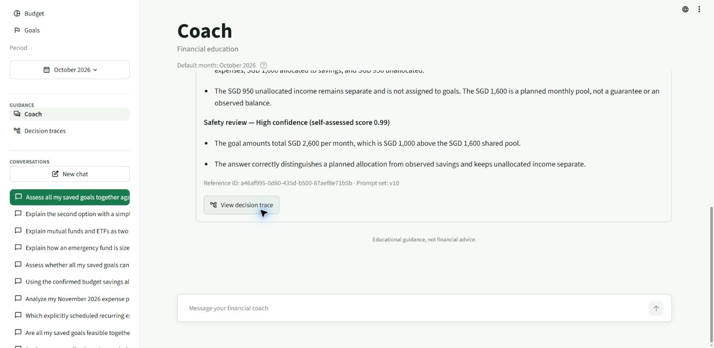

# Live reasoning retest — 9 October 2026

**Original turns: 28/34 passed. Full-chain case 35: fail. Planned repeats: 4/7 passed.**

Executed in the signed-in Edge tab with Agent Reasoning Demo — Synthetic and October 2026 selected. All standalone cases used fresh chats; 26b continued 26a. The seven previously failed cases were each repeated once after the full set; no selective reruns to obtain passes.

All 25 expenses, 3 budgets and 4 goals are exactly unchanged across every exported field. They also match the previous live-test baseline. Only test chats and traces were added.

Acceptance checks the delivered answer, specialist selection, dependency edges, required parallel overlap and numeric assertions separately. S = Spending; B = Budget; G = Goal; I = Investment. Arrows point from requester to provider. Correct numbers alone do not pass a dependency test.

All 42 turns matched the expected financial specialist selection and dependency edges. Required parallel executions overlapped. The full Goal → Budget → Spending chain ran correctly in case 35, although its answer was withheld. Case 26b's follow-up resolution check failed because the preceding answer was withheld; its financial routing still matched.

[Selected trace evidence](evaluation-evidence/agent-reasoning-live-v10-2026-10-09.json). Raw exports remain private in ignored artifacts.

[Subsequent root-cause diagnosis](agent-reasoning-live-root-causes-2026-10-09.md) maps these outcomes to review, correction and response composition, distinguishing confirmed findings from inferred claim identities.

| Case | Scenario | Selected specialists | Dependencies | Outcome | Reference ID |
| --- | --- | --- | --- | --- | --- |
| 1 | Spending: single specialist | S | None | **PASS** | `a78f5a9d-e227-449e-adc9-d07cb7f8d42d` |
| 2 | Budget: single specialist | B | None | **PASS** | `070e4e4b-5478-436f-96a4-3ac92e203ee4` |
| 3 | Goal: single specialist | G | None | **PASS** | `7e20f993-63fc-4c08-ab29-644409712665` |
| 4 | Investment: single specialist | I | None | **FAIL** | `f7d92731-0b15-4dca-84c0-ff6f6a5b8dc9` |
| 5 | Budget + Spending: dependency | B + S | B → S (transaction_category_totals) | **PASS** | `06be7a13-8610-4617-9f6d-bd46955c7967` |
| 6 | Budget + Goal: dependency | G + B | G → B (monthly_savings_capacity) | **PASS** | `7af32265-82de-4860-8061-9ebc8ee619f2` |
| 7 | Budget + Spending + Goal: dependency | S + G + B | G → B (monthly_savings_capacity); B → S (transaction_category_totals) | **PASS** | `ca2fe499-9ee8-47d7-b518-493b69189a14` |
| 8 | Spending + Goal: dependency requested, exact pair unsupported | S + G + B | G → B (monthly_savings_capacity); B → S (transaction_category_totals) | **PASS** | `906b7054-2718-4420-9e21-515a4fa9e24f` |
| 9 | Budget + Spending: independent parallel candidates | S + B | None | **PASS** | `ab73adfe-db6e-49ad-b14e-22c2358d907f` |
| 10 | Budget + Goal: independent parallel candidates | B + G | None | **PASS** | `805835a5-7d5a-4994-a4f8-dd96cbb5290d` |
| 11 | Budget + Spending + Goal: independent parallel candidates | S + B + G | None | **FAIL** | `a182eab3-7c28-4041-b0f4-8264595314c7` |
| 12 | Spending + Goal: independent parallel candidates | S + G | None | **PASS** | `0027a180-e3ac-442e-93b0-eed3d701776e` |
| 13 | Spending + Investment | S + I | None | **PASS** | `70783147-90ea-4e14-8c24-8ad0d98c6bec` |
| 14 | Budget + Investment | B + I | None | **PASS** | `bae1d40f-5011-4119-ac84-2785cb8c1b5b` |
| 15 | Goal + Investment | G + I | None | **PASS** | `a1e86019-3944-41d5-bd64-863625b5f67f` |
| 16 | Budget + Spending + Investment | S + B + I | B → S (transaction_category_totals) | **PASS** | `66155c5f-51fa-4e75-9eec-97f0150026c4` |
| 16P | Independent Investment combination | S + B + I | None | **PASS** | `76f7a36c-8f48-476a-9083-a5c869001478` |
| 17 | Spending + Goal + Investment | S + G + I | None | **PASS** | `faad6f0f-c051-4420-818a-5d1e78072b07` |
| 18 | Budget + Goal + Investment | G + I + B | G → B (monthly_savings_capacity) | **PASS** | `b3cb63ed-0079-434b-8732-84a57f7482c6` |
| 18P | Independent Investment combination | B + G + I | None | **PASS** | `469a014f-30a6-4771-831e-b4f8ec64c9cd` |
| 19 | All four specialists | S + G + I + B | G → B (monthly_savings_capacity); B → S (transaction_category_totals) | **PASS** | `b73f30d9-2868-40bc-a00e-94c0fb0ec888` |
| 19P | Independent Investment combination | S + B + G + I | None | **PASS** | `0670a196-0858-4e2d-b763-6cce1029a750` |
| 20 | Goal dynamically adds Budget | G + B | G → B (monthly_savings_capacity) | **PASS** | `7743f941-1144-44ec-ae46-363e95e0cb31` |
| 21 | Recurrence reasoning: projected versus recorded expenses | S | None | **PASS** | `d126cf33-db94-4a90-b3e6-b941a651f20a` |
| 22 | Saved plan with no observed expenses | S | None | **PASS** | `35898d1d-bcbe-4c79-87f2-ad16dc150f5d` |
| 23 | Calendar scope and competing goals | G + B | G → B (monthly_savings_capacity) | **PASS** | `11d57e77-a631-410d-85b8-a834b7b9e0c1` |
| 24 | Missing requested budget | G + B | G → B (monthly_savings_capacity) | **PASS** | `2247c164-4658-4fcc-bb5d-ac8528a534b9` |
| 25 | Emergency-fund special path | G | G → tool:education_retriever:f3cecbf1dd6c5c4e (education_context) | **FAIL** | `03b42eb1-3b63-4c1f-84ef-3c9fd5bf0c27` |
| 26a | Follow-up subject resolution | I | None | **FAIL** | `58ea20b2-0c53-4a3a-8006-9919ae30fdbc` |
| 26b | Follow-up subject resolution | I | None | **FAIL** | `43b50704-a7f1-41d6-aafc-1a2837549e77` |
| 27 | Ambiguous follow-up in a fresh conversation | I | None | **PASS** | `a6997ef9-e9ac-416f-b15b-8ed4046a2b6c` |
| 28 | Response preferences without changing reasoning | G + B | G → B (monthly_savings_capacity) | **PASS** | `a46af995-0d80-435d-b500-87aef8e71b5b` |
| 29 | Partial education answerability | I | None | **FAIL** | `a501c585-38ea-443f-99be-7ea4d3c26f04` |
| 30 | Conditional Education grounding versus a separately routed Investment answer | B + I | None | **PASS** | `be3308c5-da0f-45d3-b35e-76d6f1a4455b` |
| 35 | Explicit full dependency chain (additional) | S + B + G | G → B (monthly_savings_capacity); B → S (transaction_category_totals) | **FAIL** | `86cabd55-74ff-4e08-ac94-c4611b6bb6bd` |
| 5R | Budget + Spending: dependency | B + S | B → S (transaction_category_totals) | **PASS** | `1f031571-9c49-4ff2-88d5-62ab2b43d274` |
| 9R | Budget + Spending: independent parallel candidates | S + B | None | **PASS** | `483129e1-e7de-4895-ae35-96e75db51cdc` |
| 13R | Spending + Investment | S + I | None | **FAIL** | `00c1975f-f3b5-4ff5-a1e8-2724919dee48` |
| 21R | Recurrence reasoning: projected versus recorded expenses | S | None | **PASS** | `f68b3b58-5181-4d70-a33d-2fe19876127e` |
| 25R | Emergency-fund special path | G | G → tool:education_retriever:0cef16ac70dbf3b0 (education_context) | **FAIL** | `5cab2e0f-e8a6-4be0-9cad-da2639725cdc` |
| 29R | Partial education answerability | I | None | **FAIL** | `117f0c5a-ec1c-459e-a194-e216bacb1fd4` |
| 30R | Conditional Education grounding versus a separately routed Investment answer | B + I | None | **PASS** | `4e6bd0f9-61f2-4b0a-9053-0fae27ff9c1d` |

## Failures

- **Case 4** — General shares/bonds/mutual-funds/ETF comparison was withheld by safety review; no substantive answer delivered.
  Safety review withheld the answer. Recorded review and validation codes are retained in the evidence.
- **Case 11** — Delivered spending comparison says food was unchanged, but recorded Food fell from SGD 680 in September to SGD 660 in October. Correct category totals and goal calculations do not remove that factual error.
- **Case 25** — Emergency-fund reasoning was withheld by safety review; no reserve-sizing explanation or recorded-expense benchmark delivered.
  Safety review withheld the answer. Recorded review and validation codes are retained in the evidence.
- **Case 26a** — The required numbered mutual-fund/ETF comparison was withheld. The approved follow-up was still sent in the same conversation; no substitute answer was supplied.
  Safety review withheld the answer. Recorded review and validation codes are retained in the evidence.
- **Case 26b** — Follow-up asked for clarification after case26a was withheld. The expected resolved ETF analogy was not exercised; this is a downstream consequence of the blocked setup, rather than evidence of an unsafe follow-up resolution.
  Expected follow-up status resolved; observed ambiguous
- **Case 29** — The whole answer was withheld; the supported diversification portion and explicit boundary on current personal ETF tax treatment were not delivered.
  Safety review withheld the answer. Recorded review and validation codes are retained in the evidence.
- **Case 35** — The explicit full Spending–Budget–Goal chain produced a withheld response; no reconciled category-pressure and shared-goal assessment was delivered.
  Safety review withheld the answer. Recorded review and validation codes are retained in the evidence.
- **Case 13R** — Fresh-chat repeat withheld the whole Spending/Investment answer, while the first attempt delivered both requested parts. This is a within-run outcome inconsistency; both references are retained.
  Safety review withheld the answer. Recorded review and validation codes are retained in the evidence.
- **Case 25R** — Emergency-fund reasoning was withheld again on the single planned fresh-chat repeat.
  Safety review withheld the answer. Recorded review and validation codes are retained in the evidence.
- **Case 29R** — The supported education and personal-tax boundary were again withheld on the single planned fresh-chat repeat.
  Safety review withheld the answer. Recorded review and validation codes are retained in the evidence.

## Consistency check

Case 13 changed from a delivered answer to a withheld answer under the same deployed build, prompt content hash and financial data. This confirms an outcome inconsistency within this deployment. Compared with the previous test, the original suite improved from 27/34 to 28/34: cases 5, 9, 13, 21 and 30 passed initially, while 25 and 29 remained failed. Case 13's failed repeat means its recovery is not consistent.

| Case | First run | Repeat | Same outcome |
| --- | --- | --- | --- |
| 5 | pass | pass | True |
| 9 | pass | pass | True |
| 13 | pass | fail | False |
| 21 | pass | pass | True |
| 25 | fail | fail | True |
| 29 | fail | fail | True |
| 30 | pass | pass | True |

## Recorded review observations

All eight withheld turns recorded a `factual_qualification` concern in compliance review. Their initial review events recorded `request_allowed: true` and `repairable: true`. This is evidence of a response correction problem; it does not show that the user's request was prohibited or that the dependency graph failed.

Cases 26a and 13R also recorded `education.completeness.repair_unavailable` with `INVALID_STRUCTURED_RESPONSE`. Case 25 still had a blocking review after a second review round. In case 11, a second review cleared the answer, but the delivered Food trend remained incorrect. These observations identify failure stages without asserting that every review concern was correct.

The blocked runs' exported Risk & Compliance agent data were empty. Safe review codes and claim ownership are retained in the event evidence. Rejected drafts and account-bearing exports are not published here.

## Deployment identity

- 42 trace(s): build `dc01ebd5403c8a447be66dd1ebbfc21da039a393`, prompt set `v10`, hash `26a421a1d798b7e125a6ae330546a0ab2bf5180f49fd6602c16d3056f621b3bc`.

Build identity is reported by the saved AI traces. AWS deployment state was not independently queried. The repository at test start was `e9efb7dddb6bdd63f21c212087f0699e3bc3d047`.

Two samples for seven selected cases can expose inconsistencies, but do not establish a general model reliability rate. Browser-control delays are recorded separately from application outcomes.

## Saved response proof

Case 28's saved response and expanded safety review, showing its reference ID and prompt set v10:

