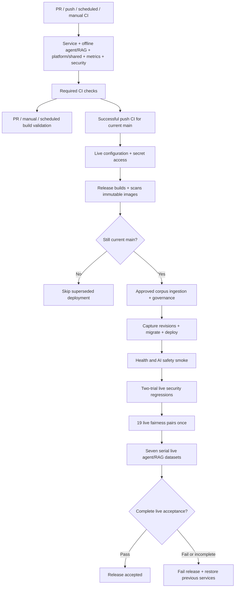

# CI, agent and RAG evaluations

## CI and release entry points

**CI and LLMSecOps** runs service tests, the seven offline agent/RAG suites,
platform/shared contracts, evaluation metrics and security scans directly in
[ci.yml](../.github/workflows/ci.yml). PRs, main pushes, schedules and manual
dispatch use the same required pre-release checks. CI has no paid-live input.
The former separate agent and security workflow entry points are removed;
historical runs retain their original results.

Successful push CI for current `main` starts **Release to AWS**. After immutable
image builds/scans, deployment and health/safety smoke, Release requires all
19 fairness pairs once (38 coaching requests), seven serial agent/RAG datasets and
two-trial live security regressions. Any failure or incomplete required evidence
fails the release and restores changed services' previous task definitions.
Manual CI does not deploy. Documentation-only/no-op releases have no deployment
to evaluate. See [required live release acceptance](post-deployment-acceptance.md)
for configuration, budgets, evidence and rollback limits.

## Jobs inside ci.yml

| Job | Responsibility and dependencies |
|---|---|
| `changes` | Test classifier/baseline helpers, inventory language data, then classify changes since the last actual successful deployment |
| `offline` ×7 | Orchestrator, Spending, Budget, Goal, Investment, Risk & Compliance and RAG; selected after change detection |
| `metrics` | Required LLMSecOps thresholds, including all 19 frozen fairness pairs, and 100-case full-document RAG evidence evaluation |
| `agent-test-gate` | Require selected offline suites, platform/shared contracts, ownership validation and metrics; reject missing/skipped required results |
| `project-security-scan` | Required offline Promptfoo attack/benign controls and provider/grader tests |
| `ai-service` | Explicit platform/shared contracts, complete/disjoint pytest ownership validation and lint |
| `frontend`, `backend` | Each service's own unit/API tests |
| `infrastructure` | Infrastructure/helper/report tests, CloudFormation and Compose validation |
| `service-integration` | PostgreSQL-backed backend-to-AI safety and bounded load checks after service tests |
| `dependency-review`, `python-sast` | Resolved dependency audit and Bandit source scan |
| `container-build` | Build validation for PRs, schedules and manual CI; main pushes build in Release |
| `report` | Always assemble CI conclusions and offline evidence; live acceptance is PENDING until the required release gate runs |

Each selected AI pytest function has one owner. Classifier/baseline tests run in
`changes`; remaining helper/report tests run in `infrastructure`. Provider and
JavaScript grader tests run in `project-security-scan`. Functional metrics and
adversarial cases exercise related behavior with different acceptance criteria.

All 101 AI modules and six shared modules have explicit selectors. There is no
remaining-tests fallback. See [test organization](test-organization.md) for the
owner map and collection checks. Metrics owns full frozen dataset execution;
scorer pytest contracts use small synthetic datasets.

Documentation-only changes still start classification against the deployed
baseline, preserving pending application fixes. Governed RAG Markdown and prompt
runtime changes still select deployment and their required checks.

## Remaining workflows

There are **six repository workflow files**, plus GitHub-managed Dependabot:

| Workflow | Trigger | Purpose |
|---|---|---|
| CI and LLMSecOps | PR, main push, weekly, manual | Required pre-release service, offline agent/RAG, metrics and security checks |
| Release to AWS | Successful push CI for current main | Build/publish/scan images, ingest/audit corpora, migrate, deploy; require smoke, live fairness, agent/RAG and security acceptance; roll back failed releases |
| RAG Source Governance | Weekly, manual | Read-only corpus approval, checksum, freshness and deployed KB audit |
| AWS Operational Validation | Weekly when enabled, manual, reusable | Live service, load, retention, edge and operational controls |
| Model Drift Monitoring | Weekly when enabled, manual | Quality capture/baseline comparison and optional operational alerts |
| Final Assessment | Manual | Repository evidence inventory, then reuse AWS Operational Validation |
| Dependabot Updates | GitHub-managed weekly dependency checks | Propose dependency PRs that still pass CI |

Release checks freshness before building and immediately before deployment.
A superseded release skips deployment. A green no-op cannot advance the deployed
baseline: actual successful service updates, smoke and the required live gate
must complete. Authentication/configuration/API failures fail closed.



Offline suites run in parallel. Release stages have separate jobs; the live
matrix starts after live security and fairness pass, exposes all seven suites with one running at a time and stops queued
work after failure. The workflow retains the release lock through acceptance
and rollback. No live stage uses `continue-on-error`; the final gate and evidence
upload also run on failure. That gate requires successful prerequisite jobs and
complete evidence; a cancelled or skipped suite cannot pass the release.

## Evaluation definitions and acceptance

The executable definitions live in:

- `infra/llmsecops/agent-test-suites.json`: exact ownership of every selected pytest file/function.
- `infra/llmsecops/agent-evaluation-specs.json`: each offline dataset, expected output, metrics and acceptance.
- `apps/ai-service/app/evals/datasets/agent_offline_examples.jsonl`: explicit question/expected-output examples.
- `infra/llmsecops/agent-live-evaluation-specs.json`: each live contract, limits and limitations.
- `infra/llmsecops/agent-live-evaluation-cases.jsonl`: versioned synthetic API requests and expected fields.
- `infra/llmsecops/investment-live-evaluation-cases.jsonl`: six Investment conversations / seven turns.
- `infra/llmsecops/investment-live-rag-cases.jsonl`: three real Bedrock queries and expected source IDs.

Reports record dataset SHA-256 hashes so a lecturer can identify exactly what was
evaluated. Offline helper/validation tests without a conversational question or
answer are labelled **N/A**, not invented model outputs. The reported dialogue
examples execute actual application code with fixture providers. Offline tests
include simulated component integration; these are not live AWS/model tests.

| Component | Offline dataset / expected outputs | Live dataset / expected outputs | Metrics and acceptance |
|---|---|---|---|
| Orchestrator | Routing JSONL, orchestrator and routing regressions, reportable examples; correct routes, overrides, dependencies, safe input | 5 automatic requests: ETF, spending, disposable income, illustrative goal, mixed spending + ETF; exact route and real router/specialist calls | Offline assertions 100%; existing numeric routing accuracy/precision/recall/F1 policy; live 5/5 contracts and exact routing/micro precision/recall/F1 = 1.0 |
| Spending | Analyzer, capture, coverage, integration, compliance regressions; exact aggregates, no fabricated records, safe drafts | 2 requests: food 120 + transport 30, and empty ledger; correct totals/count/month and limitations | Offline assertions 100%; live 2/2, completed `agent_spending` proof for analysis |
| Budget | Planner/method/capture/records/reasoning/review/boundary cases; arithmetic, confirmation, missing input | 2 requests: 4000 − 1500 = 2500; missing income asks for detail | Offline assertions 100%; live 2/2, real `agent_budget` call for calculation |
| Goal Strategy | Capture, capacity, emergency fund, dependency/recovery regressions; correct feasibility and evidence | 2 requests: 6000 / 12 = 500; unspecified goal asks for detail | Offline assertions 100%; live 2/2, real `agent_goal_strategy` call for calculation |
| Investment Education | 30 beginner questions plus education, hybrid, safety/review regressions; safe answers and truthful attribution | 6 conversations / 7 turns: four assets, ETF follow-up, diversification, Chinese, brokerage refusal, injection | Offline assertions 100%; all 7 live turn contracts, citations/history, cleanup; refusal does not require a model call |
| Risk & Compliance | Policy, guardrail and blocks/withholds/allows cases; unsafe requests/answers rejected and safe ones allowed | 2 requests: allow education with completed `risk_compliance` call; refuse regulated advice with deterministic audit | Offline assertions 100%; live 2/2; calling any unrelated model is insufficient |
| RAG | Retriever/local-doc/cache/boundary tests and 8 simulated integration scenarios; full 100-case evidence dataset | 3 direct Bedrock Retrieve queries (ETF, compound interest, diversification), top-5 passages | Offline assertions 100% + existing relevance policy; live hit@5 = 3/3, every hit nonempty/current/approved, AWS request IDs |

The required numeric job preserves the existing LLMSecOps policy and 100-case
full-document RAG evaluation. Their report states per-metric formula, thresholds,
dataset IDs, expected/actual outputs and failing examples. No threshold is lowered
to accommodate live variability.

Live acceptance additionally requires stable ECS tasks with real OpenAI and
Bedrock configuration, consistent deployed SHA for API replies, complete token
accounting, and synthetic-user cleanup. Request timeout is 90 seconds; latency
and token usage are reported descriptively. Each dataset runs once without
harness generation retries; accumulated token budgets stop further requests
(75,000 per general suite; 200,000 for the seven-turn Investment sample). A final
request may cross the budget; these are stop-before-next-request bounds, not
currency caps. Missing usage stops further generation. No claim about account
credit balance or exact dollar cost is made.

**The release gate requires the test SHA and deployed SHA to equal `RELEASE_SHA`.**
The runner checks deployment identity before making model calls and retains stable
build evidence. A small synthetic sample and passing structural contracts do not
establish 99% answer quality; semantic clarity/correctness still needs review.

## Where to review results

CI publishes **`agent-evaluation-report`** with Markdown, full JSON and HTML,
plus per-suite JUnit and evaluation artifacts. Offline/platform/shared evidence
is retained for 90 days; `investment-evaluation-metrics` retains 30 days. CI's
live status is **PENDING — required after deployment in Release to AWS**.

Release publishes **`release-live-acceptance-<run_id>`** for 90 days, including
the aggregate acceptance result, seven full agent reports, fairness answers and
blinded review CSV, live security results and frozen definitions. Inspect the
**Require complete live release acceptance** step and its summary. Missing,
failed, fixture or partial evidence cannot pass or produce a successful release.

Summaries shorten long answers; JSON retains full synthetic responses. No secret,
actual-user history or full ECS environment is retained. Automation passes
structural contracts; human semantic/fairness review remains separately pending.

## Local verification

From the repository root with dependencies installed:

```bash
MODEL_PROVIDER=local_fixture RAG_PROVIDER=local_fixture POLICY_RAG_PROVIDER=local_fixture \
  python infra/scripts/run_agent_tests.py --suite orchestrator --junitxml=artifacts/orchestrator.xml
python -m pytest infra/scripts/tests
```

Replace `orchestrator` with any of the seven suite IDs, `platform`, or `shared`.
Actual pytest collection validates that every case has one explicit owner.
All selected functions remain covered once and other CI tests are not
lost. Harness tests simulate provider/credential failures, failed live artifacts,
real-role proof, budgets, missing evidence and the required offline gate without
making paid calls.

GitHub input/condition semantics:
[workflow syntax](https://docs.github.com/en/actions/reference/workflows-and-actions/workflow-syntax).
