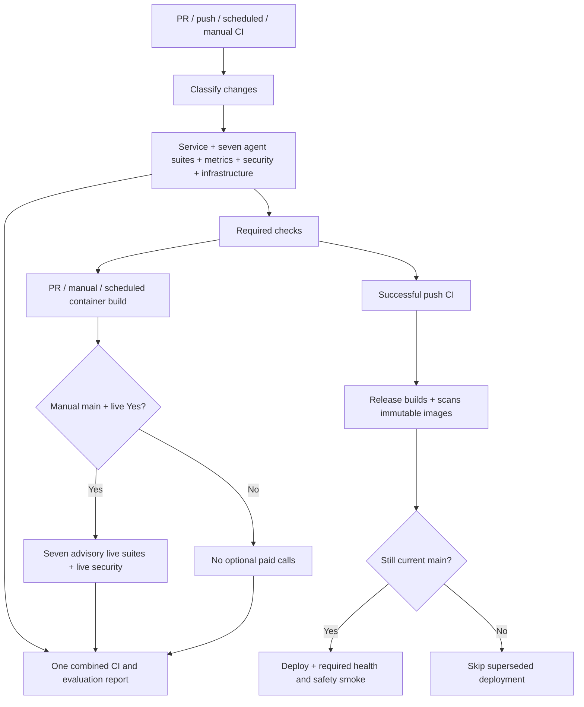

# CI, agent and RAG evaluations

## One entry point

Use **Actions → CI and LLMSecOps → Run workflow → main**. All pre-release
service tests, the seven agent/RAG suites, evaluation metrics and security scans
are defined directly in [ci.yml](../.github/workflows/ci.yml). The former
`agent-evaluations.yml` and `project-security-scan.yml` entry points are removed.
Historical runs remain visible in GitHub.

The **Run paid live evaluations** checkbox defaults to **No**:

| Choice | Execution | Effect |
|---|---|---|
| No | Required offline/fixture tests, security scans and CI validation | No optional paid model or AWS integration evaluations; CI can succeed |
| Yes, manual dispatch on main | The same required checks, then seven bounded live suites and the bounded live security scan | Live failures remain visible but advisory; they do not block deployment |

Automatic PR, push and scheduled CI cannot enable paid evaluation jobs. A new
manual dispatch is required to repeat paid evaluations; rerunning an old job
cannot generate again. Agent live jobs retain the existing `demo` environment
and AWS OIDC role. The security live job retains its separately scoped existing
model-secret role. No new IAM access is added.

This checkbox controls CI's optional evaluations. Required post-deployment smoke
checks and separately invoked operational/monitoring workflows retain their
own controls. Manual CI never triggers AWS release.

## Jobs inside ci.yml

| Job | Responsibility and dependencies |
|---|---|
| `changes` | Test the classifier/baseline helper, inventory language data, then classify changes since the last actual successful deployment |
| `offline` ×7 | Orchestrator, Spending, Budget, Goal, Investment, Risk & Compliance and RAG; selected after change detection |
| `metrics` | Required LLMSecOps thresholds and 100-case full-document RAG evidence evaluation |
| `agent-test-gate` | Require all selected offline suites and metrics to pass; reject missing/skipped required results |
| `project-security-scan` | Required offline Promptfoo attack/benign controls and provider/grader tests |
| `ai-service` | Remaining AI tests, conversational contracts, shared tests and lint; excludes files owned by agent jobs |
| `frontend`, `backend` | Each service's own unit/API tests |
| `infrastructure` | Remaining infrastructure/helper/report tests, CloudFormation and Compose validation |
| `service-integration` | PostgreSQL-backed backend-to-AI safety and bounded load checks after service tests |
| `dependency-review`, `python-sast` | Resolved dependency audit and Bandit source scan |
| `container-build` | Build validation for PRs, schedules and manual CI; skipped on main pushes because Release builds those images |
| `live` ×7 | Optional deployed agent/model/Bedrock contracts, after required CI checks; serial matrix |
| `security-live` | Optional bounded Promptfoo model scan after the live matrix; actual acceptance retained independently of advisory job status |
| `report` | Always assemble job conclusions, all retained evidence, and per-agent questions/expected/actual results in one artifact |

There is one owner for each selected AI pytest function. The two classifier and
baseline tests run early in `changes` and are excluded from `infrastructure`.
Test ownership and report-helper tests run only in `infrastructure`; provider and
JavaScript grader tests run only in `project-security-scan`. Functional metrics
and adversarial cases intentionally exercise related behavior with different
acceptance criteria; they are not duplicate executions of the same pytest suite.

Documentation-only changes still start change detection, which selects no
application deployment when the deployed code is current. README/security guides
are excluded from runtime classification; governed RAG Markdown and prompt
runtime files still trigger appropriate checks and deployment. Comparing against
the deployed baseline preserves pending application fixes even when a newer
commit only updates documentation.

## Remaining workflows

There are **six repository workflow files**, plus GitHub-managed Dependabot:

| Workflow | Trigger | Purpose |
|---|---|---|
| CI and LLMSecOps | PR, main push, weekly, manual | All pre-release testing and the optional live evaluations described above |
| Release to AWS | Successful push CI for current main | Build/publish/scan immutable images, ingest/audit corpora, migrate, deploy and require live safety smoke |
| RAG Source Governance | Weekly, manual | Read-only corpus approval, checksum, freshness and deployed KB audit |
| AWS Operational Validation | Weekly when enabled, manual, reusable | Live service, load, retention, edge and operational controls |
| Model Drift Monitoring | Weekly when enabled, manual | Quality capture/baseline comparison and optional operational alerts |
| Final Assessment | Manual | Repository evidence inventory, then reuse AWS Operational Validation |
| Dependabot Updates | GitHub-managed weekly dependency checks | Propose dependency-update PRs, which still pass through CI |

Release checks freshness before building and immediately before deployment.
A superseded release skips deployment and reports that reason. A green no-op
cannot advance the deployed baseline: successful service-update and safety-smoke
steps are required. Authentication/configuration/API failures still fail closed.



The seven offline jobs can run in parallel. Live agent jobs run serially
(`max-parallel: 1`); live security runs afterward. Deployments preserve their
existing required safety checks and rollback behavior.

## Evaluation definitions and acceptance

The executable definitions live in:

- `infra/llmsecops/agent-test-suites.json`: exact ownership of every selected pytest file/function.
- `infra/llmsecops/agent-evaluation-specs.json`: each offline dataset, expected output, metrics and acceptance.
- `apps/ai-service/app/evals/datasets/agent_offline_examples.jsonl`: explicit question/expected-output examples.
- `infra/llmsecops/agent-live-evaluation-specs.json`: each live contract, limits and limitations.
- `infra/llmsecops/agent-live-evaluation-cases.jsonl`: versioned synthetic API requests and expected fields.
- `infra/llmsecops/investment-live-evaluation-cases.jsonl`: six Investment conversations / seven turns.
- `infra/llmsecops/investment-live-rag-cases.jsonl`: three real Bedrock queries and expected source IDs.

Reports record dataset SHA-256 hashes so a lecturer can identify exactly what was
evaluated. Offline helper/validation tests without a conversational question or
answer are labelled **N/A**, not invented model outputs. The reported dialogue
examples execute actual application code with fixture providers. Offline tests
include simulated component integration; these are not live AWS/model tests.

| Component | Offline dataset / expected outputs | Live dataset / expected outputs | Metrics and acceptance |
|---|---|---|---|
| Orchestrator | Routing JSONL, orchestrator and routing regressions, reportable examples; correct routes, overrides, dependencies, safe input | 5 automatic requests: ETF, spending, disposable income, illustrative goal, mixed spending + ETF; exact route and real router/specialist calls | Offline assertions 100%; existing numeric routing accuracy/precision/recall/F1 policy; live 5/5 contracts and exact routing/micro precision/recall/F1 = 1.0 |
| Spending | Analyzer, capture, coverage, integration, compliance regressions; exact aggregates, no fabricated records, safe drafts | 2 requests: food 120 + transport 30, and empty ledger; correct totals/count/month and limitations | Offline assertions 100%; live 2/2, completed `agent_spending` proof for analysis |
| Budget | Planner/method/capture/records/reasoning/review/boundary cases; arithmetic, confirmation, missing input | 2 requests: 4000 − 1500 = 2500; missing income asks for detail | Offline assertions 100%; live 2/2, real `agent_budget` call for calculation |
| Goal Strategy | Capture, capacity, emergency fund, dependency/recovery regressions; correct feasibility and evidence | 2 requests: 6000 / 12 = 500; unspecified goal asks for detail | Offline assertions 100%; live 2/2, real `agent_goal_strategy` call for calculation |
| Investment Education | 30 beginner questions plus education, hybrid, safety/review regressions; safe answers and truthful attribution | 6 conversations / 7 turns: four assets, ETF follow-up, diversification, Chinese, brokerage refusal, injection | Offline assertions 100%; all 7 live turn contracts, citations/history, cleanup; refusal does not require a model call |
| Risk & Compliance | Policy, guardrail and blocks/withholds/allows cases; unsafe requests/answers rejected and safe ones allowed | 2 requests: allow education with completed `risk_compliance` call; refuse regulated advice with deterministic audit | Offline assertions 100%; live 2/2; calling any unrelated model is insufficient |
| RAG | Retriever/local-doc/cache/boundary tests and 8 simulated integration scenarios; full 100-case evidence dataset | 3 direct Bedrock Retrieve queries (ETF, compound interest, diversification), top-5 passages | Offline assertions 100% + existing relevance policy; live hit@5 = 3/3, every hit nonempty/current/approved, AWS request IDs |

The required numeric job preserves the existing LLMSecOps policy and 100-case
full-document RAG evaluation. Their report states per-metric formula, thresholds,
dataset IDs, expected/actual outputs and failing examples. No threshold is lowered
to accommodate live variability.

Live acceptance additionally requires stable ECS tasks with real OpenAI and
Bedrock configuration, consistent deployed SHA for API replies, complete token
accounting, and synthetic-user cleanup. Request timeout is 90 seconds; latency
and token usage are reported descriptively. Each dataset runs once without
harness generation retries; accumulated token budgets stop further requests
(75,000 per general suite; 200,000 for the seven-turn Investment sample). A final
request may cross the budget; these are stop-before-next-request bounds, not
currency caps. Missing usage stops further generation. No claim about account
credit balance or exact dollar cost is made.

**The tested deployment SHA and workflow/test SHA are separate fields.** Tests
against the existing deployed app do not prove an undeployed commit works. A
small synthetic sample and passing structural contracts also do not establish
99% answer quality; semantic clarity/correctness still needs lecturer review.

## Where to review results

Every offline/live job has its own GitHub **Summary** and artifact. The combined
job uploads **`agent-evaluation-report`**, containing:

- `summary.md`: component status, definitions, questions, expected/actual answers.
- `report.json`: full unabridged evidence, individual outcomes and dataset hashes.
- `index.html`: downloadable evidence view for the presentation.

Per-component artifacts include JUnit XML (offline), JSON, Markdown and live AWS/
model evidence. Retention is **90 days**; the existing numeric metrics artifact
retains its 30-day setting. GitHub summary cells shorten long answers for
readability; full responses stay in JSON. Only explicit synthetic test questions
and responses are captured. Existing non-opted-in evaluation clients continue to
record metadata only. No secret, actual-user history or full ECS environment is
included.

A green manual workflow with a red **live FAIL** in the report is intentional:
offline acceptance passed and optional live evaluation failed. **SKIPPED** means
No was selected; **NOT RUN / INCOMPLETE** means requested evidence was not obtained.
Neither is a live pass.

## Local verification

From the repository root with dependencies installed:

```bash
MODEL_PROVIDER=local_fixture RAG_PROVIDER=local_fixture POLICY_RAG_PROVIDER=local_fixture \
  python infra/scripts/run_agent_tests.py --suite orchestrator --junitxml=artifacts/orchestrator.xml
python -m pytest infra/scripts/tests
```

Replace `orchestrator` with any of the seven suite IDs. Ownership tests ensure
all old selected functions remain covered once and remaining CI tests are not
lost. Harness tests simulate provider/credential failures, failed live artifacts,
real-role proof, budgets, missing evidence and the required offline gate without
making paid calls.

GitHub input/condition semantics:
[workflow syntax](https://docs.github.com/en/actions/reference/workflows-and-actions/workflow-syntax).
