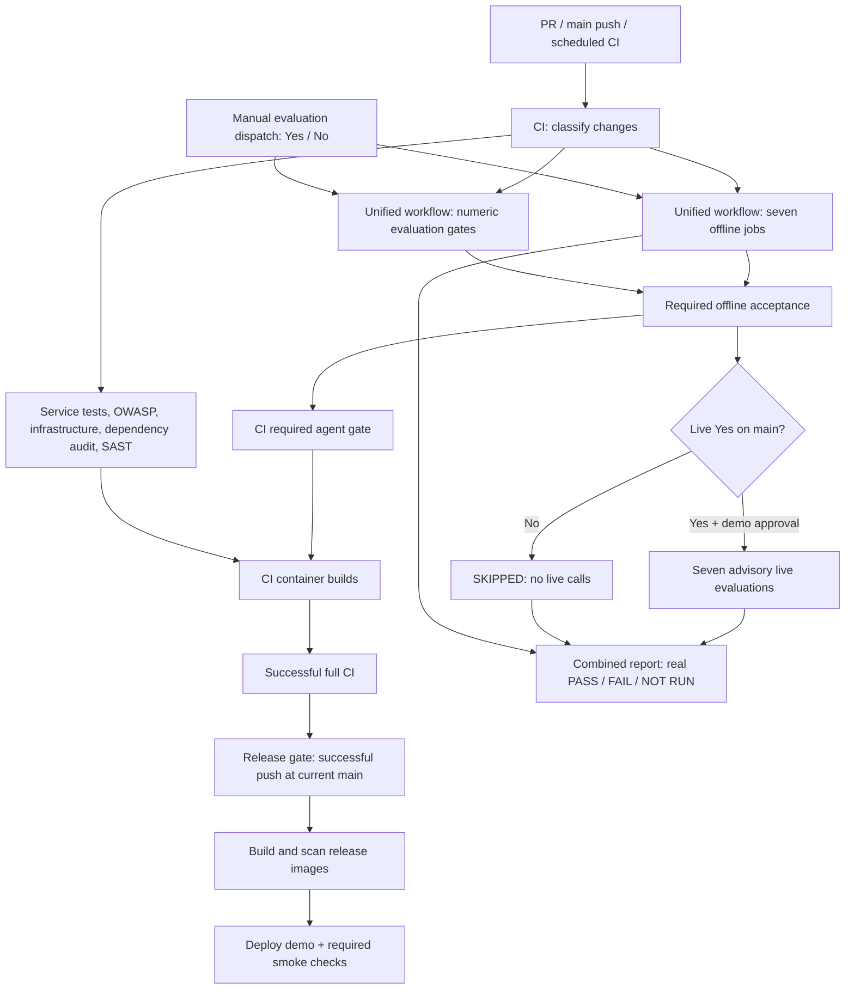

# GitHub Actions: agent evaluations and workflow dependencies

## One workflow for the seven components

Use **Agent and RAG Evaluations** (`agent-evaluations.yml`). It has seven
**offline unit/contract jobs** and seven **optional live integration jobs**:
Orchestrator, Spending, Budget, Goal Strategy, Investment Education,
Risk & Compliance, and RAG. GitHub expands each matrix entry into a separate job.
There are also **Required evaluation metrics**, **Required offline acceptance**,
and **Combined evaluation report** jobs.

To run: **Actions → Agent and RAG Evaluations → Run workflow → main**.
The `Run live integration tests?` checkbox is the Yes/No choice **before dispatch**:

| Choice | Offline jobs | Live jobs | Deployment effect |
|---|---|---|---|
| No / unchecked (default) | Required | SKIPPED; no live credentials or provider requests | Offline success can pass CI |
| Yes / checked | Required | Real deployed API/OpenAI and AWS Bedrock; advisory | Live FAIL is retained but cannot fail the required offline gate |
| Offline failure | FAIL; workflow fails | Not started | Blocks CI and release |
| Live setup/credential failure | Offline result unchanged | NOT RUN/FAIL, with missing evidence identified | Does not block release |

Automatic push/PR/scheduled CI calls the same workflow with `run_live: false`.
No automatic event can enable its live jobs. A manual dispatch on a non-main
branch cannot execute live tests. Re-running an old job cannot repeat paid calls;
start a new manual dispatch and choose Yes to opt in again. Every live job also
retains the existing `demo` environment approval and OIDC permissions. That
approval is a **job-level gate after dispatch**, distinct from the checkbox.
No new IAM role or permissions are created.

This consolidates agent **evaluation** entry points. Deployment smoke,
operational validation, corpus governance and OWASP scanning have separate
purposes and retain their own controls. The checkbox does not disable those
workflows. In particular, existing post-deployment health/security/agent smoke
checks remain required and may roll back a release.

## What existed before consolidation

At the inspected main commit `afd90da8322d099be023926a8758bdb3b4b305a9`, the
repository had **14 workflow files**, plus GitHub's generated Dependabot workflow.

| Former workflow | Jobs | Relationship / disposition |
|---|---|---|
| Reusable Agent Test Suite | `tests` | Shared pytest/report runner; replaced by consolidated offline matrix |
| Spending Agent Tests | `offline`, `functional` (capture/coverage/integration) | Called by CI; now Spending offline |
| Budget Agent Tests | `offline`, `functional` (capture/reasoning/boundaries) | Called by CI; now Budget offline |
| Goal Agent Tests | `offline`, `functional` (feasibility/dependencies/recovery) | Called by CI; now Goal offline |
| Investment Agent Tests | `offline`, `functional`, `routing-and-rag`, `evaluation` | Called by CI; split into Investment, Orchestrator, RAG and numeric metrics |
| Risk & Compliance Agent Tests | `offline`, `functional` (blocks/withholds/allows) | Called by CI; now Risk & Compliance offline |
| Investment Agent Live Integration (one time) | `arm-once` → `live` | Superseded by opt-in Investment/RAG jobs; existing bounded scenario tests reused |
| Budget Live Acceptance | `validate` | Separate manual paid evaluation; superseded by focused Budget live job |

The other six workflow files remain, with the new consolidated file making
**seven maintained workflow files**. Removed workflows may still appear in
GitHub's historical run list; that is not another active test path. Prior Budget
extended datasets and multi-turn runner remain available as specialist scripts;
the new focused live sample does not claim to reproduce that entire older paid
acceptance run. All previously owned **offline tests** remain selected exactly
once.

## Current workflows and every job

| Workflow | Trigger | Jobs and dependencies | Purpose |
|---|---|---|---|
| **CI and LLMSecOps** | PR, main push, weekly, manual | `changes`; `agent-evaluations`; `project-security-scan`; `agent-test-gate`; `ai-service`; `frontend`; `backend`; `infrastructure`; `service-integration`; `container-build`; `dependency-review`; `python-sast` | Required pre-release validation |
| **Agent and RAG Evaluations** | Reusable call from CI; manual | `offline` ×7 and `metrics` in parallel → `required-offline`; optional `live` ×7 after offline acceptance; `report` always after results | Datasets, questions, expected/actual outputs and acceptance evidence |
| **Project OWASP Security Scan** | Reusable call from CI; manual | `promptfoo` and `dispatch-guard`; optional `live` needs both | Offline security scenarios; separately opted-in manual live red-team scan |
| **Release to AWS** | Completion of successful **push** CI on current main | `release-gate` → `build-images` → `deploy-demo` (also needs release-gate) | Build/scan images, ingest approved corpora, deploy three ECS services, smoke checks and rollback |
| **RAG Source Governance** | Weekly, manual | `audit` | Local corpus and deployed Bedrock/S3 approval, integrity and freshness |
| **AWS Operational Validation** | Weekly when enabled, manual, reusable | `validate` | Service/monitoring/lifecycle validation, bounded live/load evidence and optional recovery drill |
| **Final Assessment** | Manual | `repository-evidence` → `operational-evidence` (calls AWS Operational Validation) | Academic evidence inventory tied to assessed main commit |
| **Dependabot Updates** | GitHub-managed dependency schedule | Generated by GitHub, not a repository-authored job graph | Creates dependency update PRs that still need CI |

CI's `changes` job classifies affected services. Its selected service/security
jobs run in parallel. `agent-test-gate` waits for change detection and the unified
evaluations; a selected offline suite cannot be failed, cancelled or skipped.
`service-integration` waits for change detection, AI and backend checks.
`container-build` waits for frontend/backend/AI, the agent gate and OWASP scan.
Dependency audit, SAST, infrastructure and integration also contribute to CI's
overall conclusion. A passing container build alone is not a successful CI run.



Manual evaluations **do not trigger deployment**. Live jobs run serially
(`max-parallel: 1`) to limit pressure on the shared test principal and model
spending. The seven offline jobs can run in parallel.

For detailed scenario explanations, see [Spending](spending-agent-evaluation.md),
[Budget](budget-agent-evaluation.md), [Goal](goal-agent-evaluation.md),
[Investment](investment-agent-evaluation.md), and
[Risk & Compliance](risk-compliance-agent-evaluation.md).

## Evaluation definitions and acceptance

The executable definitions live in:

- `infra/llmsecops/agent-test-suites.json`: exact ownership of every selected pytest file/function.
- `infra/llmsecops/agent-evaluation-specs.json`: each offline dataset, expected output, metrics and acceptance.
- `apps/ai-service/app/evals/datasets/agent_offline_examples.jsonl`: explicit question/expected-output examples.
- `infra/llmsecops/agent-live-evaluation-specs.json`: each live contract, limits and limitations.
- `infra/llmsecops/agent-live-evaluation-cases.jsonl`: versioned synthetic API requests and expected fields.
- `infra/llmsecops/investment-live-evaluation-cases.jsonl`: six Investment conversations / seven turns.
- `infra/llmsecops/investment-live-rag-cases.jsonl`: three real Bedrock queries and expected source IDs.

Reports record dataset SHA-256 hashes so a lecturer can identify exactly what was
evaluated. Offline helper/validation tests without a conversational question or
answer are labelled **N/A**, not invented model outputs. The reported dialogue
examples execute actual application code with fixture providers. Offline tests
include simulated component integration; these are not live AWS/model tests.

| Component | Offline dataset / expected outputs | Live dataset / expected outputs | Metrics and acceptance |
|---|---|---|---|
| Orchestrator | Routing JSONL, orchestrator and routing regressions, reportable examples; correct routes, overrides, dependencies, safe input | 5 automatic requests: ETF, spending, disposable income, illustrative goal, mixed spending + ETF; exact route and real router/specialist calls | Offline assertions 100%; existing numeric routing accuracy/precision/recall/F1 policy; live 5/5 contracts and exact routing/micro precision/recall/F1 = 1.0 |
| Spending | Analyzer, capture, coverage, integration, compliance regressions; exact aggregates, no fabricated records, safe drafts | 2 requests: food 120 + transport 30, and empty ledger; correct totals/count/month and limitations | Offline assertions 100%; live 2/2, completed `agent_spending` proof for analysis |
| Budget | Planner/method/capture/records/reasoning/review/boundary cases; arithmetic, confirmation, missing input | 2 requests: 4000 − 1500 = 2500; missing income asks for detail | Offline assertions 100%; live 2/2, real `agent_budget` call for calculation |
| Goal Strategy | Capture, capacity, emergency fund, dependency/recovery regressions; correct feasibility and evidence | 2 requests: 6000 / 12 = 500; unspecified goal asks for detail | Offline assertions 100%; live 2/2, real `agent_goal_strategy` call for calculation |
| Investment Education | 30 beginner questions plus education, hybrid, safety/review regressions; safe answers and truthful attribution | 6 conversations / 7 turns: four assets, ETF follow-up, diversification, Chinese, brokerage refusal, injection | Offline assertions 100%; all 7 live turn contracts, citations/history, cleanup; refusal does not require a model call |
| Risk & Compliance | Policy, guardrail and blocks/withholds/allows cases; unsafe requests/answers rejected and safe ones allowed | 2 requests: allow education with completed `risk_compliance` call; refuse regulated advice with deterministic audit | Offline assertions 100%; live 2/2; calling any unrelated model is insufficient |
| RAG | Retriever/local-doc/cache/boundary tests and 8 simulated integration scenarios; full 100-case evidence dataset | 3 direct Bedrock Retrieve queries (ETF, compound interest, diversification), top-5 passages | Offline assertions 100% + existing relevance policy; live hit@5 = 3/3, every hit nonempty/current/approved, AWS request IDs |

The required numeric job preserves the existing LLMSecOps policy and 100-case
full-document RAG evaluation. Their report states per-metric formula, thresholds,
dataset IDs, expected/actual outputs and failing examples. No threshold is lowered
to accommodate live variability.

Live acceptance additionally requires stable ECS tasks with real OpenAI and
Bedrock configuration, consistent deployed SHA for API replies, complete token
accounting, and synthetic-user cleanup. Request timeout is 90 seconds; latency
and token usage are reported descriptively. Each dataset runs once without
harness generation retries; accumulated token budgets stop further requests
(75,000 per general suite; 200,000 for the seven-turn Investment sample). A final
request may cross the budget; these are stop-before-next-request bounds, not
currency caps. Missing usage stops further generation. No claim about account
credit balance or exact dollar cost is made.

**The tested deployment SHA and workflow/test SHA are separate fields.** Tests
against the existing deployed app do not prove an undeployed commit works. A
small synthetic sample and passing structural contracts also do not establish
99% answer quality; semantic clarity/correctness still needs lecturer review.

## Where to review results

Every offline/live job has its own GitHub **Summary** and artifact. The combined
job uploads **`agent-evaluation-report`**, containing:

- `summary.md`: component status, definitions, questions, expected/actual answers.
- `report.json`: full unabridged evidence, individual outcomes and dataset hashes.
- `index.html`: downloadable evidence view for the presentation.

Per-component artifacts include JUnit XML (offline), JSON, Markdown and live AWS/
model evidence. Retention is **90 days**; the existing numeric metrics artifact
retains its 30-day setting. GitHub summary cells shorten long answers for
readability; full responses stay in JSON. Only explicit synthetic test questions
and responses are captured. Existing non-opted-in evaluation clients continue to
record metadata only. No secret, actual-user history or full ECS environment is
included.

A green manual workflow with a red **live FAIL** in the report is intentional:
offline acceptance passed and optional live evaluation failed. **SKIPPED** means
No was selected; **NOT RUN / INCOMPLETE** means requested evidence was not obtained.
Neither is a live pass.

## Local verification

From the repository root with dependencies installed:

```bash
MODEL_PROVIDER=local_fixture RAG_PROVIDER=local_fixture POLICY_RAG_PROVIDER=local_fixture \
  python infra/scripts/run_agent_tests.py --suite orchestrator --junitxml=artifacts/orchestrator.xml
python -m pytest infra/scripts/tests
```

Replace `orchestrator` with any of the seven suite IDs. Ownership tests ensure
all old selected functions remain covered once and remaining CI tests are not
lost. Harness tests simulate provider/credential failures, failed live artifacts,
real-role proof, budgets, missing evidence and the required offline gate without
making paid calls.

GitHub input/condition semantics:
[workflow syntax](https://docs.github.com/en/actions/reference/workflows-and-actions/workflow-syntax).
