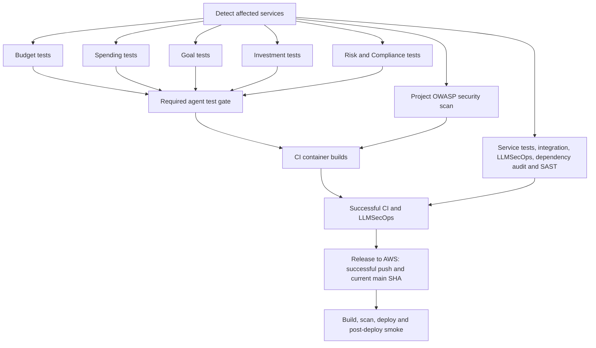

# Agent test workflows and release integration

GitHub Actions runs the Python tests in the repository. A workflow selects files
(and sometimes a pytest `-k` expression), installs dependencies, runs pytest and
publishes the result. It does not contain a separate implementation of the tests.
The Agent workflows run their owned tests. CI runs the remaining AI tests and
the backend, frontend and shared test suites when their services are affected.
Together the jobs cover the full `apps/ai-service/tests` directory.

## Workflows on main

All five named workflows expose `workflow_call` and `workflow_dispatch`.
**CI and LLMSecOps** owns automatic push, pull-request, scheduled and manual CI
execution. Individual workflows remain available for manual troubleshooting.
This avoids a second automatic run of each focused workflow alongside CI.
Agent tests execute in the Agent workflows, with their own reports and release
dependencies. The general AI test job excludes those files, and also excludes
the conversational contract file that has its own CI step.

The shared workflow is `.github/workflows/agent-test-suite.yml`. Test ownership
is defined once in `infra/llmsecops/agent-test-suites.json`, and
`infra/scripts/run_agent_tests.py` applies it to both agent and remaining test runs.
Each agent has an
offline contract job and three functional groups. Every job is offline, including
the functional groups: tests use local fixture or scripted gateways and retrievers.
They need no OpenAI key or AWS credentials and do not evaluate live answer quality.

All test paths below are relative to `apps/ai-service/tests/`.

| Workflow | Job/group | Test files | What it checks |
| --- | --- | --- | --- |
| Spending | Offline | `test_spending_analyzer.py` | Category trends, temporal patterns, anomaly detection and empty inputs |
| Spending | Capture | `test_spending_capture.py` | Unsaved drafts, explicit review, period scope, missing dates/amounts and clarification |
| Spending | Coverage | `test_spending_coverage.py` | Dated records, selected-month totals, sparse history and future-record exclusion |
| Spending | Integration | `test_spending_integration.py`, `test_risk_spending_coverage.py` | Statistical analysis, data quality and independent compliance veto |
| Budget | Offline | `test_budget_agent.py`, `test_budget_planner.py`, `test_budget_methods.py` | Arithmetic after commitments, preserved user amounts, shortfalls, missing information and what-if calculations |
| Budget | Capture | `test_budget_capture.py`, `test_budget_records.py` | Drafts, corrections, saved records, currency and calendar scope |
| Budget | Reasoning | `test_budget_reasoning.py`, `test_budget_review.py` | Categories, history, capacity, clarification and review routing |
| Budget | Boundaries | `test_edge_budget_regressions.py` | Evidence for read-only records, rejected mutation fields and qualified calculations when education is unavailable |
| Goal | Offline | `test_goal_capture.py`, `test_saved_budget_capacity.py` | Create/delete drafts, follow-up details, currency and confirmed savings capacity without double subtraction |
| Goal | Feasibility | `test_emergency_fund.py` | Emergency-fund evidence, dated spending, separate balances/currencies and execution refusal |
| Goal | Dependencies | `test_dynamic_dependencies.py` | Goal requests to Budget, required capabilities, dependency resumption, fan-in and optional failures |
| Goal | Recovery | `test_goal_education_recovery.py` | Goal references, combined affordability and education, bounded correction, model failures and token/usage limits |
| Investment | Offline | `test_investment_education_safety.py`, `test_investment_review_regressions.py` | Advice/execution/return guarantees, independent review and citation integrity |
| Investment | Beginner | `test_beginner_investment_questions.py` | Thirty learner scenarios plus dataset integrity |
| Investment | Education | `test_investment_education_agent.py` | Topic retrieval, privacy, sources, missing evidence and education output contracts |
| Investment | Hybrid | `test_hybrid_investment_education.py` | Grounded and general explanations, attribution, follow-ups, synthesis and independent safety review |
| Risk & Compliance | Offline | `test_risk_compliance.py`, `test_guardrails.py` | Policy rules and request guardrails |
| Risk & Compliance | Blocks | `test_risk_compliance_functional.py`, `-k test_blocks_unsafe_request` | Refuse unsafe requests before model review |
| Risk & Compliance | Withholds | Same file, `-k test_withholds_unsafe_answer` | Withhold unsafe drafts, invalid evidence and citations |
| Risk & Compliance | Allows | Same file, `-k test_allows_safe_answer` | Allow safe education and budgeting with sources |

Shared Budget/Goal capacity cases belong to Budget; shared guardrails belong to
Risk & Compliance. A file has one owner, except the compliance functional file,
which has three disjoint scenario groups. CI validates that every test function
in owned files is covered exactly once, so a newly added unmatched compliance
scenario cannot silently be excluded from testing. New files outside the manifest
automatically run in the remaining AI suite.

Each job uploads JUnit XML and a Markdown report for 30 days and appends the report
to its Actions summary. The summary includes test name, outcome and failure
reason. Question/response cells are populated only by tests that explicitly record
those JUnit properties; other tests show a dash.

## The Investment workflow already visible in Actions

The remote-tracking `codex/investment-agent-tests` branch inspected during this
change contains an earlier workflow that is absent from the main checkout:

- Offline: `test_manual_investment_injection.py`, `test_guardrails.py`,
  `test_risk_compliance.py`, `test_investment_live_contract.py`.
- Functional: `test_investment_functional.py`, split by
  `test_beginner_investor_functional`, `test_intermediate_investor_functional`
  and `test_specialist_investor_functional`.
- Optional live: `test_investment_agent_live.py`, enabled manually with
  `run_live=true` on main, using an AWS OIDC role and an OpenAI secret.

Those branch-only investment test files and reporting hooks have not been
merged here. The OWASP scan and its targeted guardrail/compliance fixes have been
ported while preserving newer main-branch controls. The new reusable Investment workflow uses current main's test files
listed above. Its groups are not the earlier beginner/intermediate/specialist
matrix, and it does not import that branch's optional paid evaluation.
That branch should be reconciled with this reusable workflow when merged.

## CI, LLMSecOps and AWS release



CI calls all five workflows when `ai_ci=true` or `deploy=true`. This includes
frontend/backend-only application changes because AWS recovery releases rebuild
all three services from the tested commit. Scheduled and manually dispatched CI
runs also select all suites. Infrastructure-only changes with neither flag may
skip the agent suites.

The aggregate gate runs even after an upstream failure. If agent tests are
required, every suite must succeed; failed, cancelled or skipped suites reject the
gate. Change detection must also succeed. Container builds depend on that gate
and a successful Project OWASP security scan. The scan adds security scenarios;
its former duplicate backend/frontend pytest companion jobs have been removed.
No passing manual agent run can substitute for the suites in the release's CI run.

AWS release already listens to completion of **CI and LLMSecOps** and requires
success, a push event and the current main SHA. Therefore a failed agent suite
prevents release through CI's conclusion; no cross-workflow polling or separate
deployment trigger is needed. PR, scheduled and manually dispatched CI runs do not
deploy. Changes confined to the six agent workflow definitions, including the shared runner, run AI,
infrastructure and SAST checks without selecting deployment.

The LLMSecOps policy gate additionally evaluates JSONL datasets and enforces
metric minimums/regression limits from `infra/llmsecops/evaluation-policy.json`.
These are separate dataset evaluations, not simply pytest test files. The focused
agent reports complement those metrics; they do not replace them.

**Budget Live Acceptance** remains a manual evaluation of the deployed model.
Other live evaluations and AWS post-deploy smoke checks remain separate from
these offline pre-release tests.

## Local execution and validation

Run a group's listed files from `apps/ai-service`, for example:

```powershell
C:/ai-financial-wellness-coach/.venv/Scripts/python.exe -X utf8 -m pytest tests/test_budget_agent.py tests/test_budget_planner.py tests/test_budget_methods.py -vv
C:/ai-financial-wellness-coach/.venv/Scripts/python.exe -X utf8 -m pytest tests/test_goal_capture.py tests/test_saved_budget_capacity.py -vv
```

Selection checks in `infra/scripts/tests/test_agent_test_selection.py` verify
coverage, duplicate ownership and the exclusions applied to the general AI job.
Workflow
gate tests in `infra/scripts/tests/test_agent_test_gate.py` exercise failure,
cancellation, unexpected skipping, change-detection failure and frontend-only
release selection using Linux Bash or Git Bash on Windows. They skip if a
supported shell is unavailable. GitHub Actions execution must still be verified after these changes
are pushed.
