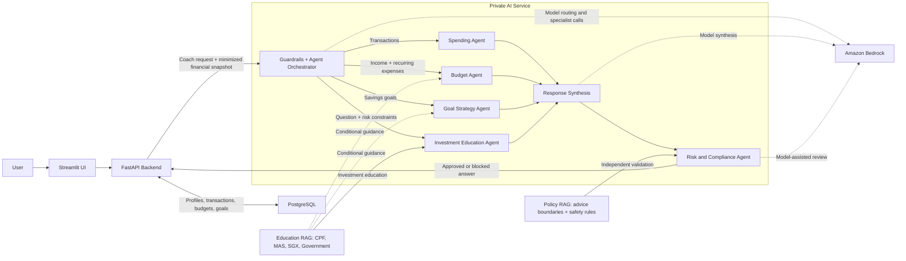
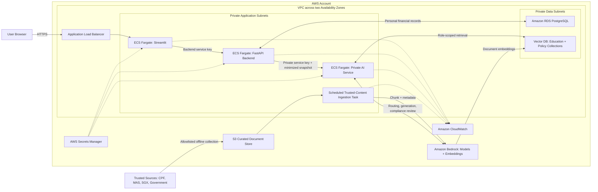

# Architecture

## Target Logical View

PostgreSQL is the system of record for personal financial data. The application backend owns database access and sends only a minimized, request-scoped financial snapshot to the private AI service. Agents do not connect directly to PostgreSQL: Spending receives transactions, Budget receives income and recurring expenses, Goal Strategy receives savings goals, and Investment Education receives only the sanitized question and relevant risk constraints.

The target retrieval design separates educational knowledge from policy controls. Investment Education can retrieve trusted CPF, MAS, SGX, and government education content. Budget and Goal Strategy can retrieve only relevant education content when deterministic financial data is insufficient. Spending does not use RAG. Risk and Compliance independently retrieves advice-boundary and safety policy before approving or blocking the synthesized response.

Investment Education now has a dedicated `education_retriever`, an offline fixture for local and CI execution, and a Bedrock Knowledge Base adapter for deployed environments. Retrieved source metadata is retained through synthesis, Compliance review, the API response, and the Streamlit UI. The separate managed policy collection and conditional Budget and Goal Strategy permissions remain implementation work; the legacy Compliance retriever still uses packaged controlled data.

## Target Physical AWS View

The target architecture terminates TLS at the ALB and keeps ECS tasks and data stores in private subnets. Its security groups permit only ALB-to-Streamlit, Streamlit-to-backend, backend-to-AI, backend-to-PostgreSQL, and AI-to-vector traffic. The AI service is not exposed to the browser or public load balancer.

Trusted CPF, MAS, SGX, and government documents enter through an allowlisted offline collection process. Curated source files are retained in S3, a scheduled ingestion task validates and chunks them, Amazon Bedrock produces embeddings, and the private vector database stores separate education and policy collections. Runtime AI tasks receive read-only, role-scoped retrieval access; they cannot ingest arbitrary user or web content.

The provisioned minimum demo intentionally differs: it uses an HTTP ALB and three single-task Fargate services in public subnets to avoid NAT Gateway cost. Each task receives a public IP for outbound AWS service access, but security groups deny direct internet ingress. A Single-AZ encrypted RDS PostgreSQL instance runs without a public address in two dedicated database subnets; only the backend security group can connect. The deployment accepts an externally provisioned Education Knowledge Base ID and grants the AI task read-only retrieval; provisioning its S3 data source and vector index remains an explicit prerequisite. The AI service is not ALB-exposed; successful backend coaching verifies the private service-discovery hop end to end. Use synthetic data only until TLS, end-user identity, and the target private application network are implemented.

The synthetic demo uses a backend service key. Before real users, the public application boundary moves to OIDC/JWT identity and authorization while the independent backend-to-AI credential remains a service secret.

## Service Boundaries

- Streamlit frontend: provides Overview, Transactions, Budget, Goals, Coach, and Profile workflows; calls the application backend server-side; and presents answers, source citations, rationale, confidence, disclaimers, and audit metadata.
- FastAPI application backend: owns user-facing APIs, access control, profiles, transactions, monthly budgets, goals, dashboard summaries, coaching snapshots, and PostgreSQL persistence workflows. It is the only application service allowed to call the AI service.
- FastAPI AI service: validates internal requests, orchestrates agents, applies shared guardrails, enforces agent-specific retrieval permissions, and integrates with Bedrock.
- Data services: PostgreSQL stores synthetic personal financial records, chat messages, and privacy-safe orchestration traces; S3 retains curated source documents; and the future vector store separates education content from policy and safety controls.
- AWS boundary: ECS runs the three application services and scheduled ingestion task, Secrets Manager supplies separate service credentials, Bedrock supplies generation and embedding models, and CloudWatch captures operational telemetry. GitHub Actions, ECR publishing, and protected deployment remain documented separately in `docs/cicd-pipeline.md`.

Each FastAPI health endpoint is available for load balancer checks. Both coaching boundaries require an `X-API-Key`: Streamlit receives only `BACKEND_API_KEY`, while the backend receives `AI_SERVICE_API_KEY`. The AI service remains on private networking and is not exposed to the browser or public load balancer.

## Architecture Decision

The original proposal specified Angular, Spring Boot, and a separate Python AI service. The implementation uses Streamlit for presentation, FastAPI for the application backend, and FastAPI for the private multi-agent service. Python reduces language overhead while the explicit backend/AI boundary preserves separate ownership, scaling, security, and deployment concerns.

Streamlit scales for concurrent UI sessions, the backend scales for application traffic, and the AI service scales for model-bound workloads. The backend persistence boundary can add identity and audit workflows without coupling those concerns to agent orchestration.

ECS Fargate remains preferable to EKS for the initial scope because there are only three independently scalable services and no Kubernetes-specific platform requirement. The minimum demo uses two-AZ subnet placement, health checks, managed rolling deployment, circuit-breaker rollback, and stateless service design with less operational overhead. Its desired count of one per service is cost-minimal, not highly available; raise the count to at least two and add autoscaling for an availability test or production. Revisit EKS if independently owned agent workloads require Kubernetes scheduling, policy, or ecosystem capabilities.

## Orchestration

The implemented LangGraph workflow is `guard_input -> route -> initialize_tasks -> run_ready_tasks -> resolve_dependencies -> run_ready_tasks -> synthesize -> review_compliance -> finalize`. Dependency resolution loops only while a validated request remains outstanding. Independent ready tasks run concurrently; a dependent task resumes only after its required capabilities have resolved. The router, prompt-v3 dependency decisions, specialist narratives, synthesis, and compliance review are model calls with non-zero temperatures. The graph can select one or more initial specialists and add an allowlisted provider when a specialist dynamically requests a capability.

Hard boundary controls run before the first model call. Each specialist receives a role-scoped task and minimized deterministic grounding. Specialists cannot call one another or select the next specialist: they return a typed `ready`, `needs_dependency`, or `needs_input` result, and the orchestrator alone authorizes, schedules, deduplicates, traces, and resolves it. Goal Strategy can request Budget's `monthly_savings_capacity`; Budget can then request Spending's `transaction_category_totals`, demonstrating a centrally governed multi-hop dependency. Required failures fail closed, optional failures resume with a warning, and execution is bounded by retries, backoff, timeouts, provider calls, model calls, and model tokens. Investment Education alone can retrieve approved education context, and the same sanitized evidence is supplied to Risk and Compliance for independent validation. Structured model responses are schema-validated, and the independent compliance result can block the draft before release. Local and CI integration use an explicitly configured offline fixture; ECS requires the Bedrock model and RAG providers.

Every completed run emits a privacy-safe trace containing task lifecycle events, dependency edges and resolutions, selected agents, model/prompt identity, model-call durations, and token usage. The backend stores that trace against the profile-scoped session and assistant message; an API-key-protected endpoint retrieves it only when the requested user owns the associated profile. Raw prompts and financial grounding are not copied into the trace.

The next retrieval phase keeps deterministic grounding as the default while adding conditional Education access for Budget and Goal Strategy and a separate managed Policy collection for Risk and Compliance. Spending remains retrieval-free. Personal financial records remain in PostgreSQL and are never embedded into the education or policy stores.

## MCP And A2A Position

MCP is relevant when the system needs a standard way to expose retrieval, budget calculators, policy engines, or external data connectors. The current AI service uses an internal tool registry and allowlist first. MCP can be added later at that boundary if it improves governance and integration reuse.

A2A becomes relevant if agents are independently deployed services owned by different teams or runtimes. The current implementation keeps agents in one FastAPI service for lower latency and simpler auditability.
