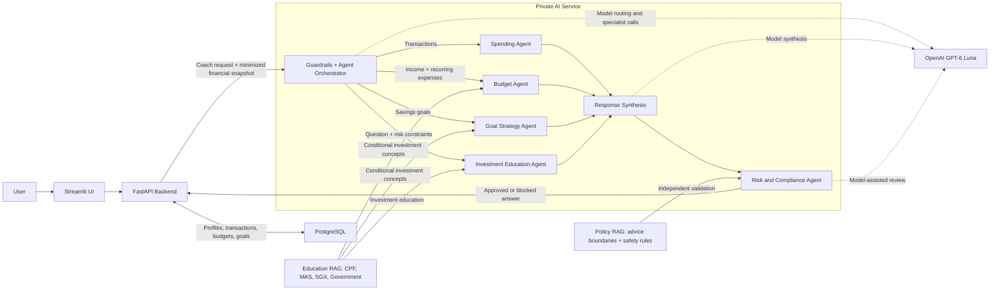
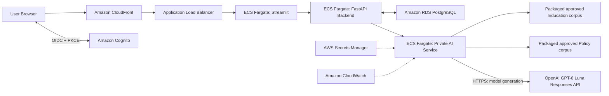

# Architecture

## Implemented Logical View

PostgreSQL is the system of record for personal financial data. The application backend owns database access and sends only a minimized, request-scoped financial snapshot to the private AI service. Agents do not connect directly to PostgreSQL: Spending receives transactions, Budget receives income and recurring expenses, Goal Strategy receives savings goals, and Investment Education receives only the sanitized question and relevant risk constraints.

The retrieval design separates educational knowledge from policy controls. Investment Education can retrieve trusted CPF, MAS, SGX, and government education content. Budget and Goal Strategy retrieve only when the user explicitly asks about an allowlisted investment concept relevant to their calculation. Spending does not use RAG. Risk and Compliance independently retrieves advice-boundary and safety policy before approving or blocking the synthesized response.

Investment Education has a dedicated `education_retriever`; Budget and Goal Strategy can request the same governed retriever through the orchestrator's typed `education_context` capability; Risk and Compliance has an independently allowlisted `policy_retriever`. Both collections provide offline fixtures for local and CI execution and checksum-verified, version-pinned local-document retrievers for deployed environments. Education citations remain user-facing, while Policy evidence is retained separately in the Compliance result and privacy-safe trace. Spending remains retrieval-free.

## Implemented Physical AWS View

The target architecture terminates TLS at the ALB and keeps ECS tasks and data stores in private subnets. Its security groups permit only ALB-to-Streamlit, Streamlit-to-backend, backend-to-AI, backend-to-PostgreSQL, and AI-to-vector traffic. The AI service is not exposed to the browser or public load balancer.

Trusted CPF and MoneySense documents and the separate operating policies are packaged with the AI image. Their reviewed manifests, SHA-256 checksums, freshness, usage scope, and indirect-injection controls are verified at startup and retrieval. Runtime requests cannot ingest arbitrary user or web content, and the two retrievers remain role-scoped.

The provisioned minimum demo intentionally keeps three single-task Fargate services in public subnets to avoid NAT Gateway cost. CloudFront provides the public HTTPS URL in front of the ALB, and Cognito provides an admin-created-user OIDC boundary. Each task receives a public IP for outbound AWS service access, but security groups deny direct task ingress. A Single-AZ encrypted RDS PostgreSQL instance runs without a public address in two dedicated database subnets; only the backend security group can connect. The deployment consumes the image-packaged Education and Policy corpora with exact corpus pins. The AI service is not ALB-exposed; successful backend coaching verifies the private service-discovery hop end to end. The edge-hardening path restricts ALB ingress to AWS's CloudFront origin-facing managed prefix list and requires a generated CloudFront origin header before listener rules forward. Optional custom-domain activation uses modern viewer TLS and an HTTPS ALB origin with a separate regional certificate.

Authentication rollout is deliberately staged. First, compatible images and the nullable ownership migration are released while the existing task configuration still accepts the automation key. Then `activate_user_auth.ps1` verifies the exact released SHA, applies the migration, provisions Cognito/CloudFront, enables strict JWT validation, and removes the automation credential from Streamlit. The backend accepts exact-issuer, exact-audience RS256 Cognito ID tokens and stores `(issuer, subject)` on each newly created profile. Legacy unowned profiles cannot be claimed. Resource mismatches return a non-enumerating 404. The automation key remains backend-only and is constrained to configured synthetic user-ID prefixes outside local development; the independent backend-to-AI credential is unchanged.

## Service Boundaries

- Streamlit frontend: provides Overview, Transactions, Budget, Goals, Coach, and Profile workflows; calls the application backend server-side; and presents answers, source citations, rationale, confidence, disclaimers, and audit metadata.
- FastAPI application backend: owns user-facing APIs, access control, profiles, transactions, monthly budgets, goals, dashboard summaries, coaching snapshots, and PostgreSQL persistence workflows. It is the only application service allowed to call the AI service.
- FastAPI AI service: validates internal requests, orchestrates agents, applies shared guardrails, enforces agent-specific retrieval permissions, and integrates with the OpenAI Responses API.
- Data services: PostgreSQL stores synthetic personal financial records, chat messages, and privacy-safe orchestration traces; the AI image contains separate governed Education and Policy corpora, preserving their role and citation boundaries.
- AWS boundary: ECS runs the three application services, Secrets Manager supplies separate service credentials, OpenAI supplies model generation, and CloudWatch captures operational telemetry. Corpus changes require a reviewed image release and a manifest/checksum update. ECR publishing and protected deployment remain documented separately in `docs/cicd-pipeline.md`.

Each FastAPI health endpoint is available for load balancer checks. After activation, the browser authenticates through Streamlit, Streamlit forwards only the exposed ID token to the backend, and the frontend task no longer receives `BACKEND_API_KEY`. The backend validates signature, issuer, audience, expiry, issued-at time, and Cognito `token_use=id` before checking profile ownership. GitHub smoke and operational jobs continue to use the backend-only automation key for allowlisted synthetic identities. The backend receives `AI_SERVICE_API_KEY` for the separate private AI boundary; the AI service remains unexposed to the browser and public load balancer.

## Architecture Decision

The original proposal specified Angular, Spring Boot, and a separate Python AI service. The implementation uses Streamlit for presentation, FastAPI for the application backend, and FastAPI for the private multi-agent service. Python reduces language overhead while the explicit backend/AI boundary preserves separate ownership, scaling, security, and deployment concerns.

Streamlit scales for concurrent UI sessions, the backend scales for application traffic, and the AI service scales for model-bound workloads. The backend persistence boundary can add identity and audit workflows without coupling those concerns to agent orchestration.

ECS Fargate remains preferable to EKS for the initial scope because there are only three independently scalable services and no Kubernetes-specific platform requirement. The minimum demo uses two-AZ subnet placement, health checks, managed rolling deployment, circuit-breaker rollback, and stateless service design with less operational overhead. Backend and AI CPU target tracking can scale from one to two tasks, but a minimum of one remains cost-oriented and is not highly available; raise minimum capacity to at least two and validate scaling/recovery evidence for an availability test or production. Revisit EKS if independently owned agent workloads require Kubernetes scheduling, policy, or ecosystem capabilities.

## Orchestration

The implemented LangGraph workflow is `guard_input -> route -> initialize_tasks -> run_ready_tasks -> resolve_dependencies -> run_ready_tasks -> synthesize -> review_compliance -> finalize`. Dependency resolution loops only while a validated request remains outstanding. Independent ready tasks run concurrently; a dependent task resumes only after its required capabilities have resolved. The router, prompt-v6 dependency decisions, specialist narratives, synthesis, and compliance review call GPT-6 Luna at low reasoning effort; the OpenAI gateway omits temperature. The graph can select one or more initial specialists and add an allowlisted agent provider or invoke an allowlisted tool provider when a specialist dynamically requests a capability.

Hard boundary controls run before the first model call. Each specialist receives a role-scoped task and minimized deterministic grounding. Specialists cannot call one another or select the next specialist: they return a typed `ready`, `needs_dependency`, or `needs_input` result, and the orchestrator alone authorizes, schedules, invokes, deduplicates, traces, and resolves it. Goal Strategy can request Budget's `monthly_savings_capacity`; Budget can then request Spending's `transaction_category_totals`, demonstrating a centrally governed multi-hop dependency. Budget and Goal Strategy can request `education_context` only when deterministic topic detection finds an allowlisted investment concept. The orchestrator sends only canonical topic labels to the Education corpus, reuses one result for identical input, and records a tool dependency edge without scheduling Investment Education. Required failures fail closed; optional Education failure preserves calculations and produces an explicit evidence gap. Execution is bounded by retries, backoff, timeouts, dependency rounds, provider calls, model calls, and model tokens. The sanitized evidence is supplied to Risk and Compliance for independent validation. Structured model responses are schema-validated, and the independent compliance result can block the draft before release. Local and CI integration use an explicitly configured offline fixture; ECS requires the OpenAI model provider and both governed local-document retrievers.

Every completed run emits a privacy-safe trace containing task lifecycle events, dependency edges and resolutions, selected agents, model/prompt identity, model-call durations, and token usage. The backend stores that trace against the profile-scoped session and assistant message; JWT ownership enforcement or constrained synthetic automation scope protects retrieval, export, and deletion. The versioned lifecycle policy keeps traces for 30 days and conversations for 90 days, while explicit workspace or chat deletion cascades to their traces. Raw prompts, identity tokens, and financial grounding are not copied into the trace.

Conditional Education access for Budget and Goal Strategy is implemented while deterministic grounding remains authoritative. Personal amounts and records are excluded from the topic-only retrieval query; Spending remains retrieval-free; and personal financial records remain in PostgreSQL rather than the Education or Policy stores.

## MCP And A2A Position

MCP is relevant when the system needs a standard way to expose retrieval, budget calculators, policy engines, or external data connectors. The current AI service uses an internal tool registry and allowlist first. MCP can be added later at that boundary if it improves governance and integration reuse.

A2A becomes relevant if agents are independently deployed services owned by different teams or runtimes. The current implementation keeps agents in one FastAPI service for lower latency and simpler auditability.
