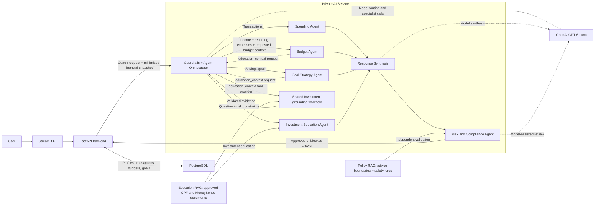
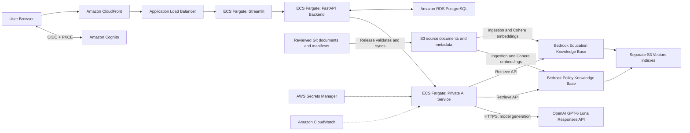

# Architecture

## Implemented Logical View

Coach resolves requested budget calendar scopes before specialist tasks. Backend-owned monthly plans and capacity contexts are selected by the requested month, month range, year or all-saved scope; the sidebar month supplies a default only when no period is named. Goal feasibility keeps each monthly savings pool separate. Saved-budget reads/comparisons and exact edit/delete proposals use the typed `budgets` workspace command. The backend validates ownership, preserves unspecified values, previews every affected month and applies confirmed mutations atomically with the chat exchange. See [budget scope contracts](budget-planning.md#saved-budgets-across-months-and-years).

Ordinary Budget reasoning receives the scoped saved category limits, planning values and protected minimums. Owned monthly expense aggregates align Spending dependencies with that same scope and keep prior history separate, including when the requested month has no recorded transactions. Spending dependencies become eligible only when scoped or historical transaction counts show recorded expenses. Full expense/plan catalogs are removed before specialist scheduling; unrelated workspace settings are omitted from ordinary advice. Capability fingerprints include dates, historical records and scoped aggregate context so different periods cannot reuse an incompatible result. The fallback projects distinct obligations using explicit recurrence terms; unknown positive-cost schedules yield unavailable capacity. A constrained semantic input check permits general budgeting explanations without income while preserving missing-input requirements for personal calculations. See [everyday reasoning context](budget-planning.md#everyday-reasoning-context).

PostgreSQL is the system of record for personal financial data. The application backend owns database access and sends owned financial snapshots and compact monthly plan/expense catalogs to the private AI service. The Orchestrator selects the requested evidence before model and specialist invocation. Agents do not connect directly to PostgreSQL: Spending receives scoped transactions and expense aggregates, Budget receives income, recurrence terms and scoped saved-plan context, Goal Strategy receives savings goals, and Investment Education receives its sanitized question/risk constraint plus minimized dialogue, preferences and goal-name/duration context. Goal reserve tasks additionally receive a server-built expense aggregate; dialogue never replaces verified financial grounding.

The retrieval design separates educational knowledge from policy controls. Investment Education retrieves the manifest’s ten approved CPF/MoneySense source documents and project-written summaries. The broader trusted-domain allowlist does not imply that every allowed publisher has an ingested document. Budget and Goal Strategy request education evidence only when the user explicitly asks about an allowlisted investment concept relevant to their calculation. Spending does not use RAG. Risk and Compliance independently retrieves advice-boundary and safety policy before approving or blocking the synthesized response.

Investment Education alone has direct `education_retriever` permission. Budget and Goal Strategy are authorized by the capability registry to request the orchestrator's typed `education_context` capability. The orchestrator obtains evidence through Investment Education's grounding logic and validates that provider's direct tool permission; the requesting agents receive resolved evidence without retriever access. Risk and Compliance has an independently allowlisted `policy_retriever`. Both collections provide offline fixtures and checksum-verified local-document retrievers for local evaluation. AWS uses separate version-pinned Bedrock Knowledge Bases, with returned provenance checked against the packaged manifests. Education citations remain user-facing, while Policy evidence is retained separately in the Compliance result and privacy-safe trace. Spending remains retrieval-free.

Semantic answerability can select server-assigned passage references. The server resolves each reference to exact text and source metadata from the current sanitized evidence before validating support. Unknown references, changed quotations, mismatched source IDs and metadata used to support financial claims are rejected. Answerability receives accepted text once as exact spans grouped by the original context, including short headings and surrounding qualifications. Selecting a reference does not establish semantic support by itself. Exact-quote responses remain supported for compatibility. Source/corpus checks and the single bounded contract correction remain enforced.

Writer and independent Compliance inputs retain full source passages. Coverage quotes already present in those passages use `quote_ref` with a zero-based context index and character offsets; the referenced text is unchanged. Unmatched quotes and source metadata are never replaced by references. Original evidence and sealed repair snapshots retain full quotations for validation and audit. This avoids repeated text within a model input while preserving financial calculations, source qualifications and review authority.

Compliance claim correction uses a unique exact `claim_quote` within a supplied
owned draft section. The server resolves its offsets; supplied legacy offsets
must still match. Owned issues supply correction requirements, so an incomplete
verdict no longer fails solely because `missing_points` paraphrases the same
requirement. Permissions, safety categories, evidence references and independent
review after correction remain mandatory. Repair admission forecasts elapsed
provider time as well as consumed calls and tokens, without extending deadlines.

Validated local defects use a replacement-only model call and server splicing,
including app-generated headings, followed by independent review. If correction
fails, a paragraph-reduced candidate can be released only after a separate full
review within the remaining budget; it is marked incomplete and clears stored
option referents. Whole-answer/completeness recovery retains its owning-writer
paths. See [local claim recovery](orchestration-local-claim-recovery-2026-10-09.md).

Spending carries observed first/last dates for each historical month separately
from its calendar boundaries and never treats those dates as proof of complete
coverage. The authenticated backend's forecast outcome includes the distinction
between projected obligations and recorded payments, including linked settlement
effects. This explanation survives rejected or unavailable response composition.
See [latest live-failure fixes](latest-live-failure-fixes-2026-10-09.md).

Saved-budget read/compare extraction carries a typed read-only operation and scoped owned-record evidence into independent review. Category-setting extraction delegates target-month existence to the authenticated backend; explicit edits/deletions cannot create missing plans. Optional education gaps preserve visible, qualified Budget/Goal calculations. Every model-assisted blocking verdict needs a bounded category and a specific policy explanation; exhausted invalid verdicts withhold the draft with `review_contract_unverified`.

## Implemented Physical AWS View

The target architecture terminates TLS at the ALB and keeps ECS tasks and data stores in private subnets. Its security groups permit only ALB-to-Streamlit, Streamlit-to-backend, backend-to-AI, backend-to-PostgreSQL, and outbound AI-to-OpenAI/Bedrock HTTPS traffic. This private-task layout is a production target; the provisioned demo layout is described below. The AI service is not exposed to the browser or public load balancer.

Trusted CPF and MoneySense documents and the separate operating policies are retained in Git and packaged with the AI image. Release uploads validated documents and metadata to the two S3 corpus prefixes, runs Bedrock ingestion and audits the KBs before applying the pins. Runtime retrieves relevant Education passages and required Policy sources through Bedrock. Their reviewed manifests, SHA-256 checksums, freshness, usage scope, and indirect-injection controls are verified at startup and retrieval. Runtime requests cannot ingest arbitrary user or web content, and the two retrievers remain role-scoped.

The provisioned minimum demo intentionally keeps three single-task Fargate services in public subnets to avoid NAT Gateway cost. CloudFront provides the public HTTPS URL in front of the ALB, and Cognito provides an admin-created-user OIDC boundary. Each task receives a public IP for outbound AWS service access, but security groups deny direct task ingress. A Single-AZ encrypted RDS PostgreSQL instance runs without a public address in two dedicated database subnets; only the backend security group can connect. The deployment consumes the separate Education and Policy Bedrock KBs with exact corpus pins and validates returned provenance against the image-packaged manifests. The AI service is not ALB-exposed; successful backend coaching verifies the private service-discovery hop end to end. The edge-hardening path restricts ALB ingress to AWS's CloudFront origin-facing managed prefix list and requires a generated CloudFront origin header before listener rules forward. Optional custom-domain activation uses modern viewer TLS and an HTTPS ALB origin with a separate regional certificate.

For older pre-authentication stacks, the authentication activation script uses a staged rollout. Fresh bootstrap already provisions Cognito. First, compatible images and the nullable ownership migration are released while the existing task configuration still accepts the automation key. Then `activate_user_auth.ps1` verifies the exact released SHA, applies the migration, provisions Cognito/CloudFront, enables strict JWT validation, and removes the automation credential from Streamlit. The backend accepts exact-issuer, exact-audience RS256 Cognito ID tokens and stores `(issuer, subject)` on each newly created profile. Legacy unowned profiles cannot be claimed. Resource mismatches return a non-enumerating 404. The automation key remains backend-only and is constrained to configured synthetic user-ID prefixes outside local development; the independent backend-to-AI credential is unchanged.

## Service Boundaries

- Streamlit frontend: provides Overview, Transactions, Budget, Goals, Coach, and Profile workflows; calls the application backend server-side; and presents answers, source citations, rationale, confidence, disclaimers, and audit metadata.
- FastAPI application backend: owns user-facing APIs, access control, profiles, transactions, monthly budgets, goals, dashboard summaries, coaching snapshots, and PostgreSQL persistence workflows. It is the only application service allowed to call the AI service.
- FastAPI AI service: validates internal requests, orchestrates agents, applies shared guardrails, enforces agent-specific retrieval permissions, and integrates with the OpenAI Responses API.
- Data services: PostgreSQL stores synthetic personal financial records, chat messages, and privacy-safe orchestration traces; separate Bedrock KBs retrieve governed Education and Policy evidence, with reviewed documents/manifests also packaged in the AI image.
- AWS boundary: ECS runs the three application services, Secrets Manager supplies separate service credentials, OpenAI supplies model generation, and CloudWatch captures operational telemetry. Corpus changes require a manifest/checksum update, reviewed release, successful Bedrock ingestion and governance audit. ECR publishing and protected deployment remain documented separately in `docs/cicd-pipeline.md`.

Each FastAPI health endpoint is available for load balancer checks. After activation, the browser authenticates through Streamlit, Streamlit forwards only the exposed ID token to the backend, and the frontend task no longer receives `BACKEND_API_KEY`. The backend validates signature, issuer, audience, expiry, issued-at time, and Cognito `token_use=id` before checking profile ownership. GitHub smoke and operational jobs continue to use the backend-only automation key for allowlisted synthetic identities. The backend receives `AI_SERVICE_API_KEY` for the separate private AI boundary; the AI service remains unexposed to the browser and public load balancer.

## Architecture Decision

The original proposal specified Angular, Spring Boot, and a separate Python AI service. The implementation uses Streamlit for presentation, FastAPI for the application backend, and FastAPI for the private multi-agent service. Python reduces language overhead while the explicit backend/AI boundary preserves separate ownership, scaling, security, and deployment concerns.

Streamlit scales for concurrent UI sessions, the backend scales for application traffic, and the AI service scales for model-bound workloads. The backend persistence boundary can add identity and audit workflows without coupling those concerns to agent orchestration.

ECS Fargate remains preferable to EKS for the initial scope because there are only three independently scalable services and no Kubernetes-specific platform requirement. The minimum demo uses two-AZ subnet placement, health checks, managed rolling deployment, circuit-breaker rollback, and stateless service design with less operational overhead. Backend and AI CPU target tracking can scale from one to two tasks, but a minimum of one remains cost-oriented and is not highly available; raise minimum capacity to at least two and validate scaling/recovery evidence for an availability test or production. Revisit EKS if independently owned agent workloads require Kubernetes scheduling, policy, or ecosystem capabilities.

## Orchestration

The implemented LangGraph workflow is `guard_input -> resolve_follow_up -> route -> initialize_tasks -> run_ready_tasks -> resolve_dependencies -> run_ready_tasks -> synthesize -> review_compliance -> finalize`. Dependency resolution loops only while a validated request remains outstanding. Independent ready tasks run concurrently; a dependent task resumes only after its required capabilities have resolved. The current prompt catalog, labelled v10, retains section-specific Education review and conditional financial dependencies; it also aligns the Compliance prompt with the supplied review schema. Goal requests Budget capacity for funding feasibility; saved-goal arithmetic needs neither income nor Budget. Budget requests Spending totals when they support Budget's own part of the question, allowing independent compound questions to remain parallel. The direct Goal–Spending edge remains deferred; spending-informed goal feasibility uses Goal → Budget → Spending. See [conditional financial dependencies](conditional-financial-dependencies.md) for contracts and rollout status and the [Risk & Compliance update](risk-compliance-review-update-2026-10-09.md) for explanations, validation diagnostics and policy scope. GPT-6 Luna uses medium default reasoning, with explicit lower routing/planning limits and medium Budget/Goal/Spending, Education and Compliance role policies; the OpenAI gateway omits temperature. The graph can select one or more initial specialists and add an allowlisted agent provider or invoke an allowlisted tool provider when a specialist dynamically requests a capability.

Hard boundary controls run before the first model call. Each specialist receives a role-scoped task and minimized deterministic grounding. Specialists cannot call one another or select the next specialist: they return a typed `ready`, `needs_dependency`, or `needs_input` result, and the orchestrator alone authorizes, schedules, invokes, deduplicates, traces, and resolves it. Goal Strategy can request Budget's `monthly_savings_capacity`; Budget can then request Spending's `transaction_category_totals`, demonstrating a centrally governed multi-hop dependency. Budget and Goal Strategy can request `education_context` for server-validated allowlisted topics identified by their scoped semantic assignment or supported topic detection. The orchestrator constructs a public-concept retrieval query, reuses one result for identical input, and records a tool dependency edge without scheduling Investment Education. Required failures fail closed; optional Education failure preserves calculations and produces an explicit evidence gap. Execution is bounded by retries, backoff, timeouts, dependency rounds, provider calls, model calls, and model tokens. The sanitized evidence is supplied to Risk and Compliance for independent validation. Structured model responses are schema-validated, and the independent compliance result can block the draft before release. Local and CI integration use an explicitly configured offline fixture; AWS release configures the OpenAI model provider and both governed Bedrock retrievers.

Every completed run emits a privacy-safe trace containing task lifecycle events, dependency edges and resolutions, selected agents, model/prompt identity, model-call durations, and token usage. The backend stores that trace against the profile-scoped session and assistant message; JWT ownership enforcement or constrained synthetic automation scope protects retrieval, export, and deletion. The versioned lifecycle policy keeps traces for 30 days and conversations for 90 days, while explicit workspace or chat deletion cascades to their traces. Raw prompts, identity tokens, and financial grounding are not copied into the trace.

Conditional Education access for Budget and Goal Strategy is implemented while deterministic grounding remains authoritative. Personal amounts and records are excluded from retrieval queries built from canonical topics and validated public search concepts; Spending remains retrieval-free; and personal financial records remain in PostgreSQL rather than the Education or Policy stores.

Semantic routing still resolves calendar scope when the backend supplies a budget-period catalog, including explicit specialist selection. A Budget or Goal analysis with recognized Education topics uses its existing `education_context` capability rather than adding Investment Education solely because the router identified those topics. This choice is made after draft-capture flags are resolved: capture paths return drafts before capability preflight and still need the Education specialist for a compound explanation. Semantic topics outside deterministic detector coverage also retain specialist routing.

## MCP And A2A Position

MCP is relevant when the system needs a standard way to expose retrieval, budget calculators, policy engines, or external data connectors. The current AI service uses an internal tool registry and allowlist first. MCP can be added later at that boundary if it improves governance and integration reuse.

A2A becomes relevant if agents are independently deployed services owned by different teams or runtimes. The current implementation keeps agents in one FastAPI service for lower latency and simpler auditability.
