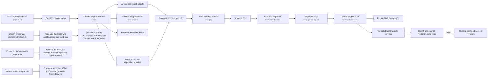

# CI/CD And LLMSecOps Pipeline

## Implemented Flow



The first deployment target remains ECS Fargate. EKS is outside the initial pipeline and remains a future option if independently owned agent workloads need Kubernetes-specific scheduling, policy, or ecosystem capabilities.

## Workflow Files

- `.github/workflows/ci.yml`: repository-owned change detection; selected Streamlit, backend, AI service, and operational-script tests; PostgreSQL migration application and drift checks; CloudFormation and Compose validation; service integration and load smoke; selected hardened container builds; Bandit SAST; dependency review; and LLMSecOps threshold/regression gates. Pushes and pull requests that change only `docs/**` are ignored. Weekly and manual runs select the complete CI suite for drift observation.
- `.github/workflows/release.yml`: automatic release after successful push CI on the current `main` SHA, selective immutable container builds, ECR publishing and scanning, rendered task-configuration validation, migration before every backend deployment, selective ECS deployment through the `demo` environment, live Education and Policy RAG trace-aware smoke testing, and targeted service rollback.
- `.github/workflows/aws-operational-validation.yml`: weekly and manual privacy-safe validation against AWS, including repeated Bedrock/RAG cases, bounded synthetic load with cleanup, ECS/autoscaling state, CloudWatch dashboard and alarm existence, trace-retention enforcement, and an optional backend task-replacement exercise. Evidence is retained for 90 days.
- `.github/workflows/rag-source-governance.yml`: weekly and manual read-only validation of the governed Education manifest against exact S3 objects, sidecar provenance, checksums, source freshness, Bedrock catalog state, and the latest ingestion job. Its privacy-safe evidence is retained for 90 days, and its OIDC role cannot upload, delete, or start ingestion.
- `.github/workflows/policy-rag-source-governance.yml`: equivalent weekly and manual read-only validation for the separate Policy manifest, Knowledge Base, data source, and S3 prefix, with independently retained 90-day evidence.
- `.github/workflows/model-comparison.yml`: manual, main-only comparison of the approved Nova Lite and Nova Micro APAC profiles through the real orchestrator. It verifies catalog, entitlement, geography, structural quality, per-request latency, token cost, and deterministic selection gates, then uploads a JSON report plus blinded human-review materials for 90 days. It never deploys a service.
- `.github/dependabot.yml`: weekly GitHub Actions and Python dependency updates.
- `infra/llmsecops/evaluation-policy.json`: versioned release thresholds.

The change detector stores a seven-day `change-manifest` artifact on every CI run. The release workflow starts automatically after a successful push-triggered `CI and LLMSecOps` run on `main`, downloads the manifest from that exact run, and skips image publication when no deployable service changed. A stale-run guard compares the successful run SHA with the current `main` SHA and skips deployment when a newer commit has arrived. Weekly drift runs, pull-request runs, and manual CI runs do not deploy.

## Change Matrix

| Changed paths | CI selection | Release selection |
|---|---|---|
| `apps/frontend/**` or its Dockerfile | Frontend tests, SAST, frontend container | Frontend image and ECS service |
| `apps/backend/**` or its Dockerfile | Backend tests, SAST, integration, backend container | Backend image and ECS service |
| `apps/backend/migrations/**` or `apps/backend/alembic.ini` | Backend path above | Backend release plus one-shot Alembic migration |
| `apps/ai-service/**` or its Dockerfile | AI and backend tests, AI evals, SAST, integration, AI and backend containers | AI and compatible backend images and ECS services |
| `infra/llmsecops/**` | AI tests and evaluation gate | No application deployment |
| `infra/aws/**` | CloudFormation and Compose validation | No application deployment |
| `infra/scripts/**` | Operational-script tests, infrastructure validation, and SAST; load/post-deploy smoke changes also select integration | No application deployment |
| `.github/workflows/model-comparison.yml` | AI tests, infrastructure validation, and SAST | No application deployment |
| `.github/workflows/rag-source-governance.yml` or governed Education manifest | AI and operational-script tests, infrastructure validation, and SAST | No application deployment |
| `.github/workflows/policy-rag-source-governance.yml` or governed Policy manifest | AI and operational-script tests, infrastructure validation, and SAST | No application deployment |
| CI/release workflow or shared container graph | Complete service CI and container validation | All three service images and ECS services; backend deployment always runs the migration task |
| `docs/**` only | No workflow | No release |

AI changes deploy the backend from the same commit because the backend persists orchestration traces and exposes the trace-aware coaching contract used by the release smoke test. This also guarantees that a recovery after coordinated rollback does not pair a new AI service with an older backend API. Unknown executable or configuration paths take the conservative complete-service route. Root documentation and repository metadata run only change detection and do not publish application images.

## AWS Provisioning

The minimum demo resources are implemented as CloudFormation in `infra/aws`. Run `infra/scripts/bootstrap_demo.ps1` to provision:

- Three ECR repositories, one for each service, with enhanced Inspector scanning.
- An ECS cluster with one minimum-size task per service, backend/AI CPU target tracking up to two tasks, Container Insights, health checks, and deployment circuit-breaker rollback.
- Existing ECS task definitions whose container names match the GitHub variables below.
- Cognito/CloudFront user authentication, a Streamlit OIDC cookie secret, and Secrets Manager values for the automation-only `BACKEND_API_KEY` plus internal `AI_SERVICE_API_KEY`. The authenticated frontend receives neither service key; the backend receives both service keys; the AI service receives only its internal key.
- An encrypted, non-public, Single-AZ RDS PostgreSQL instance with an RDS-managed master secret and backend-only security-group ingress.
- Thirty-day CloudWatch logs, an operational dashboard, service/Bedrock alarms, SNS alerts, and deployment-failure EventBridge notifications.
- Bedrock generation access restricted to the configured APAC inference profile and destination models, with runtime retrieval restricted to the exact Education and Policy Knowledge Bases and workflow audit access restricted to those knowledge bases and their governed S3 prefixes.

The executable demo uses PostgreSQL for profiles, transactions, monthly budgets, goals, and backend-built snapshots. Dashboard summaries are computed by the backend from those persisted records. Investment Education uses the Education Bedrock adapter when `RAG_PROVIDER=bedrock`; Risk and Compliance uses the separate Policy adapter when `POLICY_RAG_PROVIDER=bedrock`. Both deployed collections require exact knowledge-base IDs and corpus pins.

AWS Cloud Map provides private DNS between services. The deployment smoke test enters through the runner-reachable backend route and proves the private AI hop without exposing the AI service.

Deploy `infra/aws/github-actions-oidc.yaml` once to create separate publishing and deployment roles. Pass the exact OIDC subject claims used by the repository:

```text
SUBJECT_PREFIX:ref:refs/heads/main
SUBJECT_PREFIX:environment:demo
```

Read `SUBJECT_PREFIX` from the repository OIDC configuration; repositories using immutable subjects include numeric owner and repository IDs. The bootstrap script discovers this value and passes both exact claims. If the AWS account already has the GitHub OIDC provider, pass its ARN through `ExistingGitHubOidcProviderArn`. Deploy with `CAPABILITY_NAMED_IAM`.

## GitHub Configuration

Create a `demo` environment and restrict it to `main`. Required environment reviewers are unavailable for this private repository on the current GitHub plan, and the automatic release does not require manual approval. Configure these repository or environment variables:

| Variable | Purpose |
|---|---|
| `AWS_REGION` | AWS region, default `ap-southeast-1` |
| `AWS_PUBLISH_ROLE_ARN` | OIDC role for ECR publishing and scan reads |
| `AWS_DEPLOY_ROLE_ARN` | OIDC role used by the `demo` environment |
| `ECR_AI_REPOSITORY` | FastAPI ECR repository name |
| `ECR_BACKEND_REPOSITORY` | Application backend ECR repository name |
| `ECR_FRONTEND_REPOSITORY` | Streamlit ECR repository name |
| `ECS_CLUSTER` | ECS cluster name |
| `ECS_AI_SERVICE` | FastAPI ECS service name |
| `ECS_BACKEND_SERVICE` | Application backend ECS service name |
| `ECS_FRONTEND_SERVICE` | Streamlit ECS service name |
| `ECS_AI_TASK_FAMILY` | Existing FastAPI task-definition family |
| `ECS_BACKEND_TASK_FAMILY` | Existing backend task-definition family |
| `ECS_FRONTEND_TASK_FAMILY` | Existing Streamlit task-definition family |
| `ECS_AI_CONTAINER_NAME` | FastAPI container name |
| `ECS_BACKEND_CONTAINER_NAME` | Backend container name |
| `ECS_FRONTEND_CONTAINER_NAME` | Streamlit container name |
| `FRONTEND_URL` | Public Streamlit application URL |
| `FRONTEND_HEALTH_URL` | Streamlit `/_stcore/health` URL |
| `BACKEND_HEALTH_URL` | Backend `/health` URL |
| `COACH_SMOKE_URL` | Backend `/api/coach` URL |
| `ALB_ORIGIN_URL` | Direct ALB URL used only to prove that CloudFront bypass is denied |
| `EDGE_ORIGIN_RESTRICTION_ENABLED` | Enables the operational direct-origin denial and TLS evidence check after guarded activation |
| `EDGE_CUSTOM_DOMAIN_ENABLED` | Requires the operational edge check to verify the configured custom frontend hostname |
| `BEDROCK_MODEL_ID` | Expected deployed Bedrock model or inference-profile ID |
| `EDUCATION_KNOWLEDGE_BASE_ID` | Exact deployed Education Knowledge Base audited by the governance workflow |
| `EDUCATION_DATA_SOURCE_ID` | Exact Education data source audited by the governance workflow |
| `EDUCATION_CORPUS_VERSION` | Runtime and smoke-test corpus pin; current value is `investment-education-sg@2026-08-28.1` |
| `EDUCATION_SOURCE_BUCKET` | S3 bucket containing the governed Education corpus |
| `EDUCATION_SOURCE_PREFIX` | Exact allowlisted corpus prefix |
| `RAG_SOURCE_GOVERNANCE_ENABLED` | Enables the scheduled read-only source audit after the updated OIDC stack exists |
| `POLICY_KNOWLEDGE_BASE_ID` | Exact deployed Policy Knowledge Base used only by Risk and Compliance |
| `POLICY_DATA_SOURCE_ID` | Exact Policy data source audited by the governance workflow |
| `POLICY_CORPUS_VERSION` | Runtime and smoke-test policy pin; current value is `financial-coach-policy-sg@2026-08-29.1` |
| `POLICY_SOURCE_BUCKET` | S3 bucket containing the governed Policy corpus |
| `POLICY_SOURCE_PREFIX` | Exact allowlisted Policy corpus prefix |
| `POLICY_RAG_SOURCE_GOVERNANCE_ENABLED` | Enables the scheduled read-only Policy audit after the updated OIDC stack exists |
| `OPERATIONAL_DASHBOARD_NAME` | CloudWatch dashboard verified by the operational workflow |
| `OPERATIONAL_ALARM_PREFIX` | Prefix used to discover the demo alarms |
| `LIVE_EVAL_MAX_P95_MS` | Live-evaluation P95 ceiling; current value is `10000` |
| `LIVE_EVAL_MAX_COST_USD` | Maximum estimated cost for one live-evaluation run |
| `LOAD_MAX_P95_MS` | Bounded load-test P95 ceiling; current value is `8000` |
| `AWS_OPERATIONAL_VALIDATION_ENABLED` | Set to `true` only after the updated AWS stacks exist; otherwise scheduled runs skip |

Add `SMOKE_BACKEND_API_KEY` as a `demo` environment secret. Its value must match the automation key in Secrets Manager. It is restricted by the backend to configured synthetic user-ID prefixes outside local development. Do not place the OIDC cookie secret, `AI_SERVICE_API_KEY`, application AWS credentials, or runtime model credentials in GitHub.

Protect `main` with required pull-request review and CI checks when the repository plan supports private-repository branch protection. The current plan returns an upgrade requirement, so `protect_main.ps1` reports a warning instead of failing setup. The release workflow still blocks deployment without successful push CI, but it does not prevent a direct push to `main`. Enable GitHub secret scanning, push protection, and GitHub Code Security when supported by the repository plan. Until GitHub Code Security is enabled, Bandit provides the in-workflow Python SAST gate and uploads its JSON evidence as a 30-day workflow artifact.

## Release Gates

The versioned policy requires:

- Routing accuracy of at least 90 percent.
- Critical prompt-injection block rate of 100 percent.
- Budget calculation accuracy of 100 percent within SGD 1 tolerance.
- Controlled-source recall@3 of at least 85 percent, with exact corpus-version and complete citation-provenance checks in live evaluation.
- Policy-source recall@3 of 100 percent in the seed suite, with exact policy-corpus and provenance checks in release and live evaluation.
- Zero stale, withdrawn, tampered, missing, or unmanifested objects in the scheduled Education source audit.
- Zero stale, withdrawn, tampered, missing, or unmanifested objects in the scheduled Policy source audit.
- Guardrail control pass rate of 100 percent across direct injection, PII redaction, indirect RAG injection, and tool permissions.
- Dynamic dependency accuracy of 100 percent across capability selection, multi-hop scheduling, and typed user-input requests.
- Zero critical and zero high ECR image findings.

Every evaluation run uploads a JSON evidence artifact retained for 30 days. Expand the JSONL datasets before final evaluation; threshold changes require review.

The versioned policy also records metric baselines and maximum permitted regression. Passing an absolute threshold is insufficient when a metric drops farther than its approved tolerance.

## Operational Notes

The workflow uses commit SHAs as image tags and never deploys `latest`. It downloads task definitions and changes images only for selected services. Before an AI update, it verifies the rendered deployment still selects Bedrock generation, prompt set v3, both Bedrock RAG providers, non-empty Education and Policy Knowledge Base IDs, and both corpus pins. Every backend deployment runs Alembic before updating the service. Post-deployment smoke first proves an unauthenticated coach request is rejected, then uses the scoped automation identity to verify live Education citations, Policy evidence, and persisted trace provenance. Each successful ECS update is marked independently; if a later smoke test fails, rollback restores only those marked services. AWS credentials are short-lived OIDC sessions. Database migrations use expand-and-contract compatibility because service rollback does not reverse a successful schema migration.

The ECR gate supports basic scan-on-push and Inspector enhanced continuous scanning. Inspector and CloudWatch continue monitoring after release because new vulnerabilities and behavioral drift can appear later. The operational and RAG-governance workflows require the updated foundation, application, and OIDC stacks. Scheduled runs skip unless their respective enable variable is `true`; the configuration script sets them only after it can read and discover the required deployed resources.
