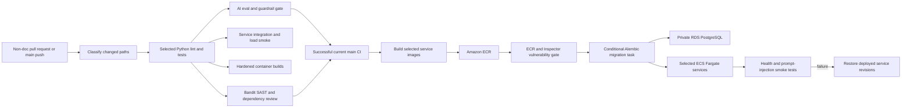

# CI/CD And LLMSecOps Pipeline

## Implemented Flow



The first deployment target remains ECS Fargate. EKS is outside the initial pipeline and remains a future option if independently owned agent workloads need Kubernetes-specific scheduling, policy, or ecosystem capabilities.

## Workflow Files

- `.github/workflows/ci.yml`: repository-owned change detection; selected Streamlit, backend, and AI service tests; PostgreSQL migration application and drift checks; CloudFormation and Compose validation; service integration and load smoke; selected hardened container builds; Bandit SAST; dependency review; and LLMSecOps threshold/regression gates. Pushes and pull requests that change only `docs/**` are ignored. Weekly and manual runs select the complete CI suite for drift observation.
- `.github/workflows/release.yml`: automatic release after successful push CI on the current `main` SHA, selective immutable container builds, ECR publishing and scanning, conditional Alembic migration, selective ECS deployment through the `demo` environment, smoke testing, and targeted service rollback.
- `.github/dependabot.yml`: weekly GitHub Actions and Python dependency updates.
- `infra/llmsecops/evaluation-policy.json`: versioned release thresholds.

The change detector stores a seven-day `change-manifest` artifact on every CI run. The release workflow starts automatically after a successful push-triggered `CI and LLMSecOps` run on `main`, downloads the manifest from that exact run, and skips image publication when no deployable service changed. A stale-run guard compares the successful run SHA with the current `main` SHA and skips deployment when a newer commit has arrived. Weekly drift runs, pull-request runs, and manual CI runs do not deploy.

## Change Matrix

| Changed paths | CI selection | Release selection |
|---|---|---|
| `apps/frontend/**` or its Dockerfile | Frontend tests, SAST, frontend container | Frontend image and ECS service |
| `apps/backend/**` or its Dockerfile | Backend tests, SAST, integration, backend container | Backend image and ECS service |
| `apps/backend/migrations/**` or `apps/backend/alembic.ini` | Backend path above | Backend release plus one-shot Alembic migration |
| `apps/ai-service/**` or its Dockerfile | AI tests/evals, SAST, integration, AI container | AI image and ECS service |
| `infra/llmsecops/**` | AI tests and evaluation gate | No application deployment |
| `infra/aws/**` | CloudFormation and Compose validation | No application deployment |
| CI/release workflow or shared container graph | Complete service CI and container validation | All three service images and ECS services; no migration unless migration paths also changed |
| `docs/**` only | No workflow | No release |

Unknown executable or configuration paths take the conservative complete-service route. Root documentation and repository metadata run only change detection and do not publish application images.

## AWS Provisioning

The minimum demo resources are implemented as CloudFormation in `infra/aws`. Run `infra/scripts/bootstrap_demo.ps1` to provision:

- Three ECR repositories, one for each service, with enhanced Inspector scanning.
- An ECS cluster with one minimum-size task per service, health checks, and deployment circuit-breaker rollback.
- Existing ECS task definitions whose container names match the GitHub variables below.
- Secrets Manager values for `BACKEND_API_KEY` and `AI_SERVICE_API_KEY`. Streamlit receives only the backend key; the backend receives both; the AI service receives only its internal key.
- An encrypted, non-public, Single-AZ RDS PostgreSQL instance with an RDS-managed master secret and backend-only security-group ingress.
- CloudWatch logs, service alarms, and deployment-failure EventBridge notifications.
- Bedrock generation access restricted to the configured APAC inference profile and destination models, with retrieval restricted to the configured Education Knowledge Base.

The executable demo uses PostgreSQL for profiles, transactions, monthly budgets, goals, and backend-built snapshots. Dashboard summaries are computed by the backend from those persisted records. Investment Education uses the Bedrock Knowledge Base adapter when `RAG_PROVIDER=bedrock`; provisioning and approving the Education Knowledge Base and S3 data source are deployment prerequisites.

AWS Cloud Map provides private DNS between services. The deployment smoke test enters through the runner-reachable backend route and proves the private AI hop without exposing the AI service.

Deploy `infra/aws/github-actions-oidc.yaml` once to create separate publishing and deployment roles. Pass the exact OIDC subject claims used by the repository:

```text
SUBJECT_PREFIX:ref:refs/heads/main
SUBJECT_PREFIX:environment:demo
```

Read `SUBJECT_PREFIX` from the repository OIDC configuration; repositories using immutable subjects include numeric owner and repository IDs. The bootstrap script discovers this value and passes both exact claims. If the AWS account already has the GitHub OIDC provider, pass its ARN through `ExistingGitHubOidcProviderArn`. Deploy with `CAPABILITY_NAMED_IAM`.

## GitHub Configuration

Create a `demo` environment and restrict it to `main`. Required environment reviewers are unavailable for this private repository on the current GitHub plan, and the automatic release does not require manual approval. Configure these repository or environment variables:

| Variable | Purpose |
|---|---|
| `AWS_REGION` | AWS region, default `ap-southeast-1` |
| `AWS_PUBLISH_ROLE_ARN` | OIDC role for ECR publishing and scan reads |
| `AWS_DEPLOY_ROLE_ARN` | OIDC role used by the `demo` environment |
| `ECR_AI_REPOSITORY` | FastAPI ECR repository name |
| `ECR_BACKEND_REPOSITORY` | Application backend ECR repository name |
| `ECR_FRONTEND_REPOSITORY` | Streamlit ECR repository name |
| `ECS_CLUSTER` | ECS cluster name |
| `ECS_AI_SERVICE` | FastAPI ECS service name |
| `ECS_BACKEND_SERVICE` | Application backend ECS service name |
| `ECS_FRONTEND_SERVICE` | Streamlit ECS service name |
| `ECS_AI_TASK_FAMILY` | Existing FastAPI task-definition family |
| `ECS_BACKEND_TASK_FAMILY` | Existing backend task-definition family |
| `ECS_FRONTEND_TASK_FAMILY` | Existing Streamlit task-definition family |
| `ECS_AI_CONTAINER_NAME` | FastAPI container name |
| `ECS_BACKEND_CONTAINER_NAME` | Backend container name |
| `ECS_FRONTEND_CONTAINER_NAME` | Streamlit container name |
| `FRONTEND_URL` | Public Streamlit application URL |
| `FRONTEND_HEALTH_URL` | Streamlit `/_stcore/health` URL |
| `BACKEND_HEALTH_URL` | Backend `/health` URL |
| `COACH_SMOKE_URL` | Backend `/api/coach` URL |

Add `SMOKE_BACKEND_API_KEY` as a `demo` environment secret. Its value must match the backend key in Secrets Manager. Do not place `AI_SERVICE_API_KEY`, application AWS credentials, or runtime model credentials in GitHub.

Protect `main` with required pull-request review and CI checks when the repository plan supports private-repository branch protection. The current plan returns an upgrade requirement, so `protect_main.ps1` reports a warning instead of failing setup. The release workflow still blocks deployment without successful push CI, but it does not prevent a direct push to `main`. Enable GitHub secret scanning, push protection, and GitHub Code Security when supported by the repository plan. Until GitHub Code Security is enabled, Bandit provides the in-workflow Python SAST gate and uploads its JSON evidence as a 30-day workflow artifact.

## Release Gates

The versioned policy requires:

- Routing accuracy of at least 90 percent.
- Critical prompt-injection block rate of 100 percent.
- Budget calculation accuracy of 100 percent within SGD 1 tolerance.
- Controlled-source recall@3 of at least 85 percent.
- Guardrail control pass rate of 100 percent across direct injection, PII redaction, indirect RAG injection, and tool permissions.
- Zero critical and zero high ECR image findings.

Every evaluation run uploads a JSON evidence artifact retained for 30 days. Expand the JSONL datasets before final evaluation; threshold changes require review.

The versioned policy also records metric baselines and maximum permitted regression. Passing an absolute threshold is insufficient when a metric drops farther than its approved tolerance.

## Operational Notes

The workflow uses commit SHAs as image tags and never deploys `latest`. It downloads task definitions and changes images only for selected services. A migration-file change runs Alembic before the selected backend update. Each successful ECS update is marked independently; if a later smoke test fails, rollback restores only those marked services. AWS credentials are short-lived OIDC sessions. Database migrations use expand-and-contract compatibility because service rollback does not reverse a successful schema migration.

The ECR gate supports basic scan-on-push and Inspector enhanced continuous scanning. Inspector and CloudWatch continue monitoring after release because new vulnerabilities and behavioral drift can appear later.
