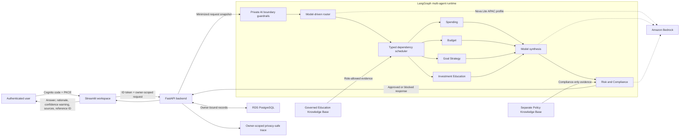
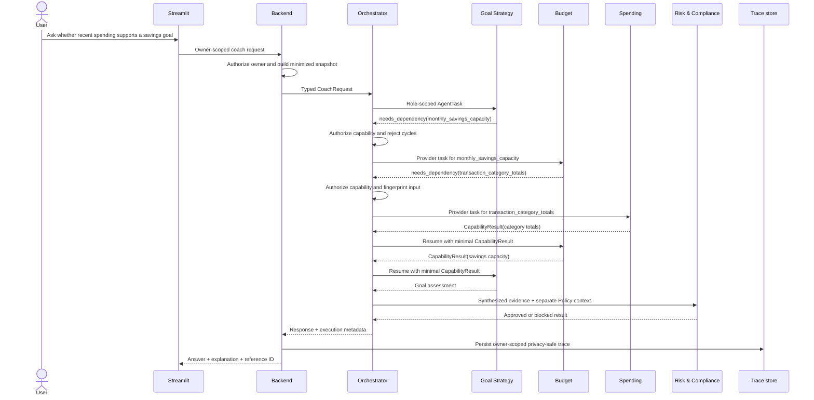

# Final Assessment Package

## Assessment Position

The implemented system is ready for final assessment as a synthetic-data AWS demonstration. The assessment claim is deliberately narrower than a production-readiness claim: it demonstrates multi-agent orchestration, governed retrieval, responsible-AI controls, identity isolation, traceability, evaluation, CI/CD, and AWS operation without accepting real personal financial data or executing financial transactions.

The machine-readable evidence map is `infra/llmsecops/final-assessment-manifest.json`. `infra/scripts/final_assessment.py` fails when a required assessment area, demonstration scenario, scope decision, or referenced evidence file is absent. A passing report inventories every referenced file with a SHA-256 digest without copying prompts, credentials, personal data, or financial records into the artifact.

## Implemented System View

The backend is the sole owner of persisted financial records. Agents receive role-minimized request state and never connect to PostgreSQL. The Education and Policy collections are independently versioned and permissioned. The Risk and Compliance agent is an independent final review layer; boundary and per-agent guardrails remain active even when Compliance is not yet reached.

## Dynamic Dependency Interaction

Specialists never select or invoke another specialist. They request a typed capability or user input; the orchestrator authorizes the request, selects or reuses the provider, orders execution, bounds retries and model calls, detects cycles, and resumes the requester with the minimum result. Independent ready tasks can run concurrently.

## Evidence Baseline

The detailed operating record is in `docs/operational-evidence.md`. The assessment baseline currently includes:

| Area | Retained result |
|---|---|
| CI and LLMSecOps | All service tests, eight policy suites, migrations, SAST, infrastructure checks, integration/load smoke, and hardened container builds passed in run `33375543534`. |
| AWS release | Migration `20260831_0008`, immutable image checks, three stable ECS services, and lifecycle-aware live smoke passed in run `33375735946`. |
| Live operation | 39/39 repeated Bedrock/RAG cases and 10/10 bounded-load requests passed with zero cleanup failures in run `33377416351`. |
| Model selection | Nova Lite passed 45/45; Nova Micro passed 42/45 and was rejected by the dependency gate in run `33354207859`. |
| Retrieval governance | Education run `33193755856` and Policy run `33231041612` passed exact object, checksum, metadata, freshness, and ingestion audits. |
| Identity and edge | Two-user owner isolation, Cognito logout, custom-domain TLS, HTTPS origin, and direct-origin denial have retained evidence. |
| Operations and lifecycle | CloudWatch-to-SNS delivery was human-acknowledged; `data-lifecycle-v1` retention, export, and complete deletion have automated evidence. |

Workflow run URLs, commits, measurements, known failed attempts, corrections, and artifact-retention dates remain in the operational register so the assessment does not hide unfavorable evidence.

## Assessment Gate

The final gate passes only when:

1. The evidence manifest covers every required architecture, agent, communication, model, memory, tool, traceability, responsible-AI, security, evaluation, RAG, identity, CI/CD, operations, and lifecycle area.
2. Every referenced evidence file exists and is integrity-hashed.
3. All six runbook scenarios are linked to one or more assessed requirements.
4. The deployed AWS operational workflow passes the repeated live evaluation, bounded load, edge, alerting, ECS, autoscaling, and lifecycle checks.
5. Both generated artifacts are retained for 90 days and their workflow URL is added to `docs/operational-evidence.md` after the approved run.

Run `.github/workflows/final-assessment.yml` manually from `main` after its CI run succeeds. It first produces the privacy-safe repository evidence inventory and then calls the established AWS operational validation with the assessment parameters. It does not deploy application images or mutate governed RAG sources.

## Explicit Scope Decisions

The following are not assessment claims for this project:

- real personal financial data, regulated financial advice, transaction execution, or production users;
- representative-user validation, which was prepared but explicitly deferred;
- durable agent memory, which remains disabled even when a consent preference is recorded;
- MCP or A2A, which remain unnecessary while agents and tools share one owner and runtime; and
- disaster-recovery or backup-restore exercises, which were explicitly excluded from the academic demo scope.

These are not silent gaps. Each has an activation condition in the machine-readable manifest and must be reassessed if the system scope expands.
