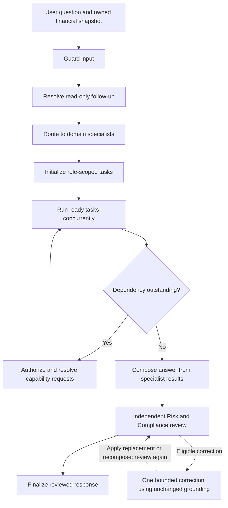

# Current orchestration implementation

This explanation follows the single packaged current source contract, labelled **v10**, including the [Risk & Compliance update](risk-compliance-review-update-2026-10-09.md) and [local claim recovery](orchestration-local-claim-recovery-2026-10-09.md). The [latest recorded live retest](agent-reasoning-live-test-results-2026-10-09.md) passed 28 of 34 original turns, failed additional case 35 and passed four of seven repeats. Its 42 turns matched financial specialist selection and dependency edges, but answer acceptance has not passed. That run predates local claim recovery. The [reasoning prompt catalogue](agent-reasoning-test-prompts-2026-10-07.md) retains the synthetic profile and original prompts. See [read-only recovery](orchestration-read-only-recovery.md), [the preceding fixes](orchestration-review-recovery.md), and [conditional financial dependencies](conditional-financial-dependencies.md).

## What the application demonstrates

The application has a central supervisor, four domain specialists and a separate Risk and Compliance reviewer. The supervisor chooses specialists, runs eligible tasks concurrently, resolves typed dependencies, combines answers and reviews the combined result.

The specialists do not freely call one another. They return a dependency request to the orchestrator. The orchestrator authorizes that request against a capability registry, supplies the provider with permitted inputs, validates the provider's output and resumes the requester. This makes dependencies visible and bounded.

| Component | Responsibility |
|---|---|
| Spending | Interpret deterministic expense aggregates, trends, anomalies and temporal patterns; read-only transaction and recurrence queries also have specialized paths |
| Budget | Explain budget calculations, confirmed savings capacity and planned limits; separate record/planning paths exist for saved plans and previews |
| Goal Strategy | Explain deterministic projections, required contributions, shared funding capacity and trade-offs |
| Investment Education | Retrieve educational evidence, assess its coverage and explain investment concepts within permitted evidence modes |
| Risk and Compliance | Independently check claims, numbers, source attribution, completeness and financial-language boundaries |
| Orchestrator | Own routing, task state, dependency resolution, scheduling, synthesis, review and finalization |

Risk and Compliance is not a router-selectable fifth domain specialist. Ordinary runs review their output after synthesis. A prohibited input may exit at the initial guardrail, before any specialist reasoning.

## The actual workflow

The graph is implemented with LangGraph in `app/orchestrator.py`. Ready tasks run through a `ThreadPoolExecutor`. Parallel execution is therefore real task concurrency, subject to configured worker capacity; listing several agents in the response alone does not prove it happened.

The route combines model intent classification with server-side rules. Besides agent selection, it identifies operation paths, calendar scope and capacity queries. A read-only saved-budget lookup, a budget-versus-actual review and a savings-capacity calculation can follow different internal paths even though they all concern Budget. Testing one path does not automatically demonstrate every dependency behavior of that specialist.

Routing is an initial decision. The final specialist set can grow when a task discovers it needs another specialist's capability. The response must distinguish the initial selection, dynamically scheduled tasks and reused provider results.

## Dependencies, tools and reuse

The current registry permits these relationships:

| Requester | Capability | Provider | Meaning |
|---|---|---|---|
| Budget | `transaction_category_totals` | Spending specialist | Recorded expense totals for contextual Budget reasoning |
| Goal | `monthly_savings_capacity` | Budget specialist | Authoritative capacity used in ordinary saved-goal feasibility |
| Budget | `monthly_budget_baseline` | Budget calculator tool | Deterministic baseline computation |
| Goal | `goal_projection` | Goal projection tool | Deterministic goal contribution arithmetic |
| Budget or Goal | `education_context` | Education retrieval tool path | Evidence for requested investment concepts |
| Compliance | `policy_context` | Policy retrieval tool | Evidence for the output review |

A specialist-to-specialist dependency and a specialist-to-tool dependency are different demonstrations. Education retrieval may execute Investment Education's grounding logic as a helper without selecting its separate narrative as another user-facing domain specialist.

For a dependency, the orchestrator checks requester authorization, required inputs, expected output fields and compatible input fingerprints. It can reuse an already completed matching capability, wait for an existing provider task, schedule a provider or report an unavailable dependency. Its checks also bound dependency expansion and reject cycles or unauthorized capabilities. Reuse avoids a duplicate execution; it does not remove the logical dependency.

Budget's Spending context request is optional for planning and required for model-selected reconciliation. The current model router assigns a separate attributed question and requirements to every selected specialist. An explicit model decision that Budget's own planning work does not require Spending removes that capability from Budget's planner options; available purchases alone do not justify a dependency. Missing legacy requirements remain classified by the scoped specialist. Historical cases 2, 9, 14, 20 and 30 exposed the whole-question problem this addresses; deployed-model reliability still requires retesting. An unavailable optional capability can leave a qualified answer that retains valid calculations. Goal's model-selected capacity requirement separates saved remaining balances, progress and equal contribution arithmetic from funding feasibility. A capacity provider computes the requested calculation, while an independently assigned conceptual Budget task retains its own scope. A required capacity dependency cannot simply be ignored while Goal asserts personal feasibility.

Each assigned question has exact source excerpts from the current user turn. Code checks the contract and provenance, while the model interprets meaning. Assigned questions and excerpts stay private to the workflow. Budget and Spending can have different requested months; Spending's primary month and comparison rows remain distinct. Expense capability fingerprints bind the produced records and calendar context. Conditional Education retrieval receives its requester's assigned question and topics, with a scope-specific fingerprint; another task's explanation is reusable only for matching meaning and evidence.

There is **no Spending-to-Goal or Goal-to-Spending capability edge**. A question linking recorded expense patterns to ordinary saved-goal feasibility reaches Spending through Budget:

These arrows show requests; validated data returns in the opposite direction. The useful execution order is Spending output, Budget capacity/context, then resumed Goal reasoning. The requester may run an initial preflight before that order, so execution traces can contain an early Goal invocation that returns a dependency request rather than an answer.

When Budget and Investment are both initially selected, Budget normally suppresses duplicate optional Education grounding and the Investment specialist supplies its own conceptual answer. Goal has a similar suppression rule, with an exception for the emergency-fund path.

## What the additional concepts mean

### Answerability

Answerability asks whether the available material supports the particular question. It is not another agent or a dependency edge.

Investment Education constructs bounded public subquestions and assesses retrieved passages against each one. The actual coverage statuses are `supported`, `partial` and `unsupported`; “answerable” describes the overall idea. Exact supporting quotations and source or passage identities provide provenance, rather than accepting a document merely because its title contains a keyword.

This addresses a rigid failure mode: useful material for one requested concept should not disappear because another requested concept lacks support. A retrieved ETF definition does not establish current tax eligibility or explain every ETF mechanism.

There are separate questions:

- Is the user's request allowed?
- Which subquestions have evidence?
- Did the answer actually address the requested parts?
- Is its language financially safe and its source attribution correct?

An allowed question can have incomplete evidence. An evidence-supported draft can still omit a requested comparison. A polished and complete draft can still contain an unsafe personal recommendation. These conditions should not collapse into one yes/no flag.

Investment Education additionally permits a visibly labelled model-knowledge section for approved stable general concepts missing from retrieval. That permission does not extend to current product terms, tax/legal rules or personalized choices. Budget and Goal's added investment explanations require carried Education evidence; they do not have the same model-only fallback permission.

### Grounding

Grounding means connecting an answer to the authoritative inputs that justify it. The application has several kinds:

- Owned backend records establish saved budgets, recorded transactions and saved goal balances.
- Explicit user-reported hypothetical inputs support illustrative calculations; they are not saved records.
- Deterministic tools establish aggregates, capacity and projection figures.
- Retrieved educational passages establish sourced investment explanations.
- Policy context and independently checked output establish release constraints.

These are not interchangeable. A financial calculation does not need an external investment citation when its numbers are already established by supplied records and deterministic tools. An investment claim does not become sourced because it is placed beside an accurate budget calculation.

The new profile exposes this distinction: October's income minus recorded expenses is SGD 2,925, its confirmed savings allocation is SGD 1,600, and its unallocated planned income is SGD 950. None of these proves a bank balance. Goal consumes the confirmed funding capacity; it should not opportunistically substitute the larger Overview residual.

Education also captures a privately validated grounding snapshot for reuse during a permitted correction. Repair must not quietly replace verified evidence with newly invented source support.

### Retryable

Retryable means an execution failure is eligible for another attempt. It belongs to runtime reliability.

The orchestrator recognizes transient model and retrieval failures, including configured connection, rate-limit, timeout and server errors. It retries within attempt limits, uses exponential backoff and records attempt and timing events. A `FailedInvocation` can explicitly be retryable. Unexpected exceptions are not automatically treated as transient.

Retrying an execution is different from correcting its answer. It does not supply missing income, resolve an ambiguous month or make a prohibited request allowed. Structured-output validation also has a bounded correction mechanism for malformed model contracts; that is separate from semantic Education repair.

### Repairable

Repairable means an allowed answer contains a bounded defect that the system can attempt to correct safely with its existing verified grounding.

The reviewer locates qualification and attribution defects with exact claim quotes or valid offsets; the server verifies ownership and protects unaffected text. For local defects, a model correction role returns only replacements keyed to supplied issues; the server splices them into the original answer and updates presentation metadata. This includes app-generated headings without changing canonical topics or option numbers. Sealed financial/source authority remains fixed. The corrected full answer receives another independent review. Whole-answer/completeness issues retain the bounded owning-writer or composition paths. Unverifiable embellishments require a located removal or grounding action using existing owned evidence; the category alone grants no repair. Prohibited advice remains ineligible.

The orchestrator checks request permissibility, the relevant specialist, grounding availability, safety categories, input needs and remaining call/token/time budgets. Local admission forecasts one correction/review pass, reserves reviewer time and allows an optional contract retry only inside the writer's remaining window. A rejected correction can produce one paragraph-reduced candidate with a visible partial-answer notice, but that candidate requires its own full independent review and budget. It records incomplete status and clears stored option referents. Otherwise the response remains withheld. A prohibited request, unresolved required input or changed grounding is not cured by recovery. A narrowly resolved conversational clarification has its own checked exception. Opt-in redacted rejected-draft diagnostics remain operator-only files outside public traces.

This addresses another rigidity problem: an allowed explanation that omitted a comparison or needed a source attribution correction need not become a blanket refusal. It also introduces significant cost and control complexity. A successful final response alone does not prove repair occurred; the trace must contain the repair decision and second review.

### Recurrence

Recurrence describes explicit payment schedules in financial data. It is unrelated to the workflow's retry loop or repeated conversation turns.

The calendar implementation supports anchored schedules, intervals, first/next/last dates and month-end handling. Forecasts expand scheduled occurrences inside a requested date range. They must remain distinct from recorded paid transactions.

Repeated descriptions do not establish a schedule. The demo's October rent has a real monthly rule; its September rent is just another recorded expense. The November forecast can include SGD 1,800 scheduled rent without claiming November actual expenditure exists.

Recurrence was useful for making the Budget baseline less arbitrary: explicitly scheduled obligations can be treated differently from irregular purchases. It is financial-domain functionality, not essential to demonstrating the existence of an orchestrator or agent dependency edge.

### Follow-up

Follow-up resolution connects a short read-only utterance, such as “explain the second option,” to a supported conversational subject.

The preliminary resolver checks bounded history and grounded referents, including displayed option order. The semantic router can identify a reference within the current message using two distinct exact spans; that classification preserves the compound task split instead of overriding it with a historical follow-up. Effective assignments are reconciled after route overrides. A resolved ETF follow-up can return to Investment Education without requiring restatement. The composer can propose current-message referents for later turns; they are validated rather than accepted as arbitrary memory.

A follow-up subject does not authorize record changes, select a record ID, provide a new amount or prove that a draft was confirmed. Missing or ambiguous references require clarification. This feature addresses conversational rigidity, but it is a memory/context layer rather than a new specialist dependency.

### Preferences

Preferences guide presentation: language, layout, detail level and relevant coaching/accessibility settings. Current user requests and saved context inform the response composer.

They should preserve verified numbers, calendar scope, limitations and source markers. Asking for a compact table should not change a SGD 1,000 shortfall into SGD 950 or bypass Compliance. The demo includes plain-language and step-by-step preferences so the same dependency reasoning can be checked in different output styles.

Preferences are also untrusted data for the model contract. A stored preference cannot override policy, establish a payment schedule or make an unsupported fact true.

### Needs input, availability and completeness

A task can need input, need a dependency, finish successfully or fail. These are different outcomes. Needed user information produces a focused clarification; a needed provider capability produces an orchestrator dependency request. Neither condition is inherently a safety violation.

An optional evidence gap should retain useful supported work and disclose the gap. A missing requested saved budget should not silently borrow another month. Completeness concerns coverage of the actual question, including every independent part of a compound request; it does not justify inventing evidence to fill a gap.

## Why some responses can still be rigid

The current safeguards do not eliminate every routing limitation:

1. **Capacity requirements depend on semantic interpretation.** The current contract allows recorded goal arithmetic to run alone, while feasibility requires Budget. A mixed Goal question containing a feasibility part still needs capacity. Ambiguous funding assessments use the conservative capacity path.
2. **The illustrative path is syntax-sensitive.** It accepts one target and one duration, rejects additional numeric residue and feasibility wording, and assumes a zero starting amount. That exception remains available; the independent tests now use saved-goal arithmetic and do not depend on its special syntax.
3. **Task separation depends on the router's semantic interpretation.** Budget's planner now receives its attributed assignment. “Analyze spending; independently explain budgeting” should have no `B → S` edge when the model assigns independent work. Structural provenance checks cannot prove that a model's interpretation is correct, so production-model evaluation remains necessary.
4. **Model decisions remain variable.** The semantic router or optional dependency planner can select a different valid route. Prompt wording is evidence to test, not an API contract fixing the graph.
5. **Some read-only requests use record/planning paths.** A budget review can bypass the ordinary dependency preflight and use supplied backend context. Its result may be correct without exercising the capability edge a demonstration intended to show.

These are implementation/design observations after the conditional-dependency update. No direct Goal–Spending edge was added. The profile records are unchanged. The [live results](agent-reasoning-live-test-results-2026-10-07.md) now separate expected behavior from actual graph, runtime and answer outcomes, including Budget's remaining scoping failures and unnecessary follow-up clarification.

## What is essential for the stated project requirement

For demonstrating orchestrator routing and multi-agent dependencies, the essential pieces are the four domain roles, central routing, typed capability requests, at least one dynamic chain, independent ready-task concurrency, provider reuse, deterministic financial inputs and observable traces. A small set of checks around authority and release is also appropriate for a financial demo.

The broader features serve different purposes:

| Layer | Why it exists | Importance to the core demonstration |
|---|---|---|
| Routing and dependency graph | Choose the right specialists and coordinate their outputs | Essential |
| Typed task/capability contracts | Make cooperation authorized, bounded and testable | Essential |
| Deterministic financial tools and source grounding | Keep domain conclusions anchored to supplied evidence | Essential at a modest scope |
| Detailed subquestion answerability | Handle partial education evidence without generic replies | Useful conversational quality layer |
| Bounded answer correction | Recover eligible incomplete education or qualified financial drafts | Optional sophistication for the demonstration |
| Retry/backoff | Survive transient service failures | Useful operational layer, separate from reasoning topology |
| Calendar recurrence | Model obligations and forecast bills accurately | Optional financial-domain feature |
| Follow-up and preferences | Make continued dialogue and presentation less rigid | Useful UX layers, not dependency mechanics |
| Full CRUD previews and confirmation workflows | Manage persistent user records safely | Product scope beyond reasoning demonstrations |

The concepts were introduced to address different failure modes; they are not all necessary to prove multi-agent orchestration. For this project's main objective, cases 1–7, 9–12 and 19 show the main structures, while case 8 documents the missing direct edge. The remaining cases should be treated as supplementary evidence of quality, scope handling and resilience.

## Code locations inspected

- `apps/ai-service/app/orchestrator.py`: attributed assignments, concurrent tasks, dependencies, deadlines, retry, synthesis and bounded answer correction.
- `apps/ai-service/app/capabilities/registry.py`: authorized agent/tool capability edges.
- `apps/ai-service/app/core/schemas.py`: typed outcomes, dependency contracts and scoped compliance review.
- `apps/ai-service/app/agents/budget.py`: role-scoped Spending selection, optional requests and capacity grounding.
- `apps/ai-service/app/agents/goal_strategy.py`: conditional capacity requirement, saved arithmetic, illustrative exception, emergency-fund path and combined feasibility.
- `apps/ai-service/app/agents/investment_education.py`: education retrieval, coverage, evidence modes and grounding reuse.
- `apps/ai-service/app/rag/answerability.py`: public subquestions, passage support and coverage contracts.
- `apps/ai-service/app/core/education_grounding.py`: verified grounding snapshot.
- `apps/ai-service/app/core/financial_grounding.py`: private unchanged financial grounding for correction.
- `apps/ai-service/app/core/claim_corrections.py`: replacement contracts, server splicing and presentation range updates.
- `apps/ai-service/app/evals/orchestration_acceptance.py`: repeated model evaluation, graph/period/fact checks and mandatory content review.
- `apps/ai-service/app/core/follow_up.py`: bounded read-only reference resolution.
- `apps/ai-service/prompts/current/prompts.json`: conditional financial requirements and domain routing/answer/review/composer instructions; the adjacent manifest records v10 and the Education review contracts are retained.
- `apps/shared/coach_math/recurrence.py`: calendar schedule calculations.
