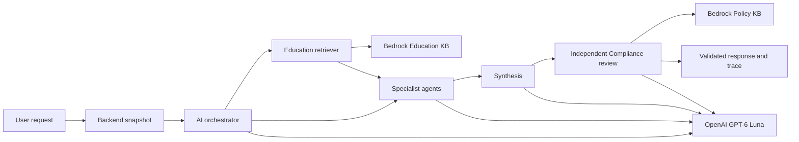

# Retrieval-Augmented Generation Architecture

## Current deployment

The deployed AI service uses separate Amazon Bedrock Knowledge Bases for Education and Policy retrieval. Reviewed documents and metadata are ingested from S3 into the KBs' Cohere multilingual embedding and S3 Vectors pipeline. The application calls `Retrieve`, validates the returned evidence, and sends selected passages to GPT-6 Luna directly through the OpenAI Responses API. Generation does not run in Bedrock and the application does not call `RetrieveAndGenerate`.



The orchestrator controls which agents may request retrieval. Investment Education receives a sanitized topic question and risk constraint and is the only agent with direct `education_retriever` permission. Budget and Goal Strategy may request `education_context` for allowlisted investment topics through the capability registry. The orchestrator checks Investment Education's tool permission and executes its grounding logic, then returns evidence to the requesting agent. Retrieval events identify Investment Education as the executor; dependency events retain the consumer. The retriever receives canonical topic labels, never raw transactions or identifiers. Spending and calculation-only paths remain retrieval-free. Compliance receives Education evidence in the draft but independently reads only the Policy corpus.

The semantic query planner's provider schema now lists the accepted canonical
topics and public search concepts assembled from the governed vocabulary and
aliases. It selects search metadata from that list while `public_question`
preserves the requested mechanism in natural language. A broader search concept
does not establish support: passage-level answerability must still identify
exact carried evidence or an honest limitation. Privacy checks, the single
bounded correction and fail-closed provenance validation remain in place.

## Corpus preparation and approval

Each corpus has a versioned `source_manifest.json` and reviewed Markdown documents. The manifest records source identity, organization, canonical URL, version, SHA-256 checksum, review status, and review deadline. The image retains the manifests and exact source files for validation and local development. Source changes require review, a new corpus version, successful KB ingestion and an image release.

Before either remote corpus is changed, `sync_bedrock_corpora.py` verifies both local corpora. It resolves an exact, available S3 data source for each manifest prefix, uploads the approved bytes and sidecars, waits for successful ingestion, and audits remote objects/checksums/metadata. Release activates the corpus pins only after both audits pass. Scheduled governance uses a separate read-only OIDC role to validate local files and remote KB/S3 state. The AI task role has only `bedrock:Retrieve` on the two KBs; their service roles invoke the embedding model.

## Retrieval and use

The Education adapter requests up to 20 semantic candidates from Bedrock, filtered by approved status and exact corpus version, then ranks accepted passages lexically and selects up to three per query. Context assembly retains the shared 1,200-word evidence limit. The Policy adapter queries each of the three mandatory policy sources using its public title and source-ID filter; it collects that source's chunks and verifies its version, checksum and URL against the approved manifest. Missing required Policy evidence fails closed. Personal draft text is not sent to Policy retrieval. Both adapters check review deadlines and carry provenance through synthesis, response and persisted trace.

Retrieved text is untrusted evidence. Content inspection and prompt boundaries prevent it from overriding system rules. The model can explain general investment concepts with citations but cannot present personalized investment advice. If approved evidence is insufficient, the response records an evidence gap. Compliance evaluates the final draft independently.

## Local and deployed settings

Local fixture mode is available for deterministic offline development. The deployed AI task uses:

```text
MODEL_PROVIDER=openai
MODEL_ID=gpt-6-luna
MODEL_REASONING_EFFORT=medium
RAG_PROVIDER=bedrock
POLICY_RAG_PROVIDER=bedrock
EDUCATION_KNOWLEDGE_BASE_ID=<approved Education KB>
POLICY_KNOWLEDGE_BASE_ID=<approved Policy KB>
RAG_MINIMUM_SCORE=0.6
POLICY_RAG_MINIMUM_SCORE=0.0
EDUCATION_CORPUS_VERSION=<exact approved version>
POLICY_CORPUS_VERSION=<exact approved version>
```

Policy retrieval uses exact mandatory sources, so a relevance-score threshold must not discard a required control. Local `local_documents` and `local_fixture` modes remain available for offline checks. The OpenAI key is injected from AWS Secrets Manager. See [model selection](model-selection.md), [Education governance](rag-source-governance.md), [Policy governance](policy-rag-governance.md), and [RAG quality](rag-quality.md). Historical Nova generation measurements do not validate the current direct OpenAI model.
