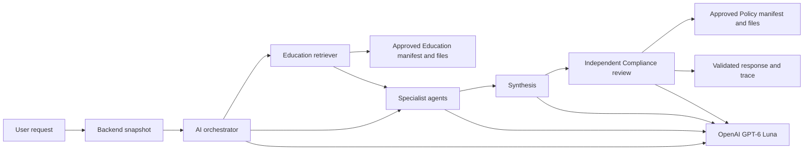

# Retrieval-Augmented Generation Architecture

## Current deployment

The AI service packages two reviewed corpora in its Docker image. Investment Education retrieves general educational passages from `knowledge/investment_education`; Risk and Compliance reads `knowledge/policy_controls`. No runtime vector database or managed knowledge base is needed. GPT-6 Luna receives only the selected passages and role-scoped task data through the OpenAI Responses API.



The orchestrator controls which agents may request retrieval. Investment Education receives a sanitized topic question and risk constraint and is the only agent with direct `education_retriever` permission. Budget and Goal Strategy may request `education_context` for allowlisted investment topics through the capability registry. The orchestrator checks Investment Education's tool permission and executes its grounding logic, then returns evidence to the requesting agent. Retrieval events identify Investment Education as the executor; dependency events retain the consumer. The retriever receives canonical topic labels, never raw transactions or identifiers. Spending and calculation-only paths remain retrieval-free. Compliance receives Education evidence in the draft but independently reads only the Policy corpus.

The semantic query planner's provider schema now lists the accepted canonical
topics and public search concepts assembled from the governed vocabulary and
aliases. It selects search metadata from that list while `public_question`
preserves the requested mechanism in natural language. A broader search concept
does not establish support: passage-level answerability must still identify
exact carried evidence or an honest limitation. Privacy checks, the single
bounded correction and fail-closed provenance validation remain in place.

## Corpus preparation and approval

Each corpus has a versioned `source_manifest.json` and local Markdown documents. The manifest records source identity, organization, canonical URL, version, SHA-256 checksum, review status, and review deadline. Reviewed source changes require a new corpus version and image release. The image includes both manifests and the exact files used by the retrievers.

At construction, both local retrievers verify manifest approval, provenance allowlists, readable UTF-8 documents, content inspection, and SHA-256 checksums. They fail closed if a source is missing, tampered with, unapproved, stale, or outside its allowed repository path. The deployed task pins both expected corpus versions; a mismatch fails startup. Scheduled GitHub governance validates the packaged corpora again and saves a privacy-safe result.

## Retrieval and use

The Education retriever splits approved documents into paragraph windows, ranks them lexically with term frequency and heading signals, and returns up to three diverse chunks with source metadata. The Policy retriever provides the three short approved policy documents for every compliance review. The runtime checks review deadlines again before retrieval. Chunks retain source ID, title, canonical URL, document version, checksum, corpus version, and deadline through synthesis, the API response, and the persisted decision trace.

Retrieved text is untrusted evidence. Content inspection and prompt boundaries prevent it from overriding system rules. The model can explain general investment concepts with citations but cannot present personalized investment advice. If approved evidence is insufficient, the response records an evidence gap. Compliance evaluates the final draft independently.

## Local and deployed settings

Local fixture mode is available for deterministic offline development. The deployed AI task uses:

```text
MODEL_PROVIDER=openai
MODEL_ID=gpt-6-luna
MODEL_REASONING_EFFORT=low
RAG_PROVIDER=local_documents
POLICY_RAG_PROVIDER=local_documents
EDUCATION_CORPUS_VERSION=<exact approved version>
POLICY_CORPUS_VERSION=<exact approved version>
```

The OpenAI key is injected from AWS Secrets Manager. See [model selection](model-selection.md) for the model rationale and acceptance gates, [Education governance](rag-source-governance.md) and [Policy governance](policy-rag-governance.md) for source records, and [RAG quality](rag-quality.md) for retrieval evaluation. Earlier Bedrock ingestion and Knowledge Base evidence in those records is historical and does not describe this deployment.
